# Python Learning Modules

[](https://www.python.org/) [](#learning-roadmap) [](#learning-modules--subtopics) [](#learning-modules--subtopics) [](#tech-stack--tools) [](./LICENSE)

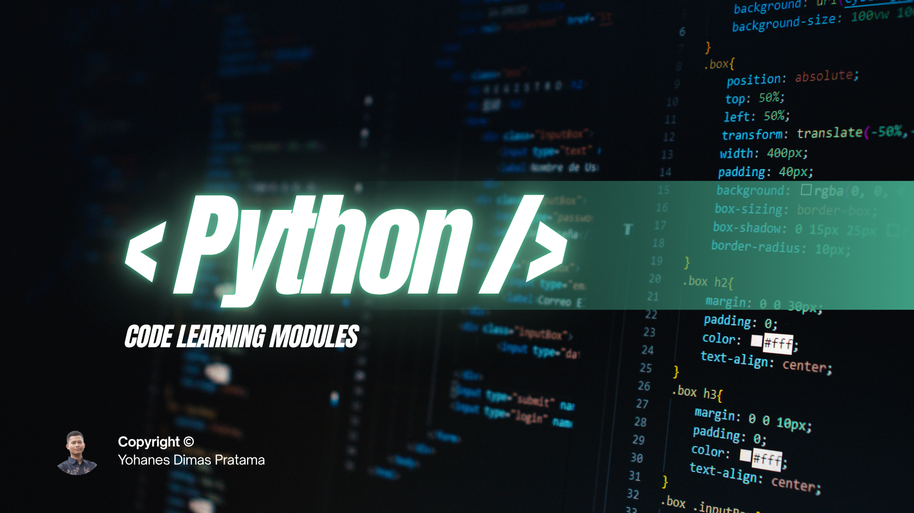

## Project Description

**Python Learning Modules** is a comprehensive, production-grade educational curriculum designed to guide learners from core language syntax and procedural programming through modern Python 3.10+ paradigms, functional programming, object-oriented software engineering, classical algorithms, data science, web APIs, and full-featured capstone applications.

Structured across **18 pedagogical modules** containing **300 fully standalone, executable Python programs**, this repository bridges academic theory with practical, industry-grade implementation. Every lesson is strictly paired with its verified terminal execution output capture rendered directly from executed processes, guaranteeing reproducible behavior across development environments. Whether learning Python as a first programming language, advancing toward systems architecture, preparing for technical interviews, or mastering enterprise ecosystem libraries (NumPy, Pandas, Matplotlib, Requests, Beautiful Soup, OpenPyXL, Flask, FastAPI, SQLAlchemy, and Pytest), this repository provides an exhaustive, code-first curriculum.

## Learning Objectives

Learners working through this curriculum will develop concrete, industry-ready software engineering skills across every domain of Python development:

- **Core Syntax & Program Anatomy**: Master script execution, print formatting parameters (`sep`, `end`), string escape sequences, indentation-based scoping, and compile-time syntax error diagnostics.
- **Type System & Dynamic Typing**: Leverage Python dynamic typing, primitive scalar types (`int`, `float`, `complex`, `str`, `bool`, `None`), explicit type casting, multiple assignment, and mutability semantics.
- **Console Stream I/O & Operator Semantics**: Build interactive CLI interactions, implement defensive input validation, evaluate full operator families (arithmetic, relational, logical, identity, membership, bitwise), and master modern f-string interpolation.
- **Control Flow & Modern Pattern Matching**: Implement robust decision trees using `if`, `elif`, `else`, nested conditionals, ternary expressions, and Python 3.10+ structural pattern matching (`match-case`) with conditional guards.
- **Iterative Control Flow & Loops**: Master sequence iteration with `for` loops, condition-controlled execution with `while` loops, `range()` arithmetic progressions, loop control (`break`, `continue`, `else`), and algorithmic pattern generation.
- **Modular Function Design & Scope**: Architect modular subroutines using positional, keyword, and arbitrary arguments (`*args`, `**kwargs`), understand the LEGB scope hierarchy (`global`, `nonlocal`), recursion, docstrings, and PEP 484 static type hints.
- **Built-In Data Structures & Collections**: Master core collection containers—lists, immutable tuples, hash-based sets, and key-value dictionaries—including slicing, search algorithms, set algebra, nested querying, and inter-collection conversions.
- **String Manipulation & Text Processing**: Process textual data using slicing, string methods, tokenization (`split`/`join`), sanitization, validation predicates, Unicode international text handling, and palindrome detection.
- **Comprehensions & Streaming Iterators**: Write idiomatic list, set, and dictionary comprehensions, generator expressions, custom iterator classes (`__iter__`, `__next__`), generator functions (`yield`, `yield from`), and memory-efficient streaming pipelines.
- **Functional Programming & Metaprogramming**: Leverage first-class functions, anonymous lambdas, `map()`, `filter()`, `functools.reduce()`, lexical closures, function decorators, parameterized decorators, decorator stacking, and partial application.
- **Object-Oriented Software Engineering**: Design robust systems using encapsulation, property getters/setters, class/static methods, single and multiple inheritance, method overriding (`super()`), polymorphism, abstract base classes, operator overloading, modern `@dataclass`, `__slots__` memory optimization, descriptors, and metaclasses.
- **Resilient File I/O & Modular Architecture**: Construct fault-tolerant applications using `try-except-else-finally`, custom exception hierarchies, text/binary file streams, context managers (`with`), object-oriented `pathlib`, JSON/CSV/pickle serialization, and Python package creation.
- **Standard Library Mastery**: Utilize Python's 'batteries included' standard library for mathematics, statistics, cryptographically secure randomness, datetime arithmetic, OS interfaces, `sys` introspection, specialized `collections`, `itertools`, `re` regular expressions, `logging`, `argparse`, `subprocess`, and embedded `sqlite3` relational databases.
- **Classical Algorithms & Data Structures**: Implement fundamental computer science algorithms from scratch, including searches (linear, binary), sorts (bubble, selection, insertion, merge, quick sort), stacks, queues, linked lists, binary search trees, heaps, graphs (BFS/DFS), backtracking, dynamic programming, greedy algorithms, and Big O complexity analysis.
- **Modern Language Features (Python 3.10+)**: Write idiomatic modern code using PEP 585/604 type unions (`int | str`), static duck typing with `typing.Protocol`, contextlib enhancements, weak references, garbage collection hooks, memory profiling, walrus operators (`:=`), and `@functools.lru_cache`.
- **Data Science, Web APIs & Ecosystem**: Perform array computations with NumPy, tabular data manipulation with Pandas, visual plotting with Matplotlib, HTTP client networking with Requests, web scraping with Beautiful Soup, Excel automation with OpenPyXL, and build microservices with Flask, FastAPI, and SQLAlchemy ORM.
- **Software Quality, Testing & Packaging**: Practice software verification using assertions, standard `unittest`, modern `pytest` test suites, dependency mocking, profiling with `cProfile`, virtual environment management (`venv`), `requirements.txt` auditing, package distribution, linting, and formatting standards.
- **Capstone Engineering**: Consolidate technical knowledge into 20 complete, standalone terminal applications and business domain systems.

## Learning Roadmap

The curriculum follows a structured pedagogical trajectory progressing from foundational syntax to advanced language mechanics, data science, web services, and full capstone applications:

| Module | Title | Level | Topics | Primary Focus |
| :--- | :--- | :---: | :---: | :--- |
| [Module 01](#module-01-introduction-to-python-and-program-structure) | Introduction to Python and Program Structure | `Fundamental` | 10 Programs (1-10) | Establishes a solid foundation in Python fundamentals, including script execution, program structure, print formatting, indentation syntax, syntax error inspection, and CLI execution. |
| [Module 02](#module-02-variables-and-data-types) | Variables and Data Types | `Fundamental` | 14 Programs (11-24) | Covers Python dynamic typing, variable assignment and references, primitive data types (int, float, complex, str, bool, None), type casting, multiple assignment, and mutability semantics. |
| [Module 03](#module-03-input-output-and-operators) | Input, Output, and Operators | `Fundamental` | 14 Programs (25-38) | Focuses on interactive terminal input, input parsing and validation, arithmetic, assignment, relational, logical, identity, membership, and bitwise operators, plus modern f-string formatting. |
| [Module 04](#module-04-control-flow-and-decision-making) | Control Flow and Decision Making | `Fundamental` | 10 Programs (39-48) | Covers branching control flow using if, if-else, elif chains, nested conditionals, ternary expressions, and Python 3.10+ structural pattern matching (match-case). |
| [Module 05](#module-05-loops-and-iterations) | Loops and Iterations | `Fundamental` | 15 Programs (49-63) | Explores iterative execution using for loops, while loops, range() sequences, loop control (break, continue, else), accumulator patterns, algorithmic loops, and game loops. |
| [Module 06](#module-06-functions-and-modular-programming) | Functions and Modular Programming | `Intermediate` | 15 Programs (64-78) | Dives into functional abstraction: function definitions, return values, default/keyword/positional arguments, *args and **kwargs, local/global/nonlocal scoping, recursion, docstrings, and type hints. |
| [Module 07](#module-07-built-in-data-structures) | Built-In Data Structures | `Intermediate` | 20 Programs (79-98) | Provides comprehensive coverage of core container types: lists, tuples, sets, and dictionaries, including slicing, search, in-place sorting, set algebra, nested collections, and type conversions. |
| [Module 08](#module-08-string-manipulation-and-text-processing) | String Manipulation and Text Processing | `Intermediate` | 14 Programs (99-112) | Examines text processing: indexing, slicing, reversal, built-in string methods, tokenization with split/join, sanitization, validation, Unicode encodings, and palindrome detection. |
| [Module 09](#module-09-comprehensions-iterators-and-generators) | Comprehensions, Iterators, and Generators | `Intermediate to Advanced` | 16 Programs (113-128) | Covers idiomatic collection comprehensions, generator expressions, custom iterators, the iterator protocol (__iter__, __next__), generator functions, yield, yield from, and lazy evaluation pipelines. |
| [Module 10](#module-10-advanced-functional-programming) | Advanced Functional Programming | `Advanced` | 15 Programs (129-143) | Explores first-class functions: lambda expressions, map(), filter(), functools.reduce(), custom key sorting, closures, function decorators, parameterized decorators, chaining, partials, and callables. |
| [Module 11](#module-11-object-oriented-programming-oop) | Object-Oriented Programming (OOP) | `Intermediate to Advanced` | 24 Programs (144-167) | Comprehensive object-oriented software engineering: classes, attributes, methods, constructors, encapsulation, properties, inheritance, polymorphism, composition, operator overloading, dataclasses, enums, slots, descriptors, metaclasses, and MRO. |
| [Module 12](#module-12-exception-handling-file-io-and-modular-architecture) | Exception Handling, File I/O, and Modular Architecture | `Intermediate to Advanced` | 20 Programs (168-187) + 1 Helper | Covers structured exception handling (try-except-else-finally, custom exceptions, chaining), text and structured file I/O (JSON, CSV, pickle), context managers, pathlib, and modular packaging. |
| [Module 13](#module-13-python-standard-library-essentials) | Python Standard Library Essentials | `Intermediate to Advanced` | 20 Programs (188-207) | Explores built-in standard modules: math, statistics, random, secrets, datetime, time, calendar, os, sys, collections, itertools, functools, re, logging, argparse, subprocess, shutil, hashlib, sqlite3, and copy. |
| [Module 14](#module-14-classical-algorithms-and-data-structures) | Classical Algorithms and Data Structures | `Advanced` | 23 Programs (208-230) | Implements core computer science algorithms and data structures from scratch: searches (linear, binary), sorts (bubble, selection, insertion, merge, quick), stacks, queues, linked lists, trees, BST, heaps, hash tables, graphs (BFS/DFS), backtracking, dynamic programming, greedy algorithms, and Big O analysis. |
| [Module 15](#module-15-modern-python-and-advanced-language-features) | Modern Python and Advanced Language Features | `Advanced` | 17 Programs (231-247) | Explores modern language features (Python 3.10+): advanced typing (unions, generics, protocols), structural pattern matching, custom context managers, contextlib, weakref, garbage collection, memory profiling, walrus operator, LRU caching, ABCs, and runtime reflection. |
| [Module 16](#module-16-data-science-apis-automation-and-ecosystem) | Data Science, APIs, Automation, and Ecosystem | `Advanced / Practical` | 17 Programs (248-264) | Introduces industry-standard ecosystem libraries: NumPy (arrays & math), Pandas (dataframes & cleaning), Matplotlib (visualization), Requests (HTTP APIs), Beautiful Soup (scraping), OpenPyXL (Excel), Flask & FastAPI (web services), and SQLAlchemy (ORM). |
| [Module 17](#module-17-testing-debugging-and-project-management) | Testing, Debugging, and Project Management | `Intermediate to Advanced` | 16 Programs (265-280) | Covers software engineering best practices: debugging workflows, assertions, unit testing with unittest and pytest, mocking, edge case verification, profiling with cProfile, venv isolation, pip, project layout, package building, linting, formatting, static type checking, and environment variables. |
| [Module 18](#module-18-practical-capstone-projects) | Practical Capstone Projects | `Capstone / Practical` | 20 Programs (281-300) | Consolidates curriculum knowledge into 20 complete, standalone applications: calculators, games, student databases, inventory systems, POS cashiers, expense trackers, library managers, file organizers, CSV/Excel analyzers, weather APIs, web scrapers, and REST APIs. |

## Prerequisites

Before starting this curriculum, ensure your local development environment meets the following baseline requirements:

- **Prior Knowledge**: No prior programming experience is required. The curriculum begins with fundamental syntax and builds systematically toward advanced concepts.
- **Python Runtime**: **Python 3.10 or higher** (Python 3.10+ is strictly required for structural pattern matching `match-case`, union type syntax `int | str`, and modern standard library features).
- **Package Manager**: `pip` (standard Python package installer, bundled with Python installations).
- **Virtual Environment**: Standard Python `venv` module for isolating project dependencies.
- **Operating System**: Cross-platform compatible (Windows 10/11, macOS 11+, or modern Linux distributions).
- **Editor or IDE**: Visual Studio Code, PyCharm, Cursor, or any modern text editor with Python extension support.

## Tech Stack & Tools

- **Core Language Runtime**: Python 3.10+ (tested across Python 3.10, 3.11, 3.12, and 3.15)
- **Standard Library Modules**: `math`, `statistics`, `random`, `secrets`, `datetime`, `time`, `calendar`, `os`, `sys`, `collections`, `itertools`, `functools`, `re`, `logging`, `argparse`, `subprocess`, `shutil`, `hashlib`, `sqlite3`, `copy`, `pathlib`, `json`, `csv`, `pickle`, `abc`, `contextlib`, `weakref`, `gc`, `unittest`
- **Numerical Computing & Data Analysis**: `numpy>=2.0`, `pandas>=2.0`
- **Data Visualization & Imaging**: `matplotlib>=3.8`, `Pillow>=12.0`
- **Spreadsheet Automation**: `openpyxl>=3.1`
- **Networking & Web Scraping**: `requests>=2.31`, `httpx2>=0.28`, `beautifulsoup4>=4.12`
- **Web Frameworks & APIs**: `Flask>=3.0`, `fastapi>=0.110`, `uvicorn>=0.27`
- **Database & ORM**: `SQLAlchemy>=2.0` (with SQLite driver)
- **Automated Testing & Diagnostics**: `pytest>=8.0`, `unittest`, `cProfile`
- **Desktop GUI Framework**: `PySide6>=6.6`

## Getting Started

Follow these steps to clone the repository, configure an isolated virtual environment, and install ecosystem dependencies:

### 1. Clone the Repository

```bash
git clone https://github.com/weztcy/Python-Learning-Modules.git
cd Python-Learning-Modules
```

### 2. Set Up a Virtual Environment

Creating a virtual environment ensures dependencies for Modules 16-18 remain isolated from your global Python environment:

- **Windows (PowerShell)**:
  ```powershell
  python -m venv .venv
  .\.venv\Scripts\Activate.ps1
  ```
- **Windows (Command Prompt)**:
  ```cmd
  python -m venv .venv
  .\.venv\Scripts\activate.bat
  ```
- **macOS / Linux (Bash / Zsh)**:
  ```bash
  python3 -m venv .venv
  source .venv/bin/activate
  ```

### 3. Install Required Dependencies

Modules 01 through 15 run entirely on the Python Standard Library without external packages. To run the advanced data science, API, and testing lessons in Modules 16-18, install the dependencies from [`requirements.txt`](./requirements.txt):

```bash
pip install -r requirements.txt
```

### 4. Verify Your Environment

Execute the following command to verify Python runtime compatibility and installed packages:

```bash
python -c "import sys, numpy, pandas, matplotlib, requests, fastapi, sqlalchemy, pytest; print('Python Runtime Ready:', sys.version)"
```

## How to Use This Repository

To maximize your learning experience, follow this systematic pedagogical study workflow:

1. **Select a Module**: Choose a module aligned with your learning roadmap. If you are starting fresh, begin with Module 01 and proceed sequentially.
2. **Study Concepts & Explanations**: Read the module overview and subtopic descriptions to understand the programming mechanics, theoretical rules, and syntax paradigms.
3. **Inspect the Standalone Source Code**: Open the linked `.py` source file. Every lesson is self-contained with readable identifiers, clean comments, and idiomatic Python design.
4. **Execute the Script Locally**: Navigate into the target module folder in your terminal and run the script using `python <filename>.py`. Observe the output values and terminal formatting.
5. **Compare with Verified Output Screenshots**: Compare your terminal output against the verified capture in the subtopic's `output/` folder. Each screenshot captures the exact terminal window from a real execution pass.
6. **Experiment and Extend**: Modify the script parameters, intentionally test edge cases, and solve related programming challenges to deepen your understanding.

## Learning Modules & Subtopics

This section contains the comprehensive curriculum breakdown across all 18 modules and 300 subtopics. Each subtopic includes a verified link to its source code, key concepts, technical execution mechanics, and rendered terminal execution capture.

### Module 01: Introduction to Python and Program Structure

**Curriculum Path**: [`module-01-pengenalan-python-dan-struktur-program`](./module-01-pengenalan-python-dan-struktur-program) | **Level**: `Fundamental` | **Scope**: 10 Programs (1-10)

#### Overview & Concepts Covered

Introduces core syntax, program entry points, terminal stream output, indentation-based block scoping, and runtime execution mechanisms. Learners understand how Python executes scripts, handles comments, formats output, and reports syntax errors.

#### Subtopics & Execution Captures

##### 1. First Python Program

- **Source Code**: [`01_hello_world.py`](./module-01-pengenalan-python-dan-struktur-program/01_hello_world.py)
- **Key Concept**: Understanding executable script execution and standard console stream output.
- **Mechanism**: Invokes print() to emit a greeting message to terminal standard output.
- **Execution Output**:

  

##### 2. Python Program Structure

- **Source Code**: [`02_python_program_structure.py`](./module-01-pengenalan-python-dan-struktur-program/02_python_program_structure.py)
- **Key Concept**: Understanding function definitions, module docstrings, and main execution guard idioms.
- **Mechanism**: Defines a greeting function executed within the if __name__ == '__main__' guard when run directly.
- **Execution Output**:

  

##### 3. Source Code Comments

- **Source Code**: [`03_comments.py`](./module-01-pengenalan-python-dan-struktur-program/03_comments.py)
- **Key Concept**: Using single-line and inline comments to document source code without runtime execution.
- **Mechanism**: Multiplies numeric variables and prints the result while comment lines are ignored by the Python interpreter.
- **Execution Output**:

  

##### 4. Print Function Parameters

- **Source Code**: [`04_print_function.py`](./module-01-pengenalan-python-dan-struktur-program/04_print_function.py)
- **Key Concept**: Controlling terminal stream separation and line terminators using sep and end arguments.
- **Mechanism**: Customizes output delimiters and suppresses trailing newlines across consecutive print calls.
- **Execution Output**:

  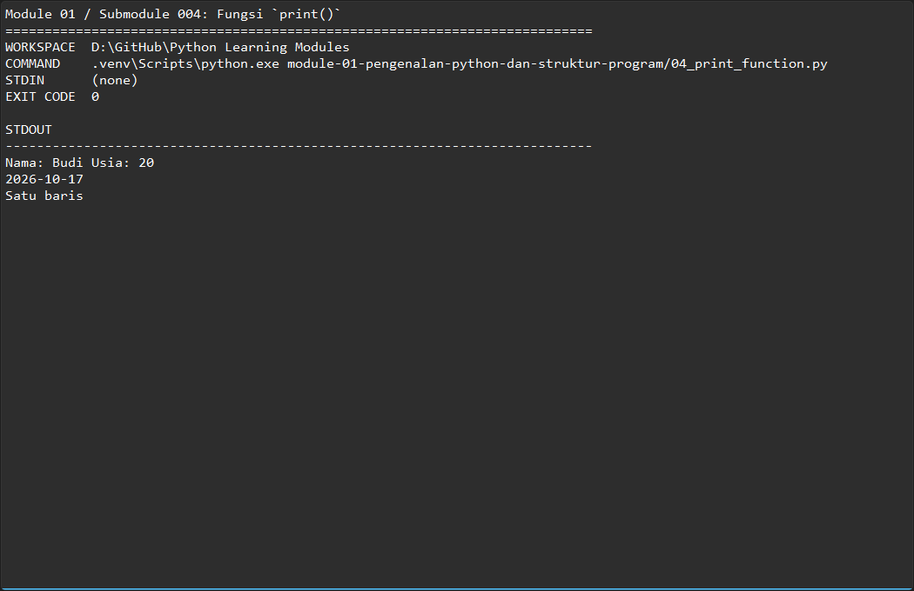

##### 5. String Escape Sequences

- **Source Code**: [`05_escape_sequences.py`](./module-01-pengenalan-python-dan-struktur-program/05_escape_sequences.py)
- **Key Concept**: Formatting string literals using escape sequences such as newline, horizontal tab, escaped quotes, and backslashes.
- **Mechanism**: Applies backslash escape characters to structure multi-line text and preserve reserved quotation symbols.
- **Execution Output**:

  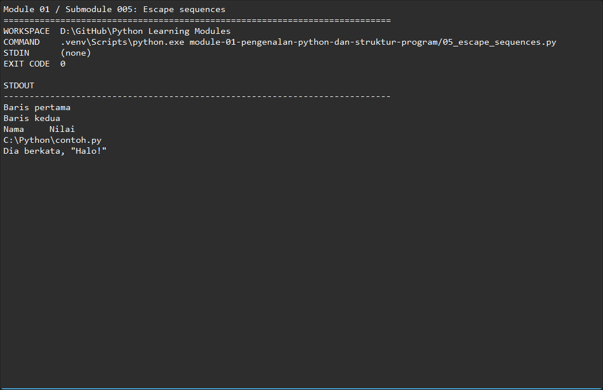

##### 6. Python Indentation and Block Scope

- **Source Code**: [`06_indentation.py`](./module-01-pengenalan-python-dan-struktur-program/06_indentation.py)
- **Key Concept**: Enforcing block scoping through consistent four-space indentation instead of braces.
- **Mechanism**: Executes statements inside the indented conditional body when true, followed by unindented statements unconditionally.
- **Execution Output**:

  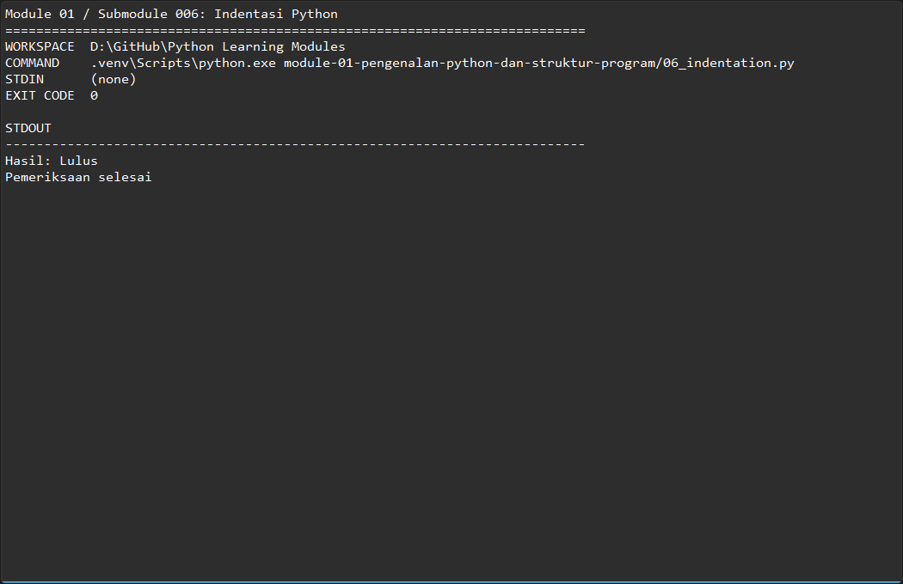

##### 7. Multiple Program Statements

- **Source Code**: [`07_multiple_statements.py`](./module-01-pengenalan-python-dan-struktur-program/07_multiple_statements.py)
- **Key Concept**: Executing sequential statements and variable computations in procedural top-down order.
- **Mechanism**: Initializes dimensions, computes rectangular area, and prints the evaluated result over consecutive statements.
- **Execution Output**:

  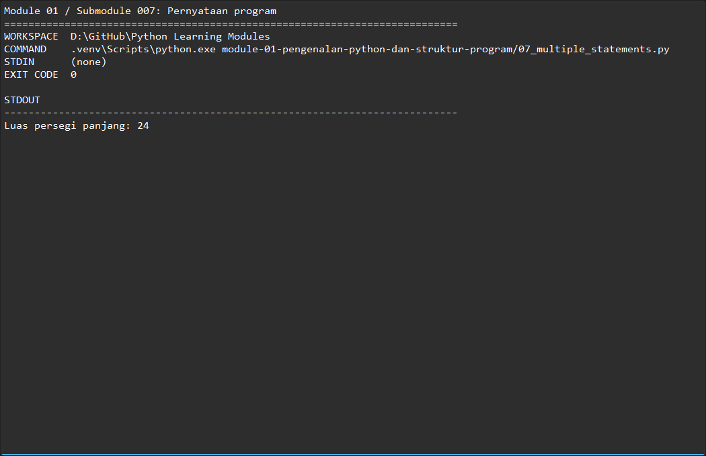

##### 8. Syntax Errors and Diagnostics

- **Source Code**: [`08_syntax_errors.py`](./module-01-pengenalan-python-dan-struktur-program/08_syntax_errors.py)
- **Key Concept**: Diagnosing compile-time syntax errors dynamically using compile() within a managed exception handler.
- **Mechanism**: Safely inspects invalid syntax strings via compile() to catch SyntaxError before executing valid code.
- **Execution Output**:

  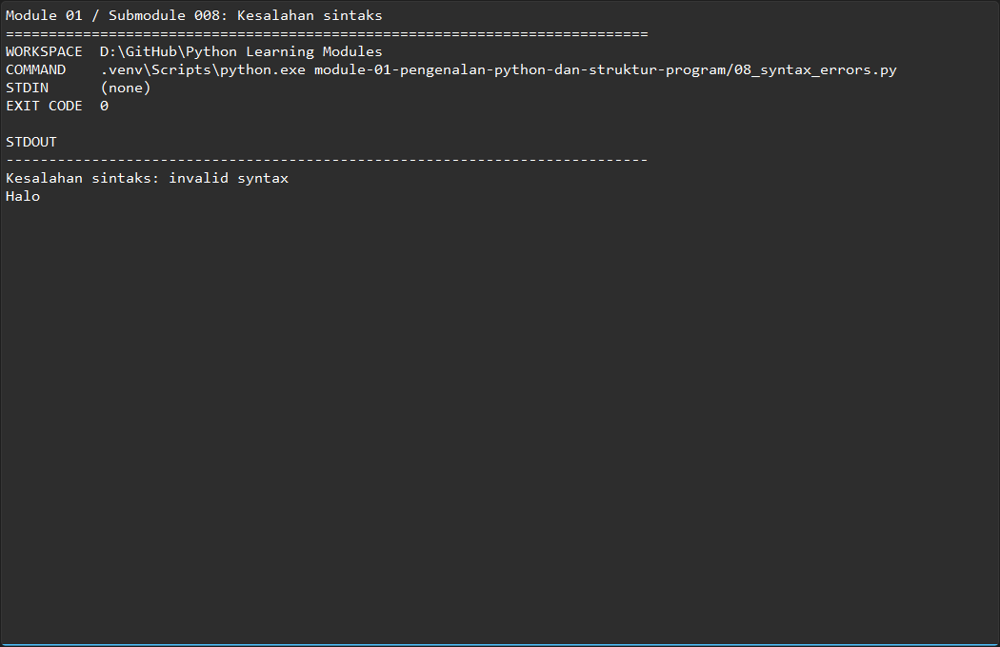

##### 9. Python Interpreter Runtime

- **Source Code**: [`09_python_interpreter.py`](./module-01-pengenalan-python-dan-struktur-program/09_python_interpreter.py)
- **Key Concept**: Introspecting Python runtime details including platform, version tuple, and executable path.
- **Mechanism**: Queries platform.python_implementation() and sys.executable to inspect active environment parameters.
- **Execution Output**:

  

##### 10. Executing Python Scripts

- **Source Code**: [`10_run_python_script.py`](./module-01-pengenalan-python-dan-struktur-program/10_run_python_script.py)
- **Key Concept**: Executing secondary Python scripts from code using external subprocess orchestration.
- **Mechanism**: Locates the target script using pathlib.Path and executes it in an isolated subprocess via subprocess.run().
- **Execution Output**:

  

### Module 02: Variables and Data Types

**Curriculum Path**: [`module-02-variabel-dan-tipe-data`](./module-02-variabel-dan-tipe-data) | **Level**: `Fundamental` | **Scope**: 14 Programs (11-24)

#### Overview & Concepts Covered

Explores how variables reference objects in memory, built-in numeric and text types, explicit and implicit type conversions, constant conventions, and the critical distinction between mutable and immutable data types.

#### Subtopics & Execution Captures

##### 11. Variables and Object References

- **Source Code**: [`11_variables.py`](./module-02-variabel-dan-tipe-data/11_variables.py)
- **Key Concept**: Understanding variable identifiers that bind to objects in memory.
- **Mechanism**: Binds name and age variables to values and displays them together in terminal output.
- **Execution Output**:

  

##### 12. Variable Reassignment

- **Source Code**: [`12_variable_assignment.py`](./module-02-variabel-dan-tipe-data/12_variable_assignment.py)
- **Key Concept**: Demonstrating dynamic variable reassignment and reference updating.
- **Mechanism**: Rebinds a numeric variable from 70 to 85, displaying both states.
- **Execution Output**:

  

##### 13. Integer Data Type

- **Source Code**: [`13_integer_type.py`](./module-02-variabel-dan-tipe-data/13_integer_type.py)
- **Key Concept**: Manipulating signed integer numbers and arithmetic using int.
- **Mechanism**: Computes updated inventory quantities by applying signed integer addition.
- **Execution Output**:

  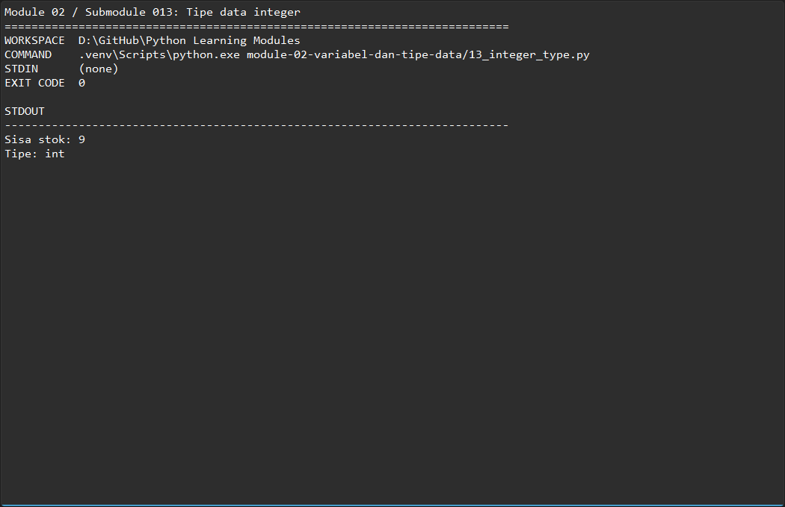

##### 14. Floating-Point Data Type

- **Source Code**: [`14_float_type.py`](./module-02-variabel-dan-tipe-data/14_float_type.py)
- **Key Concept**: Representing and computing real numbers with floating-point precision.
- **Mechanism**: Multiplies unit price with item count to evaluate total cost as a float.
- **Execution Output**:

  

##### 15. Complex Number Data Type

- **Source Code**: [`15_complex_type.py`](./module-02-variabel-dan-tipe-data/15_complex_type.py)
- **Key Concept**: Accessing real and imaginary components of complex numbers via .real and .imag.
- **Mechanism**: Instantiates a complex number literal and inspects its real and imaginary parts.
- **Execution Output**:

  

##### 16. String Data Type

- **Source Code**: [`16_string_type.py`](./module-02-variabel-dan-tipe-data/16_string_type.py)
- **Key Concept**: Working with immutable string literals, character indexing, and length retrieval.
- **Mechanism**: Accesses the initial character using index 0 and evaluates total string length using len().
- **Execution Output**:

  

##### 17. Boolean Data Type

- **Source Code**: [`17_boolean_type.py`](./module-02-variabel-dan-tipe-data/17_boolean_type.py)
- **Key Concept**: Evaluating boolean truth values resulting from relational comparisons.
- **Mechanism**: Tests a numeric score against a passing threshold to yield True or False.
- **Execution Output**:

  

##### 18. None Singleton Type

- **Source Code**: [`18_none_type.py`](./module-02-variabel-dan-tipe-data/18_none_type.py)
- **Key Concept**: Representing the absence of value using the None singleton.
- **Mechanism**: Checks the None singleton via identity testing (is None) prior to updating with an integer value.
- **Execution Output**:

  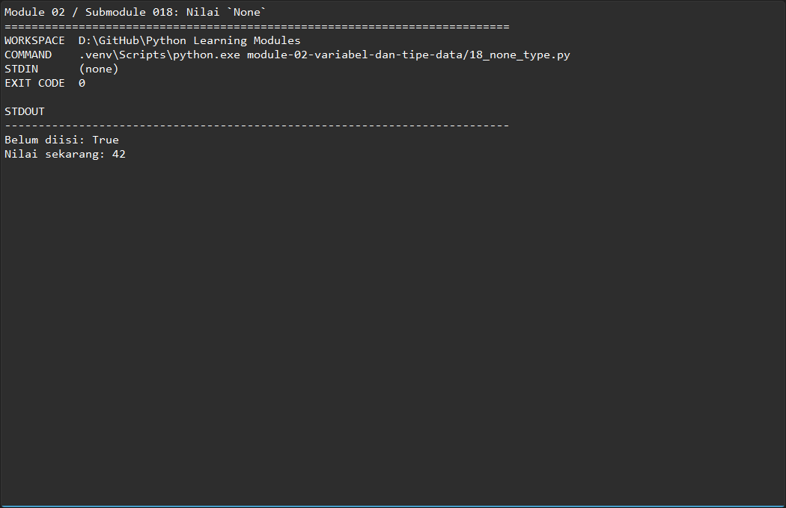

##### 19. Type Introspection with type()

- **Source Code**: [`19_type_function.py`](./module-02-variabel-dan-tipe-data/19_type_function.py)
- **Key Concept**: Introspecting runtime object types and class names using type().
- **Mechanism**: Iterates over multiple data types and prints their class representations and type names.
- **Execution Output**:

  

##### 20. Data Type Conversion

- **Source Code**: [`20_type_conversion.py`](./module-02-variabel-dan-tipe-data/20_type_conversion.py)
- **Key Concept**: Converting numeric string representations into numbers for arithmetic calculations.
- **Mechanism**: Parses a string into an integer with int() for summation, then serializes it back to string with str().
- **Execution Output**:

  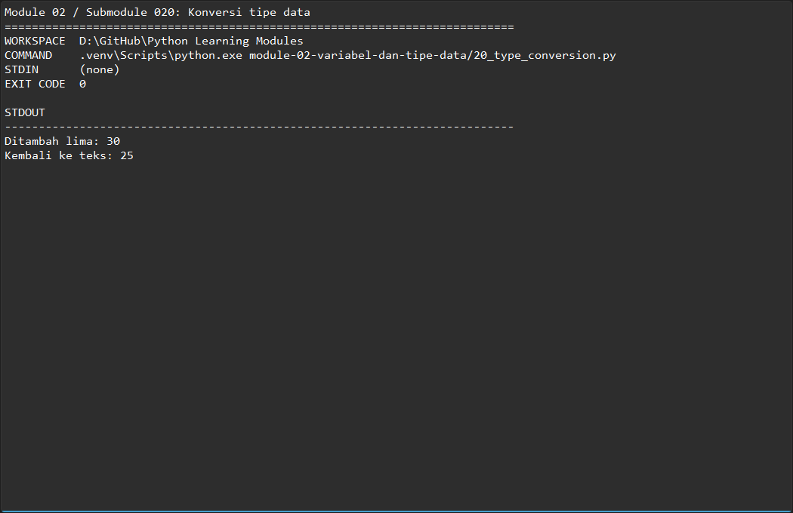

##### 21. Explicit Type Casting

- **Source Code**: [`21_type_casting.py`](./module-02-variabel-dan-tipe-data/21_type_casting.py)
- **Key Concept**: Applying explicit type casting between integers, floats, and booleans.
- **Mechanism**: Truncates floating-point decimals with int() and demonstrates float and boolean casting rules.
- **Execution Output**:

  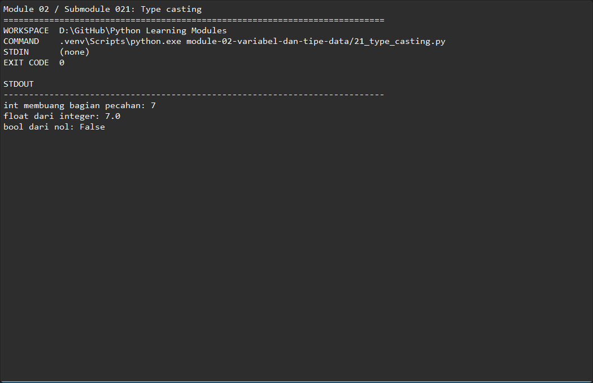

##### 22. Multiple Assignment and Tuple Unpacking

- **Source Code**: [`22_multiple_assignment.py`](./module-02-variabel-dan-tipe-data/22_multiple_assignment.py)
- **Key Concept**: Assigning multiple variables simultaneously and swapping values via tuple unpacking.
- **Mechanism**: Unpacks paired values into distinct variables and performs a variable swap without a temporary variable.
- **Execution Output**:

  

##### 23. Constant Naming Conventions

- **Source Code**: [`23_constants.py`](./module-02-variabel-dan-tipe-data/23_constants.py)
- **Key Concept**: Applying uppercase naming conventions for conceptual constants in Python.
- **Mechanism**: Calculates tax obligations using an uppercase constant multiplier according to PEP 8 conventions.
- **Execution Output**:

  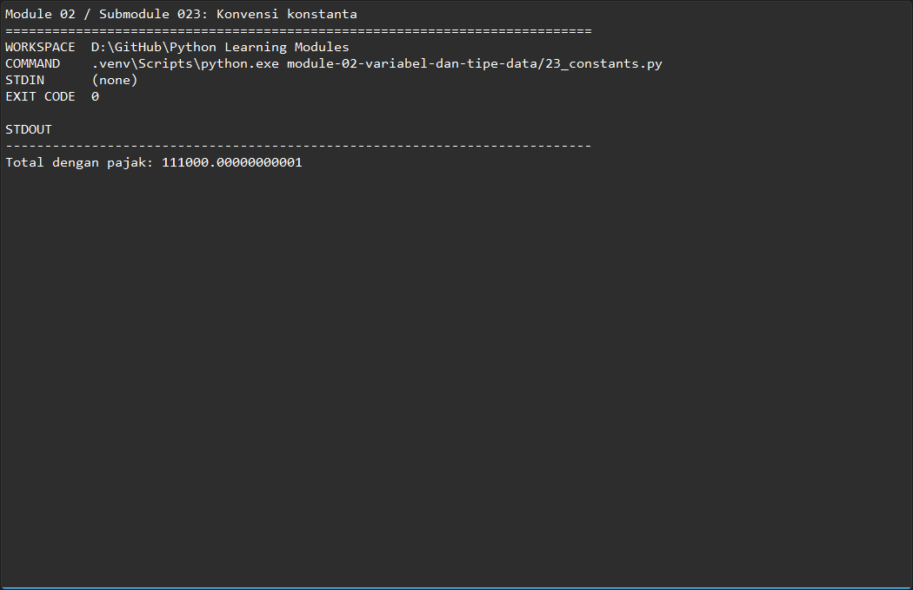

##### 24. Mutable and Immutable Objects

- **Source Code**: [`24_mutable_immutable.py`](./module-02-variabel-dan-tipe-data/24_mutable_immutable.py)
- **Key Concept**: Distinguishing in-place mutability from immutable object re-allocation.
- **Mechanism**: Appends elements to an existing list in-place while string concatenation generates a new string object.
- **Execution Output**:

  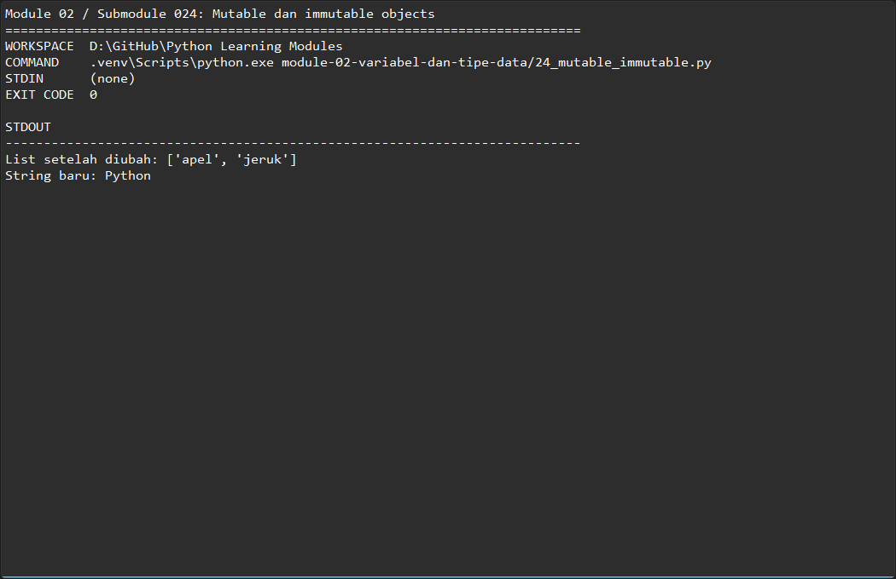

### Module 03: Input, Output, and Operators

**Curriculum Path**: [`module-03-input-output-dan-operator`](./module-03-input-output-dan-operator) | **Level**: `Fundamental` | **Scope**: 14 Programs (25-38)

#### Overview & Concepts Covered

Demonstrates terminal stream interaction using input(), numeric parsing, defensive validation, evaluation of all Python operator families with precedence rules, and high-performance string interpolation using f-strings.

#### Subtopics & Execution Captures

##### 25. Console Input with input()

- **Source Code**: [`25_input_function.py`](./module-03-input-output-dan-operator/25_input_function.py)
- **Key Concept**: Reading terminal stream text interactively using input().
- **Mechanism**: Captures an input name string and outputs an interpolated greeting to the terminal.
- **Execution Output**:

  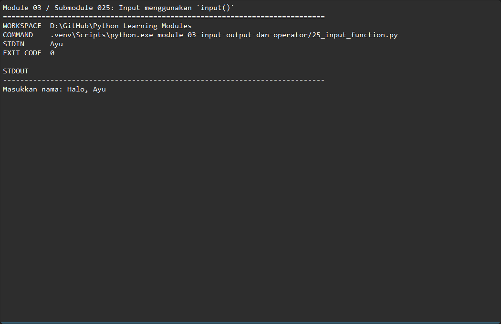

##### 26. Numeric Input Parsing

- **Source Code**: [`26_numeric_input.py`](./module-03-input-output-dan-operator/26_numeric_input.py)
- **Key Concept**: Converting string inputs into integers for numerical operations.
- **Mechanism**: Reads numeric input strings, converts them via int(), and evaluates their arithmetic sum.
- **Execution Output**:

  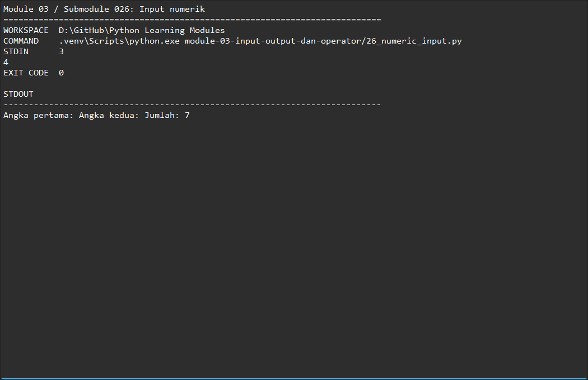

##### 27. Defensive Input Validation

- **Source Code**: [`27_input_validation.py`](./module-03-input-output-dan-operator/27_input_validation.py)
- **Key Concept**: Implementing defensive input validation with loop retries and exception handling.
- **Mechanism**: Prompts repeatedly until a valid positive integer is entered, catching ValueError gracefully.
- **Execution Output**:

  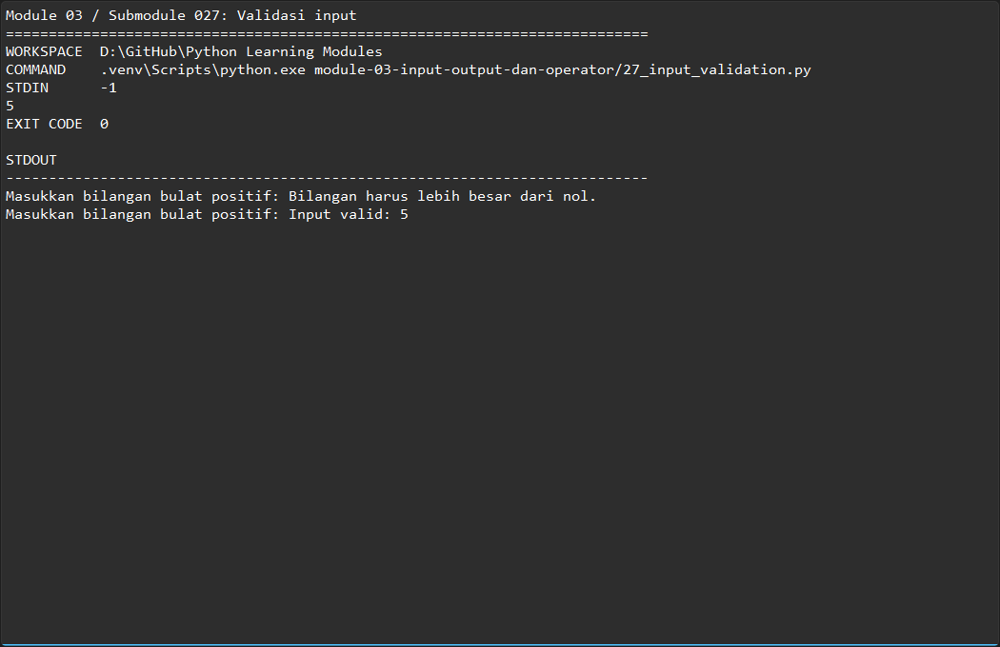

##### 28. Arithmetic Operators

- **Source Code**: [`28_arithmetic_operators.py`](./module-03-input-output-dan-operator/28_arithmetic_operators.py)
- **Key Concept**: Evaluating arithmetic operators including true division, floor division, modulo, and exponentiation.
- **Mechanism**: Applies arithmetic operators on operands to demonstrate quotient, integer floor, remainder, and power.
- **Execution Output**:

  

##### 29. Compound Assignment Operators

- **Source Code**: [`29_assignment_operators.py`](./module-03-input-output-dan-operator/29_assignment_operators.py)
- **Key Concept**: Mutating variables efficiently with in-place compound assignment operators.
- **Mechanism**: Sequentially updates an accumulator using +=, *=, and -= operators.
- **Execution Output**:

  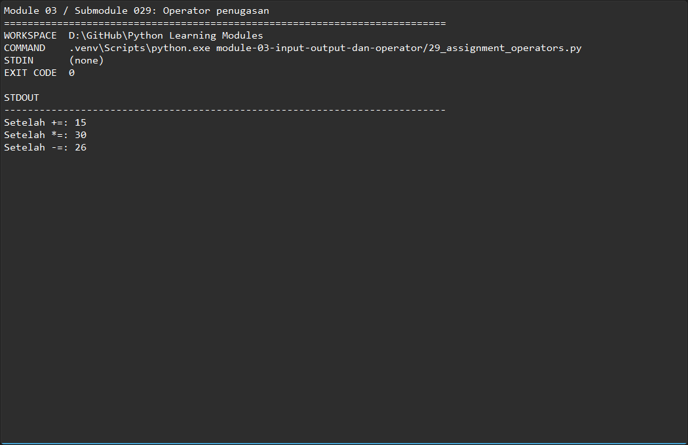

##### 30. Comparison and Relational Operators

- **Source Code**: [`30_comparison_operators.py`](./module-03-input-output-dan-operator/30_comparison_operators.py)
- **Key Concept**: Evaluating relational comparison operators to produce boolean predicates.
- **Mechanism**: Compares two numbers using equality, inequality, and ordering operators.
- **Execution Output**:

  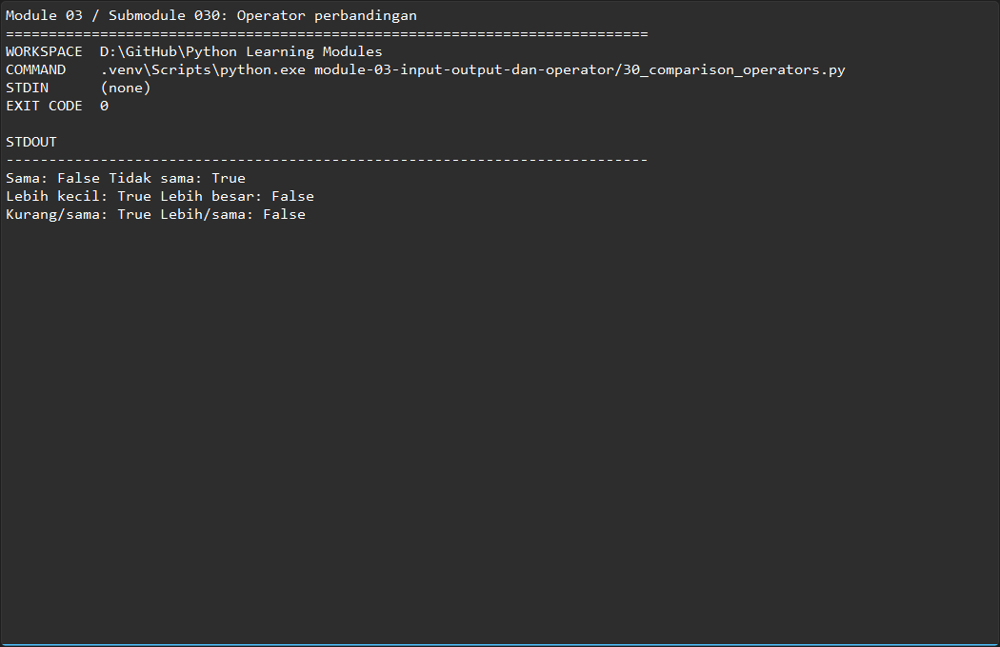

##### 31. Logical Operators

- **Source Code**: [`31_logical_operators.py`](./module-03-input-output-dan-operator/31_logical_operators.py)
- **Key Concept**: Combining and inverting truth predicates using logical and, or, and not operators.
- **Mechanism**: Evaluates admission eligibility based on compound age and ticket conditions.
- **Execution Output**:

  

##### 32. Identity Operators

- **Source Code**: [`32_identity_operators.py`](./module-03-input-output-dan-operator/32_identity_operators.py)
- **Key Concept**: Differentiating object identity (is) from structural value equality (==).
- **Mechanism**: Compares identical object references against distinct list instances containing identical values.
- **Execution Output**:

  

##### 33. Membership Operators

- **Source Code**: [`33_membership_operators.py`](./module-03-input-output-dan-operator/33_membership_operators.py)
- **Key Concept**: Testing element presence within collections using in and not in operators.
- **Mechanism**: Searches for targeted elements inside a sequence and verifies absence.
- **Execution Output**:

  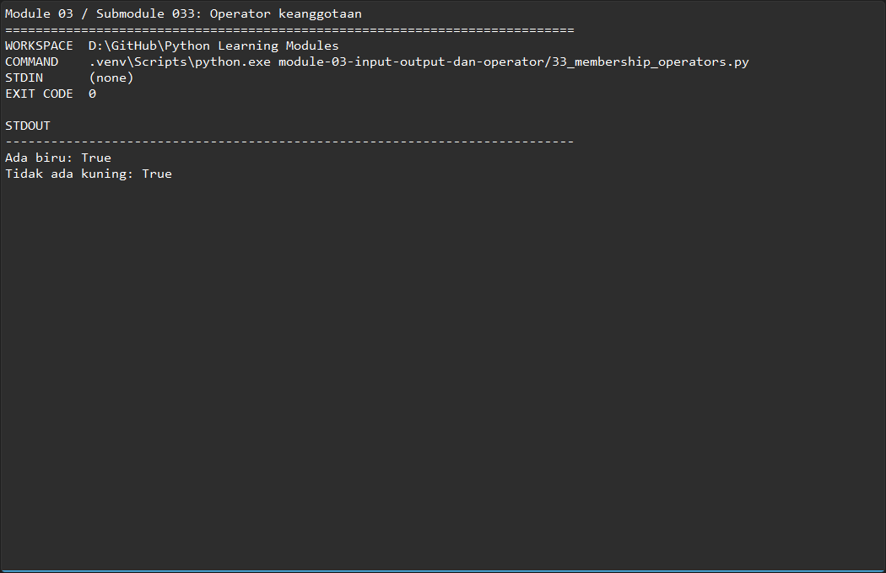

##### 34. Bitwise Operators

- **Source Code**: [`34_bitwise_operators.py`](./module-03-input-output-dan-operator/34_bitwise_operators.py)
- **Key Concept**: Manipulating integer representations at the bit level using bitwise operators.
- **Mechanism**: Performs bitwise AND, OR, XOR, and bit shifting on binary literals.
- **Execution Output**:

  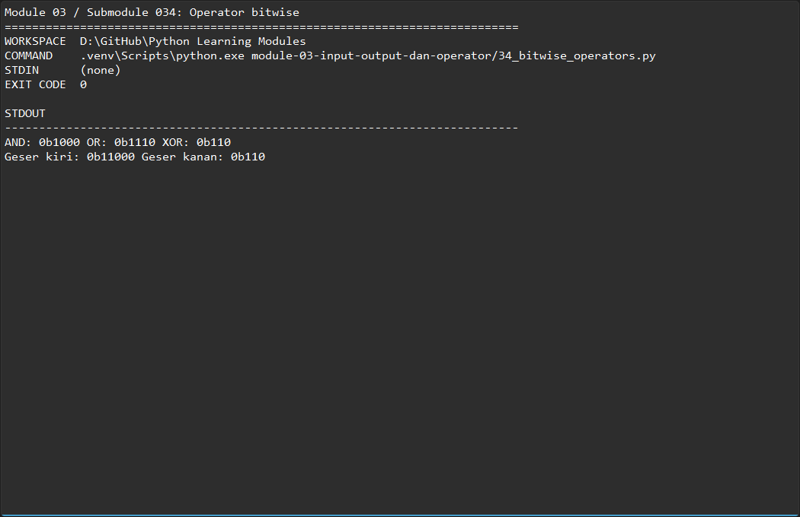

##### 35. Operator Precedence and Grouping

- **Source Code**: [`35_operator_precedence.py`](./module-03-input-output-dan-operator/35_operator_precedence.py)
- **Key Concept**: Understanding operator precedence hierarchies and explicit grouping with parentheses.
- **Mechanism**: Demonstrates how multiplication precedes addition unless overridden by parentheses.
- **Execution Output**:

  

##### 36. F-String String Interpolation

- **Source Code**: [`36_f_string_formatting.py`](./module-03-input-output-dan-operator/36_f_string_formatting.py)
- **Key Concept**: Formatting output strings using modern f-string interpolation syntax.
- **Mechanism**: Embeds variables and inline arithmetic expressions directly inside an f-string template.
- **Execution Output**:

  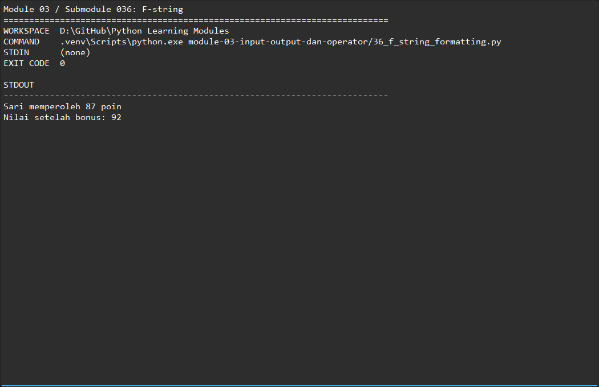

##### 37. Numeric and Percentage Formatting

- **Source Code**: [`37_format_numbers.py`](./module-03-input-output-dan-operator/37_format_numbers.py)
- **Key Concept**: Formatting numeric values with fixed decimals, thousand separators, and percentages.
- **Mechanism**: Formats numbers using format specifiers for currency (:,.2f) and percentage ratios (:.1%).
- **Execution Output**:

  

##### 38. Parsing Multiple Space-Separated Inputs

- **Source Code**: [`38_multiple_input_values.py`](./module-03-input-output-dan-operator/38_multiple_input_values.py)
- **Key Concept**: Parsing multiple space-separated input tokens into individual variables.
- **Mechanism**: Splits an input line with split() and unpacks components into separate variables.
- **Execution Output**:

  

### Module 04: Control Flow and Decision Making

**Curriculum Path**: [`module-04-percabangan-dan-pengambilan-keputusan`](./module-04-percabangan-dan-pengambilan-keputusan) | **Level**: `Fundamental` | **Scope**: 10 Programs (39-48)

#### Overview & Concepts Covered

Teaches structured conditional logic, evaluation of compound boolean expressions, concise conditional expressions, and modern pattern matching to execute code paths based on complex runtime state.

#### Subtopics & Execution Captures

##### 39. Single Conditional Branching (if)

- **Source Code**: [`39_if_statement.py`](./module-04-percabangan-dan-pengambilan-keputusan/39_if_statement.py)
- **Key Concept**: Executing conditional code blocks conditionally with single-branch if statements.
- **Mechanism**: Tests an integer threshold and executes the indented branch only when the condition is met.
- **Execution Output**:

  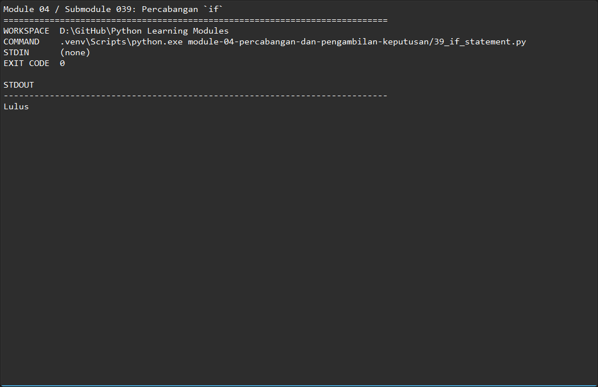

##### 40. Dual Conditional Branching (if-else)

- **Source Code**: [`40_if_else.py`](./module-04-percabangan-dan-pengambilan-keputusan/40_if_else.py)
- **Key Concept**: Handling binary conditional branching using if-else statements.
- **Mechanism**: Evaluates an age condition to route execution between adult and minor branches.
- **Execution Output**:

  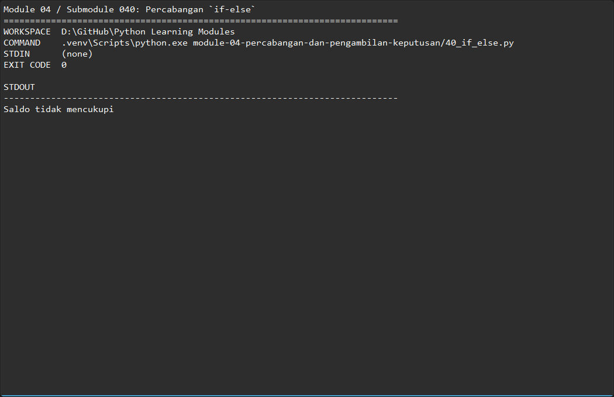

##### 41. Multi-Way Branching (elif)

- **Source Code**: [`41_elif_statement.py`](./module-04-percabangan-dan-pengambilan-keputusan/41_elif_statement.py)
- **Key Concept**: Structuring multi-way decision trees using elif statement chains.
- **Mechanism**: Categorizes a numeric score into distinct letter grade classifications.
- **Execution Output**:

  

##### 42. Nested Conditional Blocks

- **Source Code**: [`42_nested_if.py`](./module-04-percabangan-dan-pengambilan-keputusan/42_nested_if.py)
- **Key Concept**: Nesting conditional blocks to evaluate hierarchical prerequisites.
- **Mechanism**: Evaluates membership status and purchase amounts in layered conditional checks.
- **Execution Output**:

  

##### 43. Compound Boolean Conditions

- **Source Code**: [`43_multiple_conditions.py`](./module-04-percabangan-dan-pengambilan-keputusan/43_multiple_conditions.py)
- **Key Concept**: Combining multiple decision conditions using boolean logical operators.
- **Mechanism**: Evaluates student eligibility based on combined GPA and attendance criteria.
- **Execution Output**:

  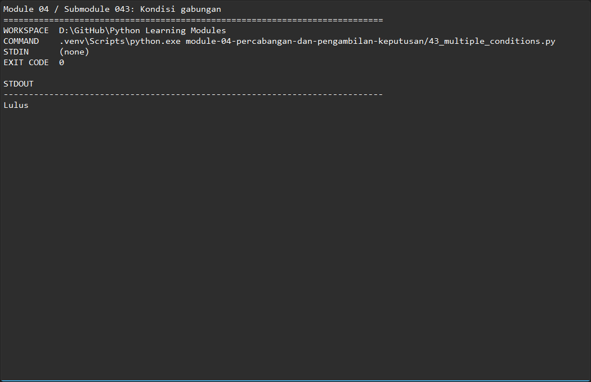

##### 44. Ternary Conditional Expressions

- **Source Code**: [`44_ternary_expression.py`](./module-04-percabangan-dan-pengambilan-keputusan/44_ternary_expression.py)
- **Key Concept**: Writing concise inline conditional assignments using ternary expressions.
- **Mechanism**: Assigns a status string in a single line using the x if condition else y syntax.
- **Execution Output**:

  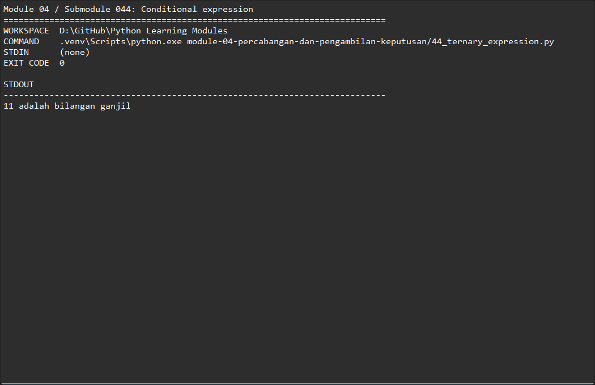

##### 45. Structural Pattern Matching (match-case)

- **Source Code**: [`45_match_case.py`](./module-04-percabangan-dan-pengambilan-keputusan/45_match_case.py)
- **Key Concept**: Performing expressive pattern matching on data with match-case constructs.
- **Mechanism**: Matches input command strings against defined case branches with wildcard fallbacks.
- **Execution Output**:

  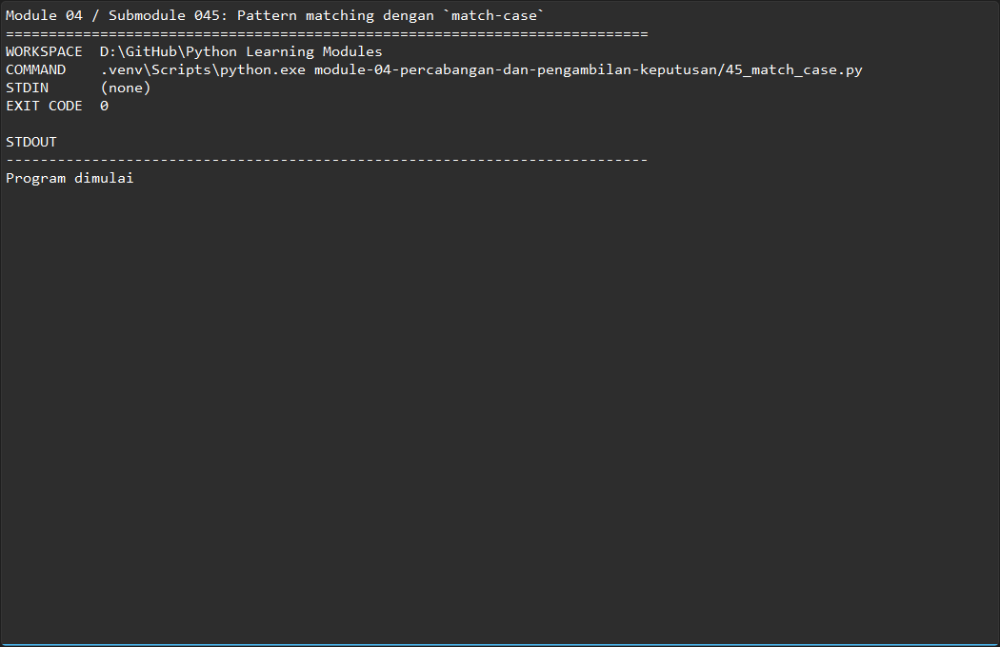

##### 46. Academic Grade Calculator

- **Source Code**: [`46_grade_calculator.py`](./module-04-percabangan-dan-pengambilan-keputusan/46_grade_calculator.py)
- **Key Concept**: Building an academic score classification and grade calculator.
- **Mechanism**: Validates numerical inputs and maps score ranges to corresponding academic letter grades.
- **Execution Output**:

  

##### 47. Even and Odd Parity Check

- **Source Code**: [`47_even_odd.py`](./module-04-percabangan-dan-pengambilan-keputusan/47_even_odd.py)
- **Key Concept**: Determining integer parity using modulo arithmetic.
- **Mechanism**: Checks whether an integer remainder equals zero when divided by two to classify even or odd.
- **Execution Output**:

  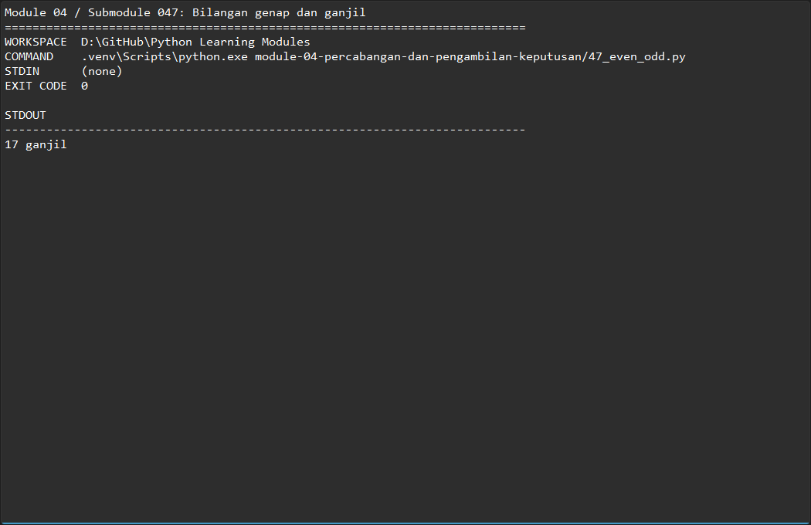

##### 48. Gregorian Leap Year Determination

- **Source Code**: [`48_leap_year.py`](./module-04-percabangan-dan-pengambilan-keputusan/48_leap_year.py)
- **Key Concept**: Implementing the Gregorian leap year algorithm with compound boolean rules.
- **Mechanism**: Determines leap year status based on divisibility by 4, 100, and 400.
- **Execution Output**:

  

### Module 05: Loops and Iterations

**Curriculum Path**: [`module-05-perulangan`](./module-05-perulangan) | **Level**: `Fundamental` | **Scope**: 15 Programs (49-63)

#### Overview & Concepts Covered

Provides hands-on mastery over iteration patterns: traversing sequences, condition-controlled execution, nested iteration, loop interruption, mathematical accumulation, pattern printing, primality testing, and interactive loops.

#### Subtopics & Execution Captures

##### 49. Sequence Iteration with for Loop

- **Source Code**: [`49_for_loop.py`](./module-05-perulangan/49_for_loop.py)
- **Key Concept**: Traversing sequential iterable elements using for loops.
- **Mechanism**: Iterates through a list of programming languages and prints each item with index tracking.
- **Execution Output**:

  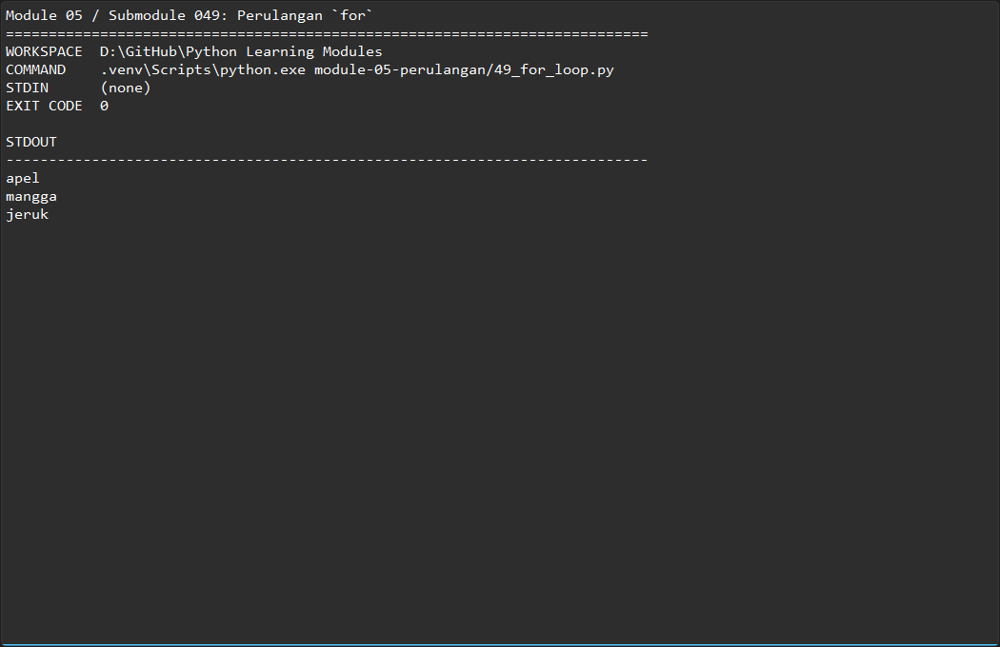

##### 50. Condition-Controlled Iteration with while Loop

- **Source Code**: [`50_while_loop.py`](./module-05-perulangan/50_while_loop.py)
- **Key Concept**: Executing iterative loops controlled by dynamic conditional predicates with while.
- **Mechanism**: Maintains a loop counter that decrements toward zero to simulate a countdown.
- **Execution Output**:

  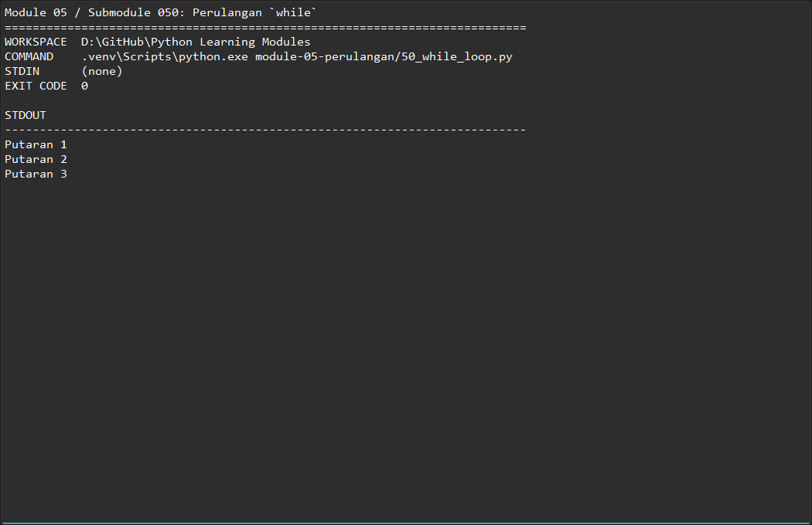

##### 51. Arithmetic Progression with range()

- **Source Code**: [`51_range_function.py`](./module-05-perulangan/51_range_function.py)
- **Key Concept**: Generating arithmetic progressions of numbers using range().
- **Mechanism**: Produces integer sequences specifying start, stop, and stride arguments.
- **Execution Output**:

  

##### 52. Nested Iteration Loops

- **Source Code**: [`52_nested_loop.py`](./module-05-perulangan/52_nested_loop.py)
- **Key Concept**: Structuring multi-dimensional iteration using nested loops.
- **Mechanism**: Executes an inner loop inside an outer loop to generate grid coordinate pairs.
- **Execution Output**:

  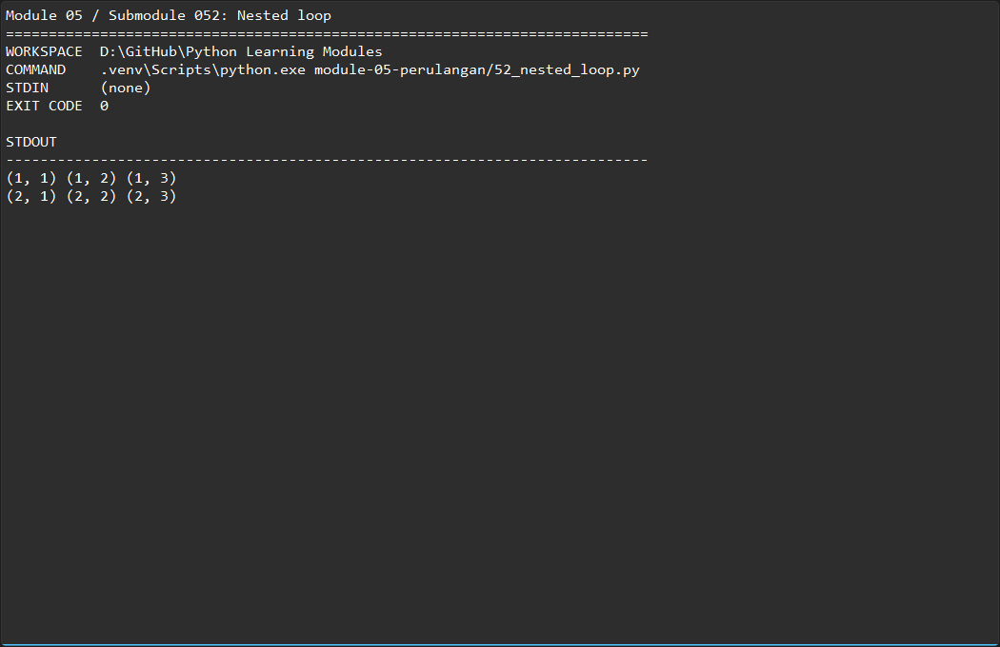

##### 53. Loop Termination with break

- **Source Code**: [`53_break_statement.py`](./module-05-perulangan/53_break_statement.py)
- **Key Concept**: Terminating loop execution early upon meeting a condition with break.
- **Mechanism**: Stops iteration immediately when a target sentinel value is encountered in a sequence.
- **Execution Output**:

  

##### 54. Iteration Skipping with continue

- **Source Code**: [`54_continue_statement.py`](./module-05-perulangan/54_continue_statement.py)
- **Key Concept**: Skipping the remainder of the current loop iteration using continue.
- **Mechanism**: Bypasses printing for specific target elements and continues with subsequent iterations.
- **Execution Output**:

  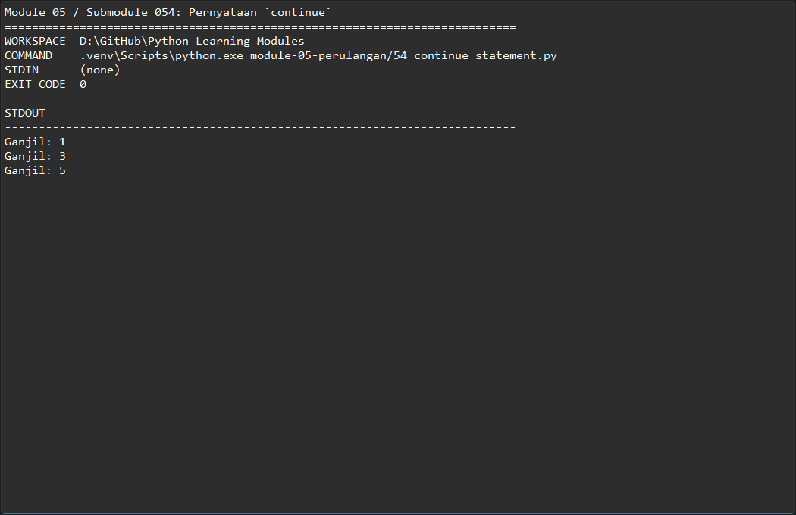

##### 55. Loop Completion Clauses (loop-else)

- **Source Code**: [`55_loop_else.py`](./module-05-perulangan/55_loop_else.py)
- **Key Concept**: Executing completion logic with for-else and while-else blocks.
- **Mechanism**: Runs the else clause only when a search loop completes without encountering a break statement.
- **Execution Output**:

  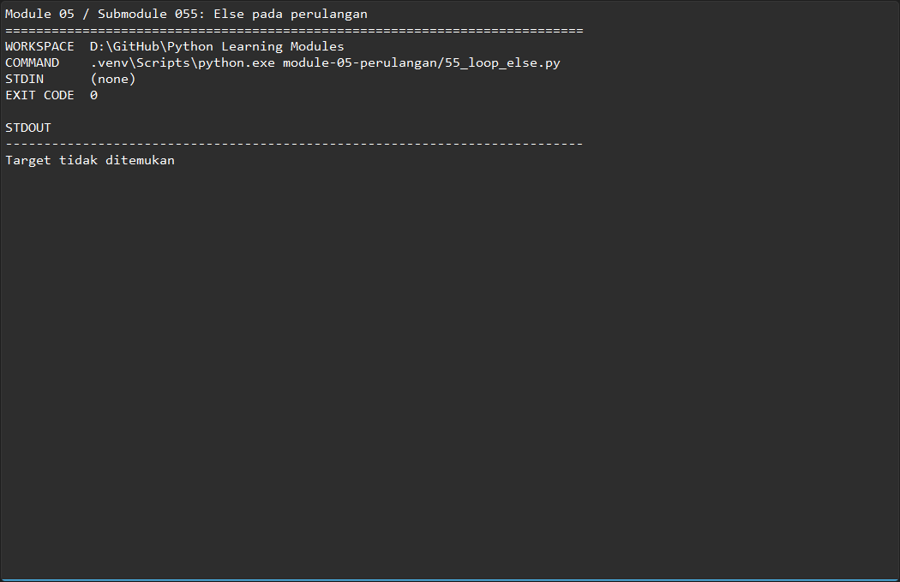

##### 56. Loop Iteration Counters

- **Source Code**: [`56_loop_counter.py`](./module-05-perulangan/56_loop_counter.py)
- **Key Concept**: Tracking loop iteration frequency with explicit counter variables.
- **Mechanism**: Increments an accumulator variable on each pass to count matching elements.
- **Execution Output**:

  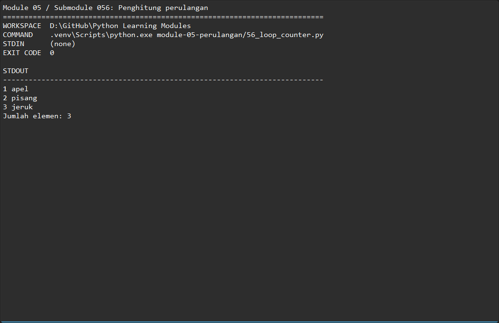

##### 57. Numeric Summation and Accumulation

- **Source Code**: [`57_sum_numbers.py`](./module-05-perulangan/57_sum_numbers.py)
- **Key Concept**: Accumulating sums over numeric sequences using loop aggregation.
- **Mechanism**: Calculates the cumulative sum of the first N natural numbers using a loop accumulator.
- **Execution Output**:

  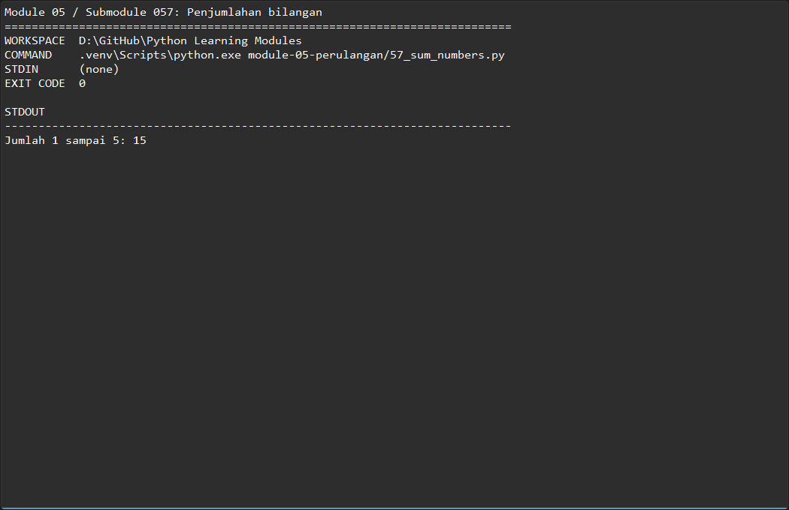

##### 58. Iterative Factorial Calculation

- **Source Code**: [`58_factorial_loop.py`](./module-05-perulangan/58_factorial_loop.py)
- **Key Concept**: Computing mathematical factorials through iterative multiplication.
- **Mechanism**: Multiplies consecutive decreasing integers in a loop to evaluate n!.
- **Execution Output**:

  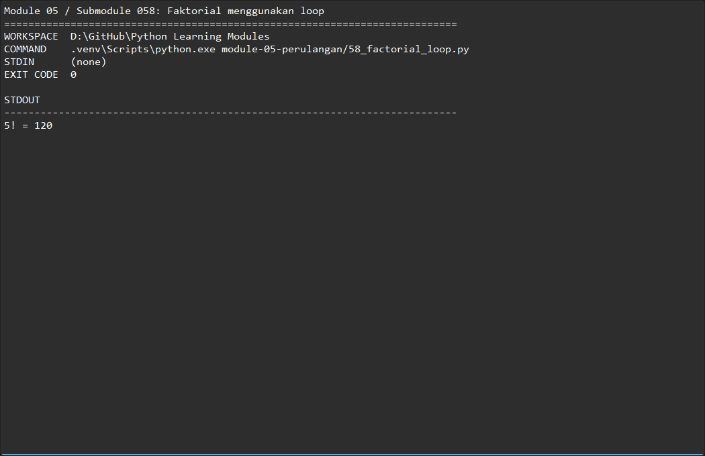

##### 59. Formatted Multiplication Table

- **Source Code**: [`59_multiplication_table.py`](./module-05-perulangan/59_multiplication_table.py)
- **Key Concept**: Rendering formatted arithmetic multiplication tables in terminal grids.
- **Mechanism**: Uses nested loops to format a standard multiplication table with columnar alignment.
- **Execution Output**:

  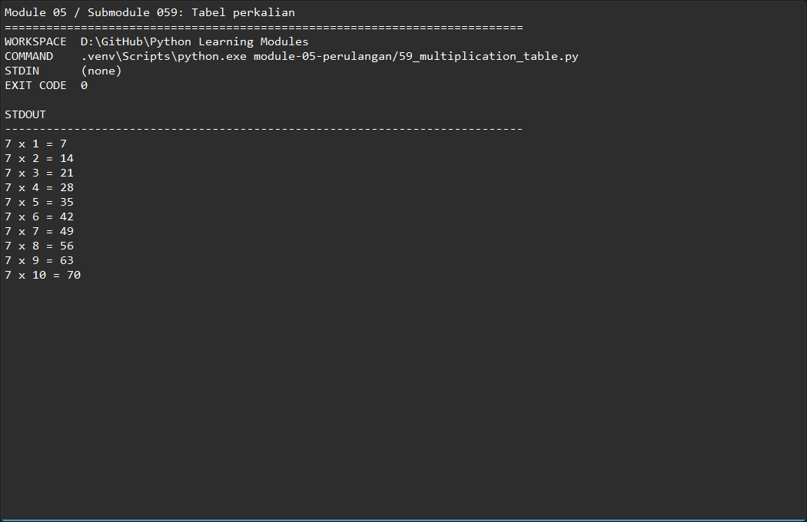

##### 60. Triangular Number Patterns

- **Source Code**: [`60_number_patterns.py`](./module-05-perulangan/60_number_patterns.py)
- **Key Concept**: Generating algorithmic triangular and rectangular number patterns.
- **Mechanism**: Iterates row and column indices to print structured numeric sequences.
- **Execution Output**:

  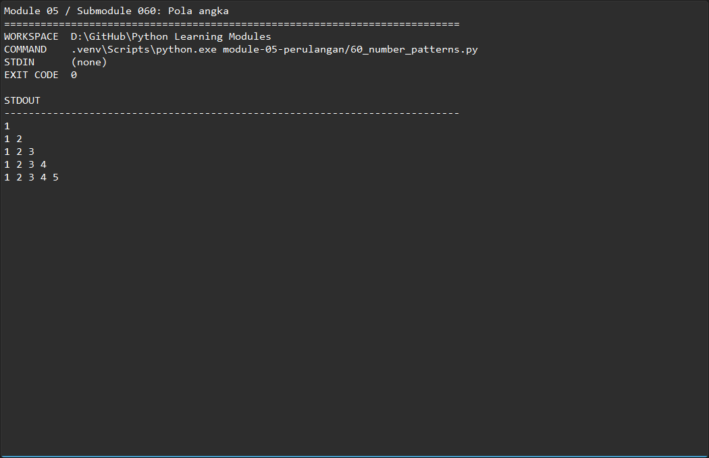

##### 61. Geometric Star and Pyramid Patterns

- **Source Code**: [`61_star_patterns.py`](./module-05-perulangan/61_star_patterns.py)
- **Key Concept**: Printing geometric star pyramids and triangle patterns in the terminal.
- **Mechanism**: Controls leading whitespace padding and character repetition to draw symmetric star shapes.
- **Execution Output**:

  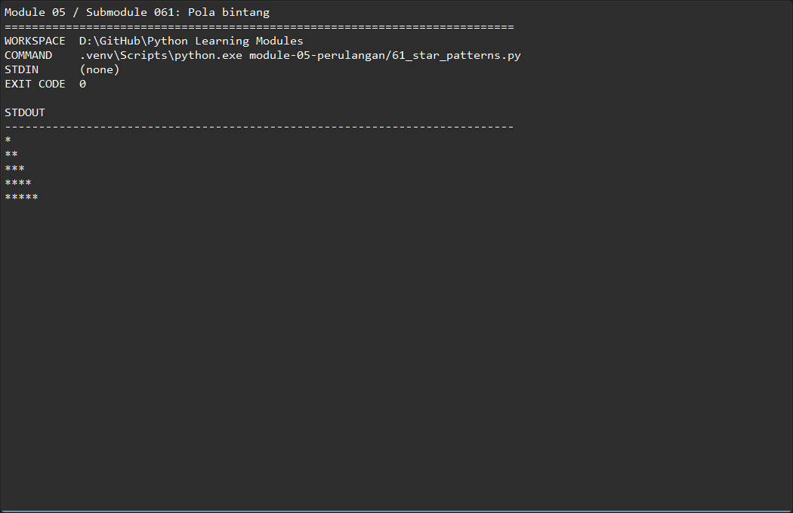

##### 62. Trial Division Primality Test

- **Source Code**: [`62_prime_number.py`](./module-05-perulangan/62_prime_number.py)
- **Key Concept**: Testing integer primality using trial division and early loop termination.
- **Mechanism**: Checks divisibility against potential factors up to the square root of the target integer.
- **Execution Output**:

  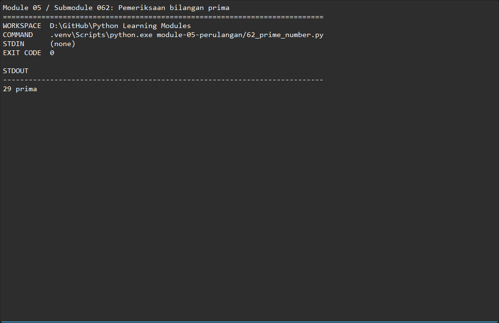

##### 63. Interactive Number Guessing Game Loop

- **Source Code**: [`63_guessing_game.py`](./module-05-perulangan/63_guessing_game.py)
- **Key Concept**: Constructing an interactive terminal number guessing game loop.
- **Mechanism**: Maintains an interactive game loop comparing user guesses against a target with higher/lower hints.
- **Execution Output**:

  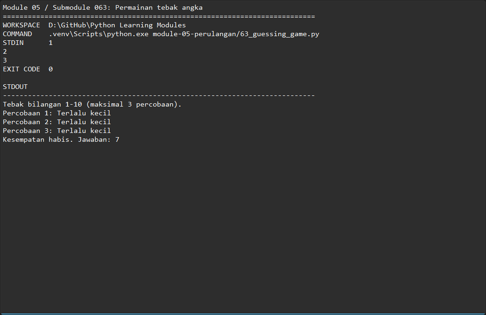

### Module 06: Functions and Modular Programming

**Curriculum Path**: [`module-06-fungsi`](./module-06-fungsi) | **Level**: `Intermediate` | **Scope**: 15 Programs (64-78)

#### Overview & Concepts Covered

Covers modular function design, parameter passing mechanisms, variable scope boundaries (LEGB rule), recursive problem decomposition, self-documenting code with docstrings, and static type annotations.

#### Subtopics & Execution Captures

##### 64. Basic Function Definition and Invocation

- **Source Code**: [`64_function_basic.py`](./module-06-fungsi/64_function_basic.py)
- **Key Concept**: Defining reusable subroutines with def and invoking them with arguments.
- **Mechanism**: Declares a modular function that formats and prints greeting messages.
- **Execution Output**:

  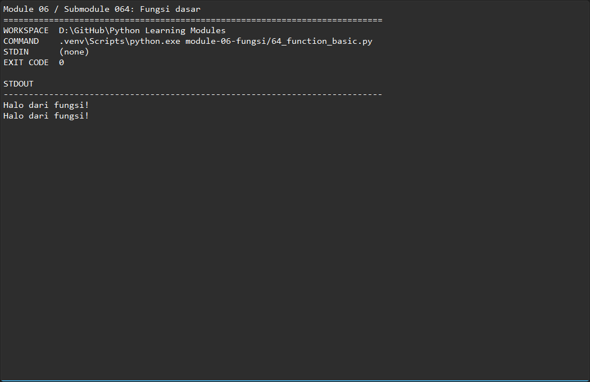

##### 65. Function Parameters and Arguments

- **Source Code**: [`65_function_parameters.py`](./module-06-fungsi/65_function_parameters.py)
- **Key Concept**: Passing data into functions via parameters and matching positional arguments.
- **Mechanism**: Passes multiple parameters into a calculation function to compute geometric area.
- **Execution Output**:

  

##### 66. Function Return Values

- **Source Code**: [`66_return_statement.py`](./module-06-fungsi/66_return_statement.py)
- **Key Concept**: Returning computed results from functions to callers using return.
- **Mechanism**: Calculates the square of a number and returns the numeric result for downstream processing.
- **Execution Output**:

  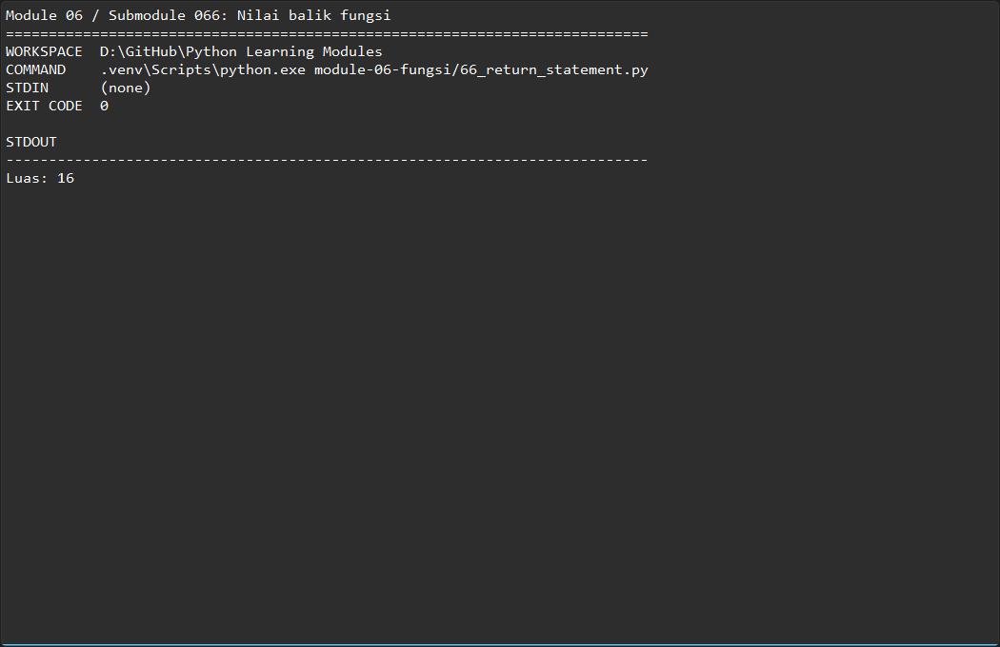

##### 67. Void-Like Functions Returning None

- **Source Code**: [`67_void_like_function.py`](./module-06-fungsi/67_void_like_function.py)
- **Key Concept**: Understanding void-like functions that return None implicitly.
- **Mechanism**: Executes side-effect actions and verifies that omitted return statements evaluate to None.
- **Execution Output**:

  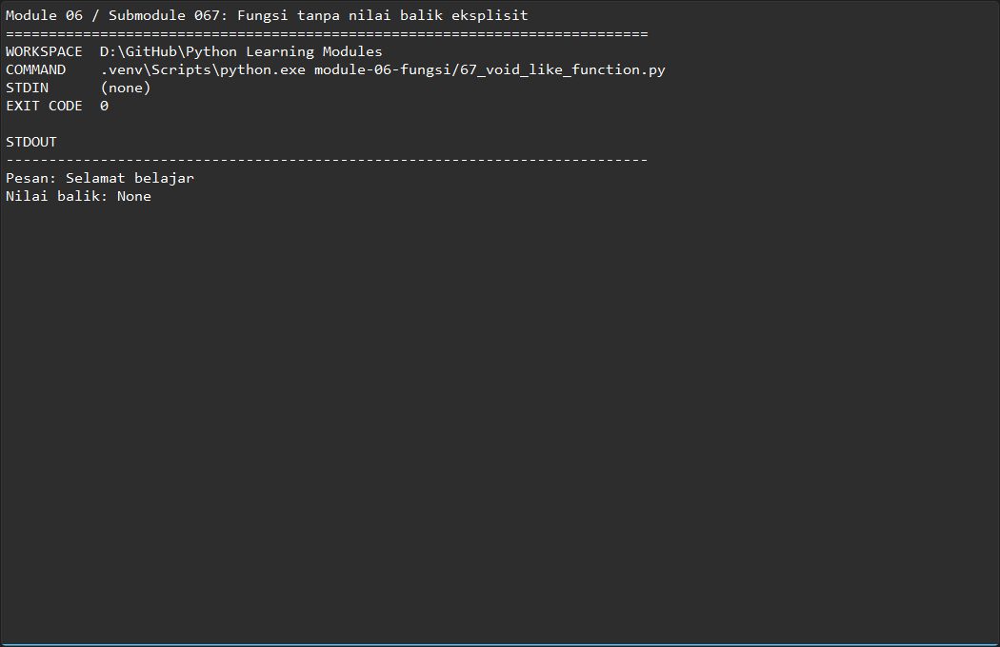

##### 68. Default Parameter Arguments

- **Source Code**: [`68_default_arguments.py`](./module-06-fungsi/68_default_arguments.py)
- **Key Concept**: Providing fallback parameter values using default function arguments.
- **Mechanism**: Supplies default values for optional parameters that can be overridden at call time.
- **Execution Output**:

  

##### 69. Keyword Arguments

- **Source Code**: [`69_keyword_arguments.py`](./module-06-fungsi/69_keyword_arguments.py)
- **Key Concept**: Passing parameters explicitly by name using keyword arguments.
- **Mechanism**: Invokes a multi-parameter function using named arguments in arbitrary ordering.
- **Execution Output**:

  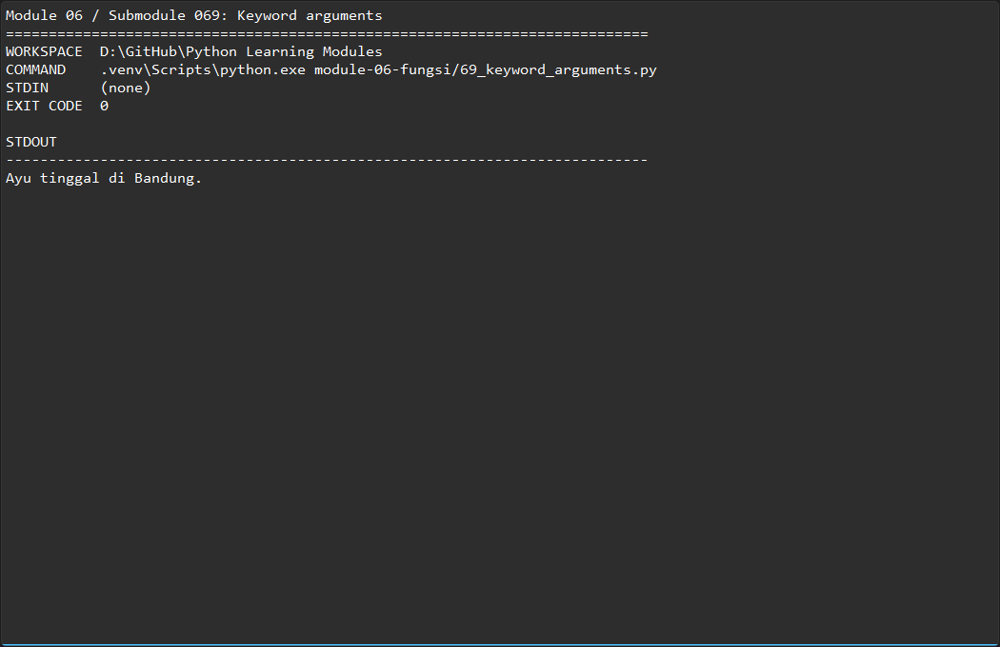

##### 70. Positional-Only Arguments

- **Source Code**: [`70_positional_arguments.py`](./module-06-fungsi/70_positional_arguments.py)
- **Key Concept**: Enforcing positional-only parameter passing using the forward slash (/) syntax.
- **Mechanism**: Restricts specified arguments to positional invocation according to PEP 570.
- **Execution Output**:

  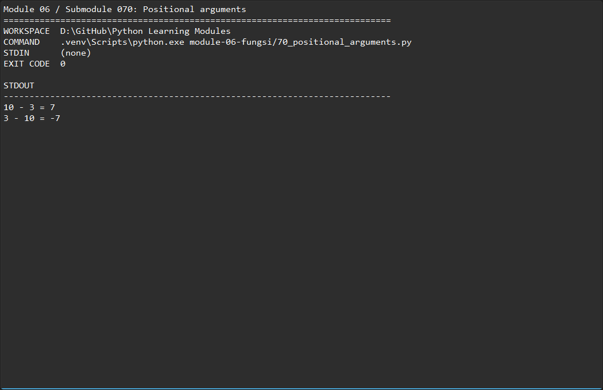

##### 71. Arbitrary Positional Arguments (*args)

- **Source Code**: [`71_arbitrary_arguments.py`](./module-06-fungsi/71_arbitrary_arguments.py)
- **Key Concept**: Accepting variable-length positional arguments using the *args parameter.
- **Mechanism**: Aggregates an arbitrary number of numeric arguments into a tuple for summation.
- **Execution Output**:

  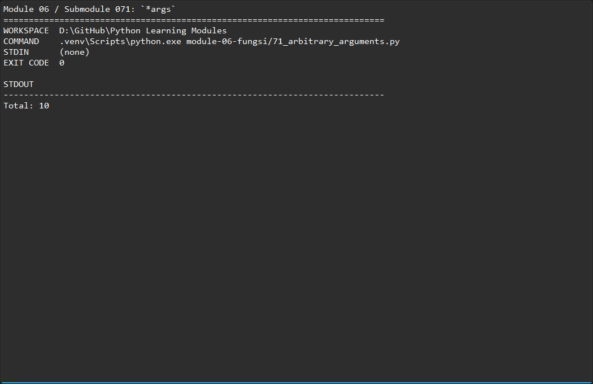

##### 72. Arbitrary Keyword Arguments (**kwargs)

- **Source Code**: [`72_keyword_arbitrary_arguments.py`](./module-06-fungsi/72_keyword_arbitrary_arguments.py)
- **Key Concept**: Accepting arbitrary keyword arguments as a dictionary using **kwargs.
- **Mechanism**: Collects arbitrary key-value parameters into a dictionary within a profile formatting function.
- **Execution Output**:

  

##### 73. Local and Global Variable Scope

- **Source Code**: [`73_function_scope.py`](./module-06-fungsi/73_function_scope.py)
- **Key Concept**: Understanding local and global namespace boundaries according to the LEGB rule.
- **Mechanism**: Demonstrates how local variables within a function shadow variables in the global scope.
- **Execution Output**:

  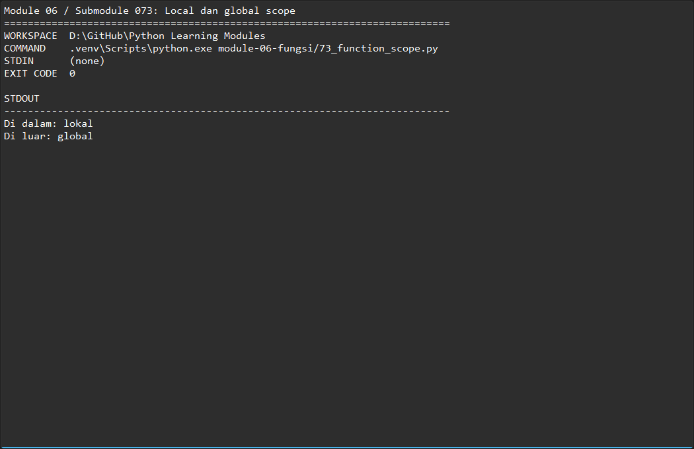

##### 74. Global Scope Modification (global)

- **Source Code**: [`74_global_keyword.py`](./module-06-fungsi/74_global_keyword.py)
- **Key Concept**: Modifying global namespace variables from within a local function using global.
- **Mechanism**: Explicitly declares a variable global to mutate module-level state inside a function.
- **Execution Output**:

  

##### 75. Enclosing Scope Modification (nonlocal)

- **Source Code**: [`75_nonlocal_keyword.py`](./module-06-fungsi/75_nonlocal_keyword.py)
- **Key Concept**: Modifying enclosing outer function scope variables in nested functions using nonlocal.
- **Mechanism**: Mutates a state variable inside an outer enclosing scope from an inner nested function.
- **Execution Output**:

  

##### 76. Recursive Function Execution

- **Source Code**: [`76_recursive_function.py`](./module-06-fungsi/76_recursive_function.py)
- **Key Concept**: Solving self-similar problems through recursive function self-invocation.
- **Mechanism**: Implements a recursive factorial function with defined base and recursive cases.
- **Execution Output**:

  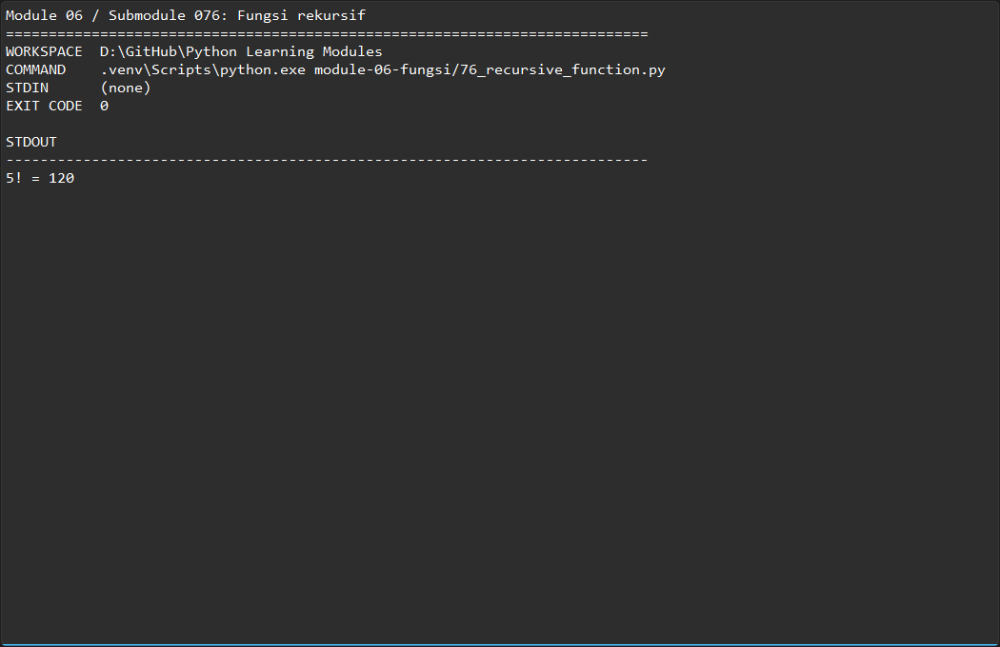

##### 77. Function Docstrings and Metadata

- **Source Code**: [`77_function_docstring.py`](./module-06-fungsi/77_function_docstring.py)
- **Key Concept**: Documenting function contracts and parameters using docstrings (__doc__).
- **Mechanism**: Attaches structured docstrings to functions and inspects them at runtime via __doc__.
- **Execution Output**:

  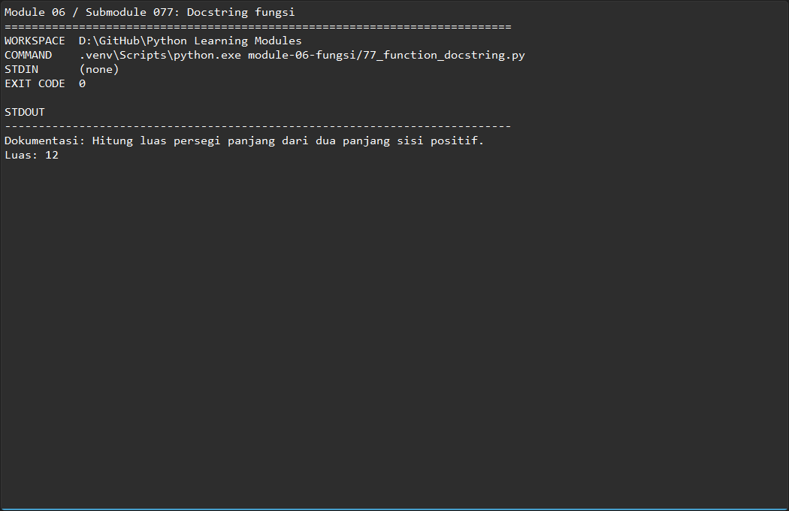

##### 78. Static Type Hints on Functions

- **Source Code**: [`78_function_type_hints.py`](./module-06-fungsi/78_function_type_hints.py)
- **Key Concept**: Annotating function signatures with static type hints (PEP 484).
- **Mechanism**: Specifies parameter types and return type annotations to enforce code clarity and tooling checks.
- **Execution Output**:

  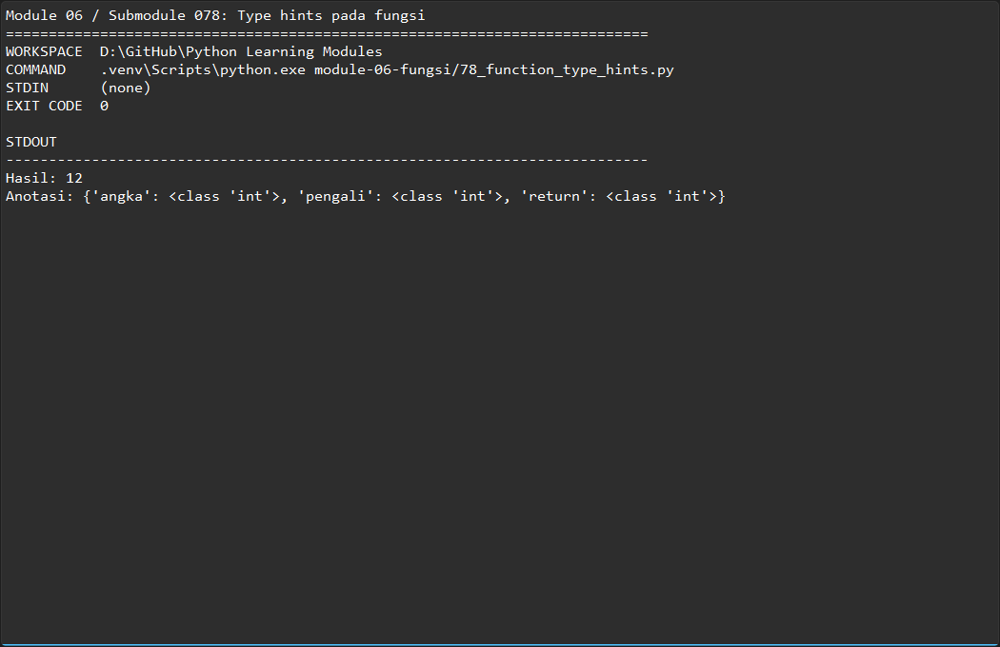

### Module 07: Built-In Data Structures

**Curriculum Path**: [`module-07-struktur-data-bawaan-python`](./module-07-struktur-data-bawaan-python) | **Level**: `Intermediate` | **Scope**: 20 Programs (79-98)

#### Overview & Concepts Covered

Examines contiguous lists, immutable tuples and unpacking, hash-based sets with mathematical set operations, key-value dictionaries, nested collection querying, shallow copying, and inter-collection conversions.

#### Subtopics & Execution Captures

##### 79. List Creation and Manipulation

- **Source Code**: [`79_list_basic.py`](./module-07-struktur-data-bawaan-python/79_list_basic.py)
- **Key Concept**: Storing and mutating ordered collections of arbitrary elements using lists.
- **Mechanism**: Instantiates a list, appends new items dynamically, and measures its length.
- **Execution Output**:

  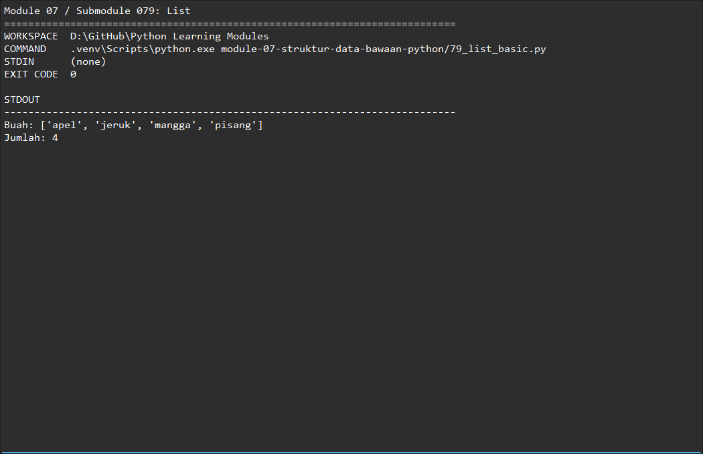

##### 80. Zero-Based and Negative List Indexing

- **Source Code**: [`80_list_indexing.py`](./module-07-struktur-data-bawaan-python/80_list_indexing.py)
- **Key Concept**: Accessing individual collection elements using positive and negative indices.
- **Mechanism**: Retrieves elements from the beginning (index 0) and end (index -1) of a list.
- **Execution Output**:

  

##### 81. List Slicing and Stride

- **Source Code**: [`81_list_slicing.py`](./module-07-struktur-data-bawaan-python/81_list_slicing.py)
- **Key Concept**: Extracting sub-collections using list slicing syntax ([start:stop:step]).
- **Mechanism**: Generates sub-lists with slicing ranges and stride intervals.
- **Execution Output**:

  

##### 82. Common List Methods

- **Source Code**: [`82_list_methods.py`](./module-07-struktur-data-bawaan-python/82_list_methods.py)
- **Key Concept**: Manipulating list contents in-place using standard list methods.
- **Mechanism**: Applies append(), sort(), and remove() to modify list contents and order in-place.
- **Execution Output**:

  

##### 83. List Iteration Patterns

- **Source Code**: [`83_list_iteration.py`](./module-07-struktur-data-bawaan-python/83_list_iteration.py)
- **Key Concept**: Traversing collection items and tracking positions using iteration and enumerate().
- **Mechanism**: Iterates over a list with enumerate() to retrieve index-value pairs simultaneously.
- **Execution Output**:

  

##### 84. Searching and Counting List Elements

- **Source Code**: [`84_list_search.py`](./module-07-struktur-data-bawaan-python/84_list_search.py)
- **Key Concept**: Locating elements and calculating occurrence counts within lists.
- **Mechanism**: Finds item positions with index() and counts matching occurrences with count().
- **Execution Output**:

  

##### 85. In-Place and Out-of-Place List Sorting

- **Source Code**: [`85_list_sorting.py`](./module-07-struktur-data-bawaan-python/85_list_sorting.py)
- **Key Concept**: Comparing in-place list sorting (.sort()) with non-destructive sorting (sorted()).
- **Mechanism**: Sorts a list in-place and compares it with producing a new sorted copy.
- **Execution Output**:

  

##### 86. List Equality and Lexicographical Comparison

- **Source Code**: [`86_list_comparison.py`](./module-07-struktur-data-bawaan-python/86_list_comparison.py)
- **Key Concept**: Evaluating collection equality and lexicographical comparison rules.
- **Mechanism**: Compares lists element-by-element using equality and ordering operators.
- **Execution Output**:

  

##### 87. Multi-Dimensional Nested Lists

- **Source Code**: [`87_nested_list.py`](./module-07-struktur-data-bawaan-python/87_nested_list.py)
- **Key Concept**: Representing multi-dimensional tabular matrices using nested lists.
- **Mechanism**: Creates a 2D matrix list and accesses elements using row and column index pairs.
- **Execution Output**:

  

##### 88. Shallow and Deep List Copying

- **Source Code**: [`88_list_copying.py`](./module-07-struktur-data-bawaan-python/88_list_copying.py)
- **Key Concept**: Differentiating shallow list copies from deep independent collection copies.
- **Mechanism**: Demonstrates how modifying nested elements affects shallow copies vs deep copies.
- **Execution Output**:

  

##### 89. Immutable Tuples

- **Source Code**: [`89_tuple_basic.py`](./module-07-struktur-data-bawaan-python/89_tuple_basic.py)
- **Key Concept**: Representing fixed, immutable sequences of data using tuples.
- **Mechanism**: Defines an immutable tuple, accesses items by index, and demonstrates immutability.
- **Execution Output**:

  

##### 90. Tuple Packing and Unpacking

- **Source Code**: [`90_tuple_unpacking.py`](./module-07-struktur-data-bawaan-python/90_tuple_unpacking.py)
- **Key Concept**: Extracting tuple elements into distinct variables using tuple unpacking.
- **Mechanism**: Unpacks coordinates and records into named variables in a single statement.
- **Execution Output**:

  

##### 91. Set Collections and Uniqueness

- **Source Code**: [`91_set_basic.py`](./module-07-struktur-data-bawaan-python/91_set_basic.py)
- **Key Concept**: Storing unique, unordered elements and deduplicating data using sets.
- **Mechanism**: Instantiates a set literal to eliminate duplicate entries automatically.
- **Execution Output**:

  

##### 92. Mathematical Set Operations

- **Source Code**: [`92_set_operations.py`](./module-07-struktur-data-bawaan-python/92_set_operations.py)
- **Key Concept**: Performing mathematical set algebra: union, intersection, and difference.
- **Mechanism**: Applies |, &, -, and ^ operators across distinct sets to evaluate set relationships.
- **Execution Output**:

  

##### 93. Key-Value Dictionaries

- **Source Code**: [`93_dictionary_basic.py`](./module-07-struktur-data-bawaan-python/93_dictionary_basic.py)
- **Key Concept**: Mapping unique keys to values using hash-based dictionaries (dict).
- **Mechanism**: Stores entity attributes as key-value pairs and accesses values by key.
- **Execution Output**:

  

##### 94. Dictionary Methods

- **Source Code**: [`94_dictionary_methods.py`](./module-07-struktur-data-bawaan-python/94_dictionary_methods.py)
- **Key Concept**: Manipulating and querying dictionaries using built-in dict methods.
- **Mechanism**: Retrieves values safely with get(), lists keys with keys(), and removes items with pop().
- **Execution Output**:

  

##### 95. Dictionary Iteration (Keys, Values, Items)

- **Source Code**: [`95_dictionary_iteration.py`](./module-07-struktur-data-bawaan-python/95_dictionary_iteration.py)
- **Key Concept**: Iterating over dictionary keys, values, and key-value items.
- **Mechanism**: Iterates through dictionary entries using the .items() view in a loop.
- **Execution Output**:

  

##### 96. Hierarchical Nested Dictionaries

- **Source Code**: [`96_nested_dictionary.py`](./module-07-struktur-data-bawaan-python/96_nested_dictionary.py)
- **Key Concept**: Modeling hierarchical structured records using nested dictionaries.
- **Mechanism**: Navigates multi-level nested dictionaries to query child properties.
- **Execution Output**:

  

##### 97. Dictionary Comparison and Merging

- **Source Code**: [`97_dictionary_comparison.py`](./module-07-struktur-data-bawaan-python/97_dictionary_comparison.py)
- **Key Concept**: Comparing dictionary equality and merging dictionaries with the union operator (|).
- **Mechanism**: Tests dictionary equivalence and merges two dictionaries using the Python 3.9+ | operator.
- **Execution Output**:

  

##### 98. Inter-Collection Type Conversions

- **Source Code**: [`98_collection_conversion.py`](./module-07-struktur-data-bawaan-python/98_collection_conversion.py)
- **Key Concept**: Converting seamlessly between lists, tuples, sets, and dictionaries.
- **Mechanism**: Transforms collections across different data structure types to leverage specific properties.
- **Execution Output**:

  

### Module 08: String Manipulation and Text Processing

**Curriculum Path**: [`module-08-manipulasi-string`](./module-08-manipulasi-string) | **Level**: `Intermediate` | **Scope**: 14 Programs (99-112)

#### Overview & Concepts Covered

Covers immutable string mechanics, substring extraction and slicing, case manipulation, search and replace, character set validation, whitespace stripping, Unicode representations, and string algorithm design.

#### Subtopics & Execution Captures

##### 99. String Character Indexing

- **Source Code**: [`99_string_indexing.py`](./module-08-manipulasi-string/99_string_indexing.py)
- **Key Concept**: Accessing individual string characters using zero-based and negative indices.
- **Mechanism**: Retrieves specific characters by index and demonstrates string immutability.
- **Execution Output**:

  

##### 100. String Slicing and Reversal

- **Source Code**: [`100_string_slicing.py`](./module-08-manipulasi-string/100_string_slicing.py)
- **Key Concept**: Extracting substrings and reversing strings using slicing syntax.
- **Mechanism**: Extracts word segments and reverses full string contents using [::-1].
- **Execution Output**:

  

##### 101. Common String Methods

- **Source Code**: [`101_string_methods.py`](./module-08-manipulasi-string/101_string_methods.py)
- **Key Concept**: Transforming text case and inspecting characteristics using string methods.
- **Mechanism**: Applies upper(), lower(), title(), and count() to text strings.
- **Execution Output**:

  

##### 102. String Concatenation

- **Source Code**: [`102_string_concatenation.py`](./module-08-manipulasi-string/102_string_concatenation.py)
- **Key Concept**: Concatenating multiple string objects into unified text sequences.
- **Mechanism**: Combines strings using the + operator and formatted strings.
- **Execution Output**:

  

##### 103. String Repetition

- **Source Code**: [`103_string_repetition.py`](./module-08-manipulasi-string/103_string_repetition.py)
- **Key Concept**: Duplicating text sequences repeatedly using the string multiplication operator (*).
- **Mechanism**: Generates repeated character patterns and terminal separators via string multiplication.
- **Execution Output**:

  

##### 104. Subtext Searching and Boundaries

- **Source Code**: [`104_string_search.py`](./module-08-manipulasi-string/104_string_search.py)
- **Key Concept**: Locating substring positions and checking boundary prefixes/suffixes.
- **Mechanism**: Finds character offsets with find() and validates boundaries with startswith() and endswith().
- **Execution Output**:

  

##### 105. Text Search and Replacement

- **Source Code**: [`105_string_replace.py`](./module-08-manipulasi-string/105_string_replace.py)
- **Key Concept**: Replacing targeted subtext patterns with replacement strings using replace().
- **Mechanism**: Substitutes specific words within a text block with replacement terms.
- **Execution Output**:

  

##### 106. String Tokenization with split()

- **Source Code**: [`106_string_split.py`](./module-08-manipulasi-string/106_string_split.py)
- **Key Concept**: Tokenizing structured text strings into lists of words using split().
- **Mechanism**: Splits sentences into individual word lists based on delimiter whitespace.
- **Execution Output**:

  

##### 107. Joining Iterable Elements with join()

- **Source Code**: [`107_string_join.py`](./module-08-manipulasi-string/107_string_join.py)
- **Key Concept**: Joining lists of string tokens into formatted sentences using join().
- **Mechanism**: Concatenates a list of words into a single delimiter-separated string.
- **Execution Output**:

  

##### 108. String Validation Predicates

- **Source Code**: [`108_string_validation.py`](./module-08-manipulasi-string/108_string_validation.py)
- **Key Concept**: Validating character composition using predicate methods (isalpha, isdigit, isalnum).
- **Mechanism**: Tests strings against alphanumeric, numeric, and alphabetical constraints.
- **Execution Output**:

  

##### 109. Whitespace Stripping and Sanitization

- **Source Code**: [`109_string_cleaning.py`](./module-08-manipulasi-string/109_string_cleaning.py)
- **Key Concept**: Sanitizing text input by stripping surrounding whitespace characters.
- **Mechanism**: Removes leading and trailing whitespace using strip(), lstrip(), and rstrip().
- **Execution Output**:

  

##### 110. Advanced String Formatting (str.format)

- **Source Code**: [`110_string_formatting.py`](./module-08-manipulasi-string/110_string_formatting.py)
- **Key Concept**: Formatting text dynamically using str.format() with positional and named placeholders.
- **Mechanism**: Injects data into template strings using format() specifiers.
- **Execution Output**:

  

##### 111. Unicode Encoding and International Text

- **Source Code**: [`111_unicode_strings.py`](./module-08-manipulasi-string/111_unicode_strings.py)
- **Key Concept**: Handling Unicode characters, emojis, and international multilingual text.
- **Mechanism**: Encodes and displays non-ASCII characters and inspects their Unicode code points.
- **Execution Output**:

  

##### 112. Palindrome Detection Algorithm

- **Source Code**: [`112_palindrome_checker.py`](./module-08-manipulasi-string/112_palindrome_checker.py)
- **Key Concept**: Designing an algorithmic palindrome checker ignoring case and whitespace.
- **Mechanism**: Normalizes text and compares it against its reverse to verify palindrome symmetry.
- **Execution Output**:

  

### Module 09: Comprehensions, Iterators, and Generators

**Curriculum Path**: [`module-09-comprehension-iterator-dan-generator`](./module-09-comprehension-iterator-dan-generator) | **Level**: `Intermediate to Advanced` | **Scope**: 16 Programs (113-128)

#### Overview & Concepts Covered

Deepens knowledge of functional and memory-efficient Python constructs: list/set/dict comprehensions, conditional filtering, generator expressions, writing custom iterators, delegating generators, and multi-stage streaming pipelines.

#### Subtopics & Execution Captures

##### 113. List Comprehensions

- **Source Code**: [`113_list_comprehension.py`](./module-09-comprehension-iterator-dan-generator/113_list_comprehension.py)
- **Key Concept**: Generating transformed lists concisely using list comprehensions.
- **Mechanism**: Constructs a squared number list from an iterable using inline comprehension syntax.
- **Execution Output**:

  

##### 114. Conditional Filtering in Comprehensions

- **Source Code**: [`114_list_comprehension_conditions.py`](./module-09-comprehension-iterator-dan-generator/114_list_comprehension_conditions.py)
- **Key Concept**: Filtering elements during comprehension evaluation with conditional if clauses.
- **Mechanism**: Filters a range to extract only even numbers using a trailing if clause in comprehension.
- **Execution Output**:

  

##### 115. Nested Comprehensions (Matrix Operations)

- **Source Code**: [`115_nested_comprehension.py`](./module-09-comprehension-iterator-dan-generator/115_nested_comprehension.py)
- **Key Concept**: Flattening and transforming multi-dimensional matrices with nested comprehensions.
- **Mechanism**: Flattens a 2D matrix into a 1D list using nested for clauses in a comprehension.
- **Execution Output**:

  

##### 116. Dictionary Comprehensions

- **Source Code**: [`116_dictionary_comprehension.py`](./module-09-comprehension-iterator-dan-generator/116_dictionary_comprehension.py)
- **Key Concept**: Constructing transformed key-value mappings using dictionary comprehensions.
- **Mechanism**: Maps names to their string lengths in a dictionary via comprehension expression.
- **Execution Output**:

  

##### 117. Set Comprehensions

- **Source Code**: [`117_set_comprehension.py`](./module-09-comprehension-iterator-dan-generator/117_set_comprehension.py)
- **Key Concept**: Generating deduplicated collections concisely using set comprehensions.
- **Mechanism**: Creates a set of unique word lengths from a sentence using set comprehension.
- **Execution Output**:

  

##### 118. Memory-Efficient Generator Expressions

- **Source Code**: [`118_generator_expression.py`](./module-09-comprehension-iterator-dan-generator/118_generator_expression.py)
- **Key Concept**: Producing memory-efficient streaming iterables using generator expressions.
- **Mechanism**: Instantiates a generator expression that yields evaluated numbers lazily on demand.
- **Execution Output**:

  

##### 119. The iter() Protocol Function

- **Source Code**: [`119_iter_function.py`](./module-09-comprehension-iterator-dan-generator/119_iter_function.py)
- **Key Concept**: Creating iterator objects from collections using the iter() built-in function.
- **Mechanism**: Converts an iterable collection into an active iterator object.
- **Execution Output**:

  

##### 120. Sequential Retrieval with next()

- **Source Code**: [`120_next_function.py`](./module-09-comprehension-iterator-dan-generator/120_next_function.py)
- **Key Concept**: Retrieving sequential values manually from an iterator using next().
- **Mechanism**: Fetches elements one by one from an iterator and handles StopIteration.
- **Execution Output**:

  

##### 121. Custom Iterator Class Implementation

- **Source Code**: [`121_custom_iterator.py`](./module-09-comprehension-iterator-dan-generator/121_custom_iterator.py)
- **Key Concept**: Building custom iterator classes implementing __iter__() and __next__().
- **Mechanism**: Implements a custom counter iterator class enforcing iteration protocol boundaries.
- **Execution Output**:

  

##### 122. Python Iterator Protocol Invariants

- **Source Code**: [`122_iterator_protocol.py`](./module-09-comprehension-iterator-dan-generator/122_iterator_protocol.py)
- **Key Concept**: Adhering to Python iterator protocol invariants and handling StopIteration.
- **Mechanism**: Demonstrates how for loops internally consume iterators until StopIteration is raised.
- **Execution Output**:

  

##### 123. Generator Functions and Streaming

- **Source Code**: [`123_generator_function.py`](./module-09-comprehension-iterator-dan-generator/123_generator_function.py)
- **Key Concept**: Authoring generator functions that stream evaluated data across execution cycles.
- **Mechanism**: Defines a generator function that yields a sequence of incremental values.
- **Execution Output**:

  

##### 124. Value Emitting with yield

- **Source Code**: [`124_yield_keyword.py`](./module-09-comprehension-iterator-dan-generator/124_yield_keyword.py)
- **Key Concept**: Pausing function execution and emitting values dynamically using yield.
- **Mechanism**: Yields values from a stateful generator function across multiple calls.
- **Execution Output**:

  

##### 125. Sub-Generator Delegation with yield from

- **Source Code**: [`125_yield_from.py`](./module-09-comprehension-iterator-dan-generator/125_yield_from.py)
- **Key Concept**: Delegating generator iteration to sub-generators cleanly using yield from.
- **Mechanism**: Streams elements from multiple iterable sources using yield from delegation.
- **Execution Output**:

  

##### 126. Multi-Stage Generator Pipelines

- **Source Code**: [`126_generator_pipeline.py`](./module-09-comprehension-iterator-dan-generator/126_generator_pipeline.py)
- **Key Concept**: Composing multi-stage streaming data pipelines using chained generators.
- **Mechanism**: Connects filtering and transformation generators in a memory-efficient pipeline.
- **Execution Output**:

  

##### 127. Lazy Evaluation Semantics

- **Source Code**: [`127_lazy_evaluation.py`](./module-09-comprehension-iterator-dan-generator/127_lazy_evaluation.py)
- **Key Concept**: Evaluating data on-demand without memory pre-allocation via lazy evaluation.
- **Mechanism**: Demonstrates how large streams are consumed lazily without loading everything into RAM.
- **Execution Output**:

  

##### 128. Parallel and Indexed Iteration (enumerate & zip)

- **Source Code**: [`128_enumerate_zip.py`](./module-09-comprehension-iterator-dan-generator/128_enumerate_zip.py)
- **Key Concept**: Iterating collections with automatic index tracking (enumerate) and paired iteration (zip).
- **Mechanism**: Combines parallel sequences with zip() and indexes elements with enumerate().
- **Execution Output**:

  

### Module 10: Advanced Functional Programming

**Curriculum Path**: [`module-10-fungsi-lanjutan`](./module-10-fungsi-lanjutan) | **Level**: `Advanced` | **Scope**: 15 Programs (129-143)

#### Overview & Concepts Covered

Presents functions as first-class citizens in Python: anonymous functions, higher-order functional utilities, lexical scope encapsulation with closures, metaprogramming via decorators, partial application, and callable objects.

#### Subtopics & Execution Captures

##### 129. Anonymous Lambda Functions

- **Source Code**: [`129_lambda_function.py`](./module-10-fungsi-lanjutan/129_lambda_function.py)
- **Key Concept**: Defining lightweight anonymous inline functions using lambda expressions.
- **Mechanism**: Passes a concise lambda function to calculate mathematical formulas on-the-fly.
- **Execution Output**:

  

##### 130. Higher-Order Functions

- **Source Code**: [`130_higher_order_functions.py`](./module-10-fungsi-lanjutan/130_higher_order_functions.py)
- **Key Concept**: Passing functions as arguments and returning functions from higher-order functions.
- **Mechanism**: Defines a higher-order function that applies arbitrary operations to inputs.
- **Execution Output**:

  

##### 131. Sequence Transformation with map()

- **Source Code**: [`131_map_function.py`](./module-10-fungsi-lanjutan/131_map_function.py)
- **Key Concept**: Transforming iterable elements functionally using the map() built-in function.
- **Mechanism**: Applies a transformation function across a numeric list via map().
- **Execution Output**:

  

##### 132. Element Filtering with filter()

- **Source Code**: [`132_filter_function.py`](./module-10-fungsi-lanjutan/132_filter_function.py)
- **Key Concept**: Selecting elements meeting predicate conditions using the filter() function.
- **Mechanism**: Filters a collection to retain only elements satisfying a boolean predicate function.
- **Execution Output**:

  

##### 133. Cumulative Aggregation with functools.reduce()

- **Source Code**: [`133_reduce_function.py`](./module-10-fungsi-lanjutan/133_reduce_function.py)
- **Key Concept**: Performing cumulative reductions over sequences using functools.reduce().
- **Mechanism**: Reduces a numeric sequence into a single cumulative product using reduce().
- **Execution Output**:

  

##### 134. Custom Key Sorting with Lambdas

- **Source Code**: [`134_sorted_key_function.py`](./module-10-fungsi-lanjutan/134_sorted_key_function.py)
- **Key Concept**: Customizing collection sorting criteria using lambda functions with the key parameter.
- **Mechanism**: Sorts a list of tuples by a specific secondary element via key=lambda.
- **Execution Output**:

  

##### 135. Function Closures and Lexical Scope

- **Source Code**: [`135_closure_function.py`](./module-10-fungsi-lanjutan/135_closure_function.py)
- **Key Concept**: Encapsulating lexical environment and state retention using function closures.
- **Mechanism**: Returns an inner function that retains access to variables in its enclosing scope.
- **Execution Output**:

  

##### 136. Function Decorators

- **Source Code**: [`136_nested_function.py`](./module-10-fungsi-lanjutan/136_nested_function.py)
- **Key Concept**: Modifying or extending function behavior non-invasively using function decorators.
- **Mechanism**: Wraps an existing function with a logging decorator to report execution timing.
- **Execution Output**:

  

##### 137. Parameterized Decorators

- **Source Code**: [`137_decorator_basic.py`](./module-10-fungsi-lanjutan/137_decorator_basic.py)
- **Key Concept**: Authoring flexible function decorators that accept configurable arguments.
- **Mechanism**: Implements a three-tier decorator that accepts configuration arguments at decoration time.
- **Execution Output**:

  

##### 138. Decorator Chaining and Stacking

- **Source Code**: [`138_decorator_with_arguments.py`](./module-10-fungsi-lanjutan/138_decorator_with_arguments.py)
- **Key Concept**: Stacking multiple decorators onto a single function in sequence.
- **Mechanism**: Applies multiple decorators to a function and observes the bottom-up execution order.
- **Execution Output**:

  

##### 139. Partial Function Application (functools.partial)

- **Source Code**: [`139_multiple_decorators.py`](./module-10-fungsi-lanjutan/139_multiple_decorators.py)
- **Key Concept**: Fixing function arguments to create specialized variants using functools.partial().
- **Mechanism**: Pre-binds arguments in a general function to produce a specialized single-argument function.
- **Execution Output**:

  

##### 140. Callable Class Instances (__call__)

- **Source Code**: [`140_function_annotations.py`](./module-10-fungsi-lanjutan/140_function_annotations.py)
- **Key Concept**: Creating callable class instances by implementing the __call__() dunder method.
- **Mechanism**: Implements __call__() on a class so its instances can be invoked like functions.
- **Execution Output**:

  

##### 141. Currying and Function Specialization

- **Source Code**: [`141_partial_function.py`](./module-10-fungsi-lanjutan/141_partial_function.py)
- **Key Concept**: Transforming multi-argument functions into chains of single-argument functions (currying).
- **Mechanism**: Curries a three-argument calculation into successive unary function calls.
- **Execution Output**:

  

##### 142. Memoization and Caching Patterns

- **Source Code**: [`142_callable_objects.py`](./module-10-fungsi-lanjutan/142_callable_objects.py)
- **Key Concept**: Optimizing expensive recursive computations using memoization dictionaries.
- **Mechanism**: Caches evaluated results in a dictionary to prevent redundant subproblem recalculations.
- **Execution Output**:

  

##### 143. Advanced Recursion over Nested Structures

- **Source Code**: [`143_recursion_advanced.py`](./module-10-fungsi-lanjutan/143_recursion_advanced.py)
- **Key Concept**: Traversing and aggregating arbitrarily nested data structures with recursive functions.
- **Mechanism**: Recursively flattens and sums values from deeply nested lists.
- **Execution Output**:

  

### Module 11: Object-Oriented Programming (OOP)

**Curriculum Path**: [`module-11-object-oriented-programming`](./module-11-object-oriented-programming) | **Level**: `Intermediate to Advanced` | **Scope**: 24 Programs (144-167)

#### Overview & Concepts Covered

Detailed study of OOP principles and Python object data model protocols: instance vs class attributes, classmethod/staticmethod, property decorators, single and multiple inheritance, abstract classes, dunder methods, dataclass boilerplate reduction, memory-saving __slots__, descriptor protocols, and metaclass architecture.

#### Subtopics & Execution Captures

##### 144. Class Definition and Object Instantiation

- **Source Code**: [`144_class_basic.py`](./module-11-object-oriented-programming/144_class_basic.py)
- **Key Concept**: Declaring blueprint classes and instantiating concrete object instances.
- **Mechanism**: Defines a class, instantiates multiple objects, and accesses their members.
- **Execution Output**:

  

##### 145. Instance Attributes

- **Source Code**: [`145_instance_attributes.py`](./module-11-object-oriented-programming/145_instance_attributes.py)
- **Key Concept**: Attaching distinct state to individual objects via instance attributes.
- **Mechanism**: Assigns unique state properties to separate object instances during initialization.
- **Execution Output**:

  

##### 146. Class Attributes and Shared State

- **Source Code**: [`146_class_attributes.py`](./module-11-object-oriented-programming/146_class_attributes.py)
- **Key Concept**: Sharing state and constants across all class instances via class attributes.
- **Mechanism**: Defines a class-level variable shared by all instances and updates it centrally.
- **Execution Output**:

  

##### 147. Instance Methods

- **Source Code**: [`147_instance_methods.py`](./module-11-object-oriented-programming/147_instance_methods.py)
- **Key Concept**: Defining object behaviors and accessing state via instance methods (self).
- **Mechanism**: Invokes instance methods that read and mutate the invoking object's internal state.
- **Execution Output**:

  

##### 148. Class Methods (@classmethod)

- **Source Code**: [`148_class_methods.py`](./module-11-object-oriented-programming/148_class_methods.py)
- **Key Concept**: Creating alternative constructors and class-level methods using @classmethod.
- **Mechanism**: Implements a class method using cls to construct instances from formatted strings.
- **Execution Output**:

  

##### 149. Static Methods (@staticmethod)

- **Source Code**: [`149_static_methods.py`](./module-11-object-oriented-programming/149_static_methods.py)
- **Key Concept**: Organizing utility functions inside classes using the @staticmethod decorator.
- **Mechanism**: Declares a self-contained static utility method that does not access class or instance state.
- **Execution Output**:

  

##### 150. Constructor Initialization (__init__)

- **Source Code**: [`150_constructor_init.py`](./module-11-object-oriented-programming/150_constructor_init.py)
- **Key Concept**: Initializing newly created instances with the __init__() constructor method.
- **Mechanism**: Initializes object attributes automatically upon instantiation with custom arguments.
- **Execution Output**:

  

##### 151. String Representations (__str__ and __repr__)

- **Source Code**: [`151_string_representation.py`](./module-11-object-oriented-programming/151_string_representation.py)
- **Key Concept**: Defining human-readable and developer-focused string representations (__str__, __repr__).
- **Mechanism**: Implements __str__ for user-friendly display and __repr__ for unambiguous debugging output.
- **Execution Output**:

  

##### 152. Data Encapsulation and Access Modifiers

- **Source Code**: [`152_encapsulation.py`](./module-11-object-oriented-programming/152_encapsulation.py)
- **Key Concept**: Protecting internal object state using private naming conventions (_ and __).
- **Mechanism**: Encapsulates sensitive attributes using double-underscore name mangling.
- **Execution Output**:

  

##### 153. Managed Attributes with @property and @setter

- **Source Code**: [`153_properties.py`](./module-11-object-oriented-programming/153_properties.py)
- **Key Concept**: Exposing managed attributes with getters, setters, and deleters using @property.
- **Mechanism**: Validates attribute assignments through @property and @setter decorators.
- **Execution Output**:

  

##### 154. Single Inheritance and Code Reuse

- **Source Code**: [`154_inheritance.py`](./module-11-object-oriented-programming/154_inheritance.py)
- **Key Concept**: Reusing behavior and establishing is-a relationships through single inheritance.
- **Mechanism**: Derives a specialized child class that inherits attributes and methods from a base class.
- **Execution Output**:

  

##### 155. Multiple Inheritance and MRO

- **Source Code**: [`155_multiple_inheritance.py`](./module-11-object-oriented-programming/155_multiple_inheritance.py)
- **Key Concept**: Inheriting from multiple parent classes and resolving diamond inheritance hierarchies.
- **Mechanism**: Combines behaviors from two distinct base classes into a derived class.
- **Execution Output**:

  

##### 156. Method Overriding and super() Delegation

- **Source Code**: [`156_method_overriding.py`](./module-11-object-oriented-programming/156_method_overriding.py)
- **Key Concept**: Overriding base class methods and delegating to parent implementations with super().
- **Mechanism**: Overrides a base method in a child class while calling super() to extend parent logic.
- **Execution Output**:

  

##### 157. Runtime Polymorphism

- **Source Code**: [`157_polymorphism.py`](./module-11-object-oriented-programming/157_polymorphism.py)
- **Key Concept**: Achieving runtime polymorphism by invoking uniform interfaces across varied classes.
- **Mechanism**: Iterates over heterogeneous objects calling a shared method polymorphically.
- **Execution Output**:

  

##### 158. Abstract Base Classes (@abstractmethod)

- **Source Code**: [`158_abstract_classes.py`](./module-11-object-oriented-programming/158_abstract_classes.py)
- **Key Concept**: Enforcing interface contracts using abstract base classes and @abstractmethod.
- **Mechanism**: Defines abstract methods in a base class that subclasses must implement.
- **Execution Output**:

  

##### 159. Object Composition and Delegation

- **Source Code**: [`159_composition.py`](./module-11-object-oriented-programming/159_composition.py)
- **Key Concept**: Building flexible object architectures through composition over inheritance.
- **Mechanism**: Embeds an engine instance inside a vehicle class to delegate functionality.
- **Execution Output**:

  

##### 160. Operator Overloading (__add__, __eq__)

- **Source Code**: [`160_operator_overloading.py`](./module-11-object-oriented-programming/160_operator_overloading.py)
- **Key Concept**: Customizing arithmetic and comparison behavior using operator overloading.
- **Mechanism**: Implements __add__ and __eq__ to support intuitive syntax on custom object instances.
- **Execution Output**:

  

##### 161. Special Dunder Container Methods (__len__, __getitem__)

- **Source Code**: [`161_dunder_methods.py`](./module-11-object-oriented-programming/161_dunder_methods.py)
- **Key Concept**: Emulating native container behavior with special dunder methods (__len__, __getitem__).
- **Mechanism**: Implements sequence protocols on a custom class to enable indexing and len().
- **Execution Output**:

  

##### 162. Data Classes (@dataclass)

- **Source Code**: [`162_dataclass_basic.py`](./module-11-object-oriented-programming/162_dataclass_basic.py)
- **Key Concept**: Reducing class boilerplate automatically using the modern @dataclass decorator.
- **Mechanism**: Declares structured data classes with generated constructors, representations, and equality.
- **Execution Output**:

  

##### 163. Enumeration Types (enum.Enum)

- **Source Code**: [`163_enum_class.py`](./module-11-object-oriented-programming/163_enum_class.py)
- **Key Concept**: Defining type-safe, immutable enumerations of symbolic names using enum.Enum.
- **Mechanism**: Declares an enumeration class to represent fixed status constants.
- **Execution Output**:

  

##### 164. Memory Optimization with __slots__

- **Source Code**: [`164_slots.py`](./module-11-object-oriented-programming/164_slots.py)
- **Key Concept**: Restricting dynamic attribute creation and optimizing memory with __slots__.
- **Mechanism**: Defines __slots__ on a class to eliminate instance __dict__ overhead and save memory.
- **Execution Output**:

  

##### 165. The Descriptor Protocol (__get__, __set__)

- **Source Code**: [`165_descriptors.py`](./module-11-object-oriented-programming/165_descriptors.py)
- **Key Concept**: Intercepting attribute access and mutation using the descriptor protocol.
- **Mechanism**: Implements __get__ and __set__ in a descriptor class to validate attribute assignments.
- **Execution Output**:

  

##### 166. Custom Metaclasses

- **Source Code**: [`166_metaclasses.py`](./module-11-object-oriented-programming/166_metaclasses.py)
- **Key Concept**: Customizing class creation and enforcing architectural constraints using metaclasses.
- **Mechanism**: Authors a custom metaclass inheriting from type to inspect class definitions at import time.
- **Execution Output**:

  

##### 167. Method Resolution Order (MRO / C3 Linearization)

- **Source Code**: [`167_mro_method_resolution.py`](./module-11-object-oriented-programming/167_mro_method_resolution.py)
- **Key Concept**: Inspecting inheritance linearization orders using Method Resolution Order (MRO).
- **Mechanism**: Examines the .__mro__ attribute to trace method lookup resolution across multiple inheritance.
- **Execution Output**:

  

### Module 12: Exception Handling, File I/O, and Modular Architecture

**Curriculum Path**: [`module-12-exception-file-handling-dan-modul`](./module-12-exception-file-handling-dan-modul) | **Level**: `Intermediate to Advanced` | **Scope**: 20 Programs (168-187) + 1 Helper

#### Overview & Concepts Covered

Teaches robust fault-tolerant software design: exception hierarchies, defensive file handling, object serialization with JSON/CSV/pickle, modern filesystem navigation with pathlib, authoring custom modules, and creating Python packages.

#### Subtopics & Execution Captures

##### 168. Structured Exception Handling (try-except)

- **Source Code**: [`168_try_except.py`](./module-12-exception-file-handling-dan-modul/168_try_except.py)
- **Key Concept**: Catching and mitigating runtime exceptions gracefully using try-except blocks.
- **Mechanism**: Catches ValueError when parsing malformed input and displays an informative error message.
- **Execution Output**:

  

##### 169. Multiple Exception Handling Clauses

- **Source Code**: [`169_multiple_exceptions.py`](./module-12-exception-file-handling-dan-modul/169_multiple_exceptions.py)
- **Key Concept**: Handling multiple distinct exception types with dedicated except blocks.
- **Mechanism**: Differentiates between ValueError and ZeroDivisionError in a single error handler.
- **Execution Output**:

  

##### 170. The else and finally Execution Blocks

- **Source Code**: [`170_else_finally.py`](./module-12-exception-file-handling-dan-modul/170_else_finally.py)
- **Key Concept**: Ensuring resource cleanup and successful execution with else and finally blocks.
- **Mechanism**: Executes the else block upon success and ensures finally executes regardless of errors.
- **Execution Output**:

  

##### 171. Manual Exception Raising (raise)

- **Source Code**: [`171_raise_exception.py`](./module-12-exception-file-handling-dan-modul/171_raise_exception.py)
- **Key Concept**: Signaling invalid program states explicitly using the raise statement.
- **Mechanism**: Raises an informative ValueError when an argument violates validation constraints.
- **Execution Output**:

  

##### 172. Custom Exception Class Hierarchies

- **Source Code**: [`172_custom_exceptions.py`](./module-12-exception-file-handling-dan-modul/172_custom_exceptions.py)
- **Key Concept**: Designing domain-specific custom exception hierarchies inheriting from Exception.
- **Mechanism**: Defines a custom application exception class and raises it in business logic.
- **Execution Output**:

  

##### 173. Exception Chaining (raise ... from ...)

- **Source Code**: [`173_exception_chaining.py`](./module-12-exception-file-handling-dan-modul/173_exception_chaining.py)
- **Key Concept**: Preserving underlying error root causes using exception chaining (raise ... from).
- **Mechanism**: Wraps a low-level IOError into a higher-level domain exception while preserving traceback.
- **Execution Output**:

  

##### 174. Text File Reading (open & read)

- **Source Code**: [`174_file_reading.py`](./module-12-exception-file-handling-dan-modul/174_file_reading.py)
- **Key Concept**: Opening and reading text file contents safely using open() in read mode.
- **Mechanism**: Reads stored text from a file on disk and displays the contents in terminal output.
- **Execution Output**:

  

##### 175. Text File Writing (mode 'w')

- **Source Code**: [`175_file_writing.py`](./module-12-exception-file-handling-dan-modul/175_file_writing.py)
- **Key Concept**: Creating and writing text data to disk files using write mode ('w').
- **Mechanism**: Writes structured text lines to a file and verifies successful writing.
- **Execution Output**:

  

##### 176. Appending Data to Files (mode 'a')

- **Source Code**: [`176_file_append.py`](./module-12-exception-file-handling-dan-modul/176_file_append.py)
- **Key Concept**: Appending new data records to existing files without truncation using mode 'a'.
- **Mechanism**: Appends log lines to an existing text file preserving previous file content.
- **Execution Output**:

  

##### 177. Line-by-Line File Processing (readline / readlines)

- **Source Code**: [`177_read_file_lines.py`](./module-12-exception-file-handling-dan-modul/177_read_file_lines.py)
- **Key Concept**: Processing large files efficiently line-by-line using readline() and readlines().
- **Mechanism**: Iterates over lines sequentially to process text records with minimal memory overhead.
- **Execution Output**:

  

##### 178. Context Managers and the with Statement

- **Source Code**: [`178_with_statement.py`](./module-12-exception-file-handling-dan-modul/178_with_statement.py)
- **Key Concept**: Guaranteeing automatic file closure using context managers and the with statement.
- **Mechanism**: Opens files within a with block ensuring file descriptors close even on failure.
- **Execution Output**:

  

##### 179. Object-Oriented Path Management with pathlib

- **Source Code**: [`179_pathlib_basic.py`](./module-12-exception-file-handling-dan-modul/179_pathlib_basic.py)
- **Key Concept**: Navigating and inspecting filesystem paths using modern object-oriented pathlib.
- **Mechanism**: Uses pathlib.Path to query file existence, resolve paths, and inspect extensions.
- **Execution Output**:

  

##### 180. JSON Data Serialization and Deserialization

- **Source Code**: [`180_json_read_write.py`](./module-12-exception-file-handling-dan-modul/180_json_read_write.py)
- **Key Concept**: Serializing and parsing structured JSON data using json.dumps() and json.loads().
- **Mechanism**: Converts Python dictionaries into JSON strings and deserializes JSON back into objects.
- **Execution Output**:

  

##### 181. CSV File Parsing and Writing

- **Source Code**: [`181_csv_read_write.py`](./module-12-exception-file-handling-dan-modul/181_csv_read_write.py)
- **Key Concept**: Reading and writing tabular data files using the standard csv module.
- **Mechanism**: Parses CSV rows into structured records and writes tabular data with custom delimiters.
- **Execution Output**:

  

##### 182. Binary Object Serialization with pickle

- **Source Code**: [`182_pickle_basic.py`](./module-12-exception-file-handling-dan-modul/182_pickle_basic.py)
- **Key Concept**: Serializing arbitrary Python object hierarchies into binary streams using pickle.
- **Mechanism**: Serializes a live object graph to binary format and deserializes it back to memory.
- **Execution Output**:

  

##### 183. Importing Standard and Custom Modules

- **Source Code**: [`183_import_modules.py`](./module-12-exception-file-handling-dan-modul/183_import_modules.py)
- **Key Concept**: Importing and leveraging external functions and variables across module boundaries.
- **Mechanism**: Imports functions from math and custom modules to perform modular calculations.
- **Execution Output**:

  

##### 184. Authoring Reusable Python Modules

- **Source Code**: [`184_create_module.py`](./module-12-exception-file-handling-dan-modul/184_create_module.py)
- **Key Concept**: Authoring custom reusable module files containing functions and constants.
- **Mechanism**: Creates a standalone helper Python file and imports its functions into a driver script.
- **Execution Output**:

  

##### 185. Creating Python Packages (__init__.py)

- **Source Code**: [`185_create_package.py`](./module-12-exception-file-handling-dan-modul/185_create_package.py)
- **Key Concept**: Organizing related Python modules into hierarchical packages using __init__.py.
- **Mechanism**: Structures a package directory containing an __init__.py and imports submodules.
- **Execution Output**:

  

##### 186. Main Execution Guard (if __name__ == '__main__')

- **Source Code**: [`186_main_guard.py`](./module-12-exception-file-handling-dan-modul/186_main_guard.py)
- **Key Concept**: Protecting top-level script execution entry points using if __name__ == '__main__'.
- **Mechanism**: Ensures test code runs when executed directly but is suppressed when imported as a library.
- **Execution Output**:

  

##### 187. Relative and Absolute Package Imports

- **Source Code**: [`187_relative_imports.py`](./module-12-exception-file-handling-dan-modul/187_relative_imports.py)
- **Key Concept**: Navigating internal package structures using relative and absolute import syntax.
- **Mechanism**: Imports sibling submodules within a package using dot-relative import syntax.
- **Execution Output**:

  

### Module 13: Python Standard Library Essentials

**Curriculum Path**: [`module-13-standard-library-python`](./module-13-standard-library-python) | **Level**: `Intermediate to Advanced` | **Scope**: 20 Programs (188-207)

#### Overview & Concepts Covered

Unlocks the power of Python's 'batteries included' philosophy: mathematical operations, cryptographically secure randomness, temporal data, operating system and runtime introspection, specialized collections, regex, logging, CLI parsers, subcommands, hashing, and embedded SQLite databases.

#### Subtopics & Execution Captures

##### 188. Mathematical Functions (math Module)

- **Source Code**: [`188_math_module.py`](./module-13-standard-library-python/188_math_module.py)
- **Key Concept**: Performing advanced mathematical computations using the standard math module.
- **Mechanism**: Calculates trigonometric values, square roots, factorials, and logarithms via math.
- **Execution Output**:

  

##### 189. Descriptive Statistics (statistics Module)

- **Source Code**: [`189_statistics_module.py`](./module-13-standard-library-python/189_statistics_module.py)
- **Key Concept**: Calculating descriptive statistics (mean, median, stdev) using the statistics module.
- **Mechanism**: Computes central tendency and dispersion metrics over numerical datasets.
- **Execution Output**:

  

##### 190. Pseudo-Random Number Generation (random Module)

- **Source Code**: [`190_random_module.py`](./module-13-standard-library-python/190_random_module.py)
- **Key Concept**: Generating pseudo-random numbers, shuffling, and sampling with the random module.
- **Mechanism**: Generates random floats, picks random elements, and shuffles lists with random.
- **Execution Output**:

  

##### 191. Cryptographically Secure Randomness (secrets Module)

- **Source Code**: [`191_secrets_module.py`](./module-13-standard-library-python/191_secrets_module.py)
- **Key Concept**: Generating cryptographically secure tokens and secrets using the secrets module.
- **Mechanism**: Generates secure URL-safe authentication tokens and cryptographic random numbers.
- **Execution Output**:

  

##### 192. Date and Time Arithmetic (datetime Module)

- **Source Code**: [`192_datetime_module.py`](./module-13-standard-library-python/192_datetime_module.py)
- **Key Concept**: Manipulating dates, times, intervals, and timezones using the datetime module.
- **Mechanism**: Creates datetime objects, performs timedelta arithmetic, and formats ISO timestamps.
- **Execution Output**:

  

##### 193. Epoch Timing and Delays (time Module)

- **Source Code**: [`193_time_module.py`](./module-13-standard-library-python/193_time_module.py)
- **Key Concept**: Measuring execution elapsed time and pausing execution using the time module.
- **Mechanism**: Benchmarks code execution duration using time.perf_counter() and delays with time.sleep().
- **Execution Output**:

  

##### 194. Text Calendars and Leap Checks (calendar Module)

- **Source Code**: [`194_calendar_module.py`](./module-13-standard-library-python/194_calendar_module.py)
- **Key Concept**: Generating formatted text calendars and checking leap years with the calendar module.
- **Mechanism**: Renders a monthly terminal calendar grid and checks leap year rules with calendar.
- **Execution Output**:

  

##### 195. Operating System Interfaces (os Module)

- **Source Code**: [`195_os_module.py`](./module-13-standard-library-python/195_os_module.py)
- **Key Concept**: Interacting with the host operating system, environment variables, and paths using os.
- **Mechanism**: Queries environment variables, inspects current working directory, and lists files via os.
- **Execution Output**:

  

##### 196. System Introspection and Parameters (sys Module)

- **Source Code**: [`196_sys_module.py`](./module-13-standard-library-python/196_sys_module.py)
- **Key Concept**: Introspecting interpreter parameters, command arguments, and memory using sys.
- **Mechanism**: Inspects sys.argv arguments, sys.version, and sys.path configuration at runtime.
- **Execution Output**:

  

##### 197. Specialized Container Datatypes (collections Module)

- **Source Code**: [`197_collections_module.py`](./module-13-standard-library-python/197_collections_module.py)
- **Key Concept**: Using specialized collection containers: Counter, defaultdict, deque, and namedtuple.
- **Mechanism**: Applies Counter for frequency analysis, deque for fast queues, and namedtuple for records.
- **Execution Output**:

  

##### 198. Infinite and Combinatoric Iterators (itertools Module)

- **Source Code**: [`198_itertools_module.py`](./module-13-standard-library-python/198_itertools_module.py)
- **Key Concept**: Generating infinite sequences and combinatoric permutations using itertools.
- **Mechanism**: Generates Cartesian products, combinations, and chained iterables with itertools.
- **Execution Output**:

  

##### 199. Higher-Order Functional Utilities (functools Module)

- **Source Code**: [`199_functools_module.py`](./module-13-standard-library-python/199_functools_module.py)
- **Key Concept**: Leveraging higher-order utilities and caching using the functools module.
- **Mechanism**: Decorates functions with @lru_cache and performs functional compositions with functools.
- **Execution Output**:

  

##### 200. Regular Expressions and Pattern Matching (re Module)

- **Source Code**: [`200_re_module.py`](./module-13-standard-library-python/200_re_module.py)
- **Key Concept**: Compiling and evaluating regular expression patterns using the standard re module.
- **Mechanism**: Validates email formats and extracts captured regex groups from strings via re.
- **Execution Output**:

  

##### 201. Configurable Application Logging (logging Module)

- **Source Code**: [`201_logging_module.py`](./module-13-standard-library-python/201_logging_module.py)
- **Key Concept**: Configuring multi-level application diagnostic logs with the logging module.
- **Mechanism**: Configures log levels (INFO, WARNING, ERROR) and formats log messages with timestamps.
- **Execution Output**:

  

##### 202. Command-Line Argument Parsing (argparse Module)

- **Source Code**: [`202_argparse_module.py`](./module-13-standard-library-python/202_argparse_module.py)
- **Key Concept**: Parsing command-line flags, options, and positional arguments using argparse.
- **Mechanism**: Defines a CLI interface with argument types, help messages, and required flags.
- **Execution Output**:

  

##### 203. Spawning External Subprocesses (subprocess Module)

- **Source Code**: [`203_subprocess_module.py`](./module-13-standard-library-python/203_subprocess_module.py)
- **Key Concept**: Spawning external system processes and capturing output with subprocess.
- **Mechanism**: Executes system commands in child processes and captures stdout and return codes.
- **Execution Output**:

  

##### 204. High-Level File and Directory Operations (shutil Module)

- **Source Code**: [`204_shutil_module.py`](./module-13-standard-library-python/204_shutil_module.py)
- **Key Concept**: Performing high-level file system operations (copy, move, delete) using shutil.
- **Mechanism**: Copies files, archives directories into zip files, and cleans up directory structures via shutil.
- **Execution Output**:

  

##### 205. Cryptographic Hashing Algorithms (hashlib Module)

- **Source Code**: [`205_hashlib_module.py`](./module-13-standard-library-python/205_hashlib_module.py)
- **Key Concept**: Computing cryptographic digest hashes (SHA-256, MD5) using the hashlib module.
- **Mechanism**: Hashes plaintext strings into fixed-length hexadecimal digest strings with hashlib.
- **Execution Output**:

  

##### 206. Embedded Relational Database (sqlite3 Module)

- **Source Code**: [`206_sqlite3_module.py`](./module-13-standard-library-python/206_sqlite3_module.py)
- **Key Concept**: Persisting and querying relational data in embedded databases using sqlite3.
- **Mechanism**: Creates a local SQLite database table, inserts records, and executes SQL queries.
- **Execution Output**:

  

##### 207. Shallow vs. Deep Object Cloning (copy Module)

- **Source Code**: [`207_copy_module.py`](./module-13-standard-library-python/207_copy_module.py)
- **Key Concept**: Creating shallow and deep object copies with the copy module.
- **Mechanism**: Compares copy.copy() with copy.deepcopy() on nested data structures.
- **Execution Output**:

  

### Module 14: Classical Algorithms and Data Structures

**Curriculum Path**: [`module-14-algoritma-dan-struktur-data`](./module-14-algoritma-dan-struktur-data) | **Level**: `Advanced` | **Scope**: 23 Programs (208-230)

#### Overview & Concepts Covered

Provides code-first implementations of foundational algorithms and data structures, analyzing algorithmic steps, pointer manipulations, tree traversals, shortest path graph traversals, memoized optimization, and asymptotic time/space complexities.

#### Subtopics & Execution Captures

##### 208. Linear Search Algorithm (O(n))

- **Source Code**: [`208_linear_search.py`](./module-14-algoritma-dan-struktur-data/208_linear_search.py)
- **Key Concept**: Searching for target values sequentially in unsorted datasets (Linear Search, O(n)).
- **Mechanism**: Iterates through an array to find target elements and returns their index or -1.
- **Execution Output**:

  

##### 209. Binary Search on Sorted Arrays (O(log n))

- **Source Code**: [`209_binary_search.py`](./module-14-algoritma-dan-struktur-data/209_binary_search.py)
- **Key Concept**: Executing logarithmic search on sorted arrays using Binary Search (O(log n)).
- **Mechanism**: Halves the search space on each comparison step to find elements in logarithmic time.
- **Execution Output**:

  

##### 210. Bubble Sort Algorithm

- **Source Code**: [`210_bubble_sort.py`](./module-14-algoritma-dan-struktur-data/210_bubble_sort.py)
- **Key Concept**: Sorting elements by repeatedly swapping adjacent out-of-order elements (Bubble Sort).
- **Mechanism**: Implements Bubble Sort with an early-exit flag when no swaps occur in a pass.
- **Execution Output**:

  

##### 211. Selection Sort Algorithm

- **Source Code**: [`211_selection_sort.py`](./module-14-algoritma-dan-struktur-data/211_selection_sort.py)
- **Key Concept**: Sorting collections by repeatedly selecting the minimum unsorted element (Selection Sort).
- **Mechanism**: Finds the smallest element in the unsorted partition and swaps it into position.
- **Execution Output**:

  

##### 212. Insertion Sort Algorithm

- **Source Code**: [`212_insertion_sort.py`](./module-14-algoritma-dan-struktur-data/212_insertion_sort.py)
- **Key Concept**: Building a sorted array one element at a time by inserting elements (Insertion Sort).
- **Mechanism**: Shifts larger elements to the right to insert the current item at its sorted index.
- **Execution Output**:

  

##### 213. Merge Sort Algorithm (O(n log n))

- **Source Code**: [`213_merge_sort.py`](./module-14-algoritma-dan-struktur-data/213_merge_sort.py)
- **Key Concept**: Applying divide-and-conquer to sort arrays with guaranteed O(n log n) (Merge Sort).
- **Mechanism**: Recursively divides the array in half and merges the sorted subarrays.
- **Execution Output**:

  

##### 214. Quick Sort Algorithm with Recursive Partitioning

- **Source Code**: [`214_quick_sort.py`](./module-14-algoritma-dan-struktur-data/214_quick_sort.py)
- **Key Concept**: Partitioning arrays around a pivot element recursively (Quick Sort).
- **Mechanism**: Partitions an array around a pivot and recursively sorts subarrays on either side.
- **Execution Output**:

  

##### 215. Stack Abstract Data Type (LIFO)

- **Source Code**: [`215_stack_implementation.py`](./module-14-algoritma-dan-struktur-data/215_stack_implementation.py)
- **Key Concept**: Implementing the Last-In-First-Out (LIFO) Stack abstract data type.
- **Mechanism**: Builds a Stack class supporting push, pop, peek, and isEmpty operations.
- **Execution Output**:

  

##### 216. Queue Abstract Data Type (FIFO)

- **Source Code**: [`216_queue_implementation.py`](./module-14-algoritma-dan-struktur-data/216_queue_implementation.py)
- **Key Concept**: Implementing the First-In-First-Out (FIFO) Queue abstract data type.
- **Mechanism**: Builds a Queue class supporting enqueue, dequeue, and length inspection.
- **Execution Output**:

  

##### 217. Singly Linked List Implementation

- **Source Code**: [`217_linked_list.py`](./module-14-algoritma-dan-struktur-data/217_linked_list.py)
- **Key Concept**: Constructing dynamic singly linked lists with forward node pointers.
- **Mechanism**: Creates Node objects linked via next pointers with prepend, append, and display methods.
- **Execution Output**:

  

##### 218. Doubly Linked List Implementation

- **Source Code**: [`218_doubly_linked_list.py`](./module-14-algoritma-dan-struktur-data/218_doubly_linked_list.py)
- **Key Concept**: Building bidirectional doubly linked lists with forward and backward pointers.
- **Mechanism**: Maintains next and prev pointers to allow efficient forward and backward traversal.
- **Execution Output**:

  

##### 219. Binary Tree Data Structure

- **Source Code**: [`219_binary_tree.py`](./module-14-algoritma-dan-struktur-data/219_binary_tree.py)
- **Key Concept**: Representing hierarchical branching data using Binary Tree node structures.
- **Mechanism**: Builds a binary tree and computes tree height and total node count recursively.
- **Execution Output**:

  

##### 220. Binary Search Tree (BST) Operations

- **Source Code**: [`220_binary_search_tree.py`](./module-14-algoritma-dan-struktur-data/220_binary_search_tree.py)
- **Key Concept**: Inserting and searching nodes efficiently in a Binary Search Tree (BST).
- **Mechanism**: Maintains the BST ordering invariant where left children are smaller and right are larger.
- **Execution Output**:

  

##### 221. Tree Traversal (Inorder, Preorder, Postorder)

- **Source Code**: [`221_tree_traversal.py`](./module-14-algoritma-dan-struktur-data/221_tree_traversal.py)
- **Key Concept**: Traversing binary trees systematically: Inorder, Preorder, and Postorder.
- **Mechanism**: Recursively visits tree nodes in depth-first traversal orderings.
- **Execution Output**:

  

##### 222. Binary Heap Priority Queue (heapq Module)

- **Source Code**: [`222_heap_implementation.py`](./module-14-algoritma-dan-struktur-data/222_heap_implementation.py)
- **Key Concept**: Implementing priority queue min-heaps using the standard heapq module.
- **Mechanism**: Pushes and pops elements maintaining the min-heap invariant with heapq.
- **Execution Output**:

  

##### 223. Hash Table with Collision Resolution

- **Source Code**: [`223_hash_table.py`](./module-14-algoritma-dan-struktur-data/223_hash_table.py)
- **Key Concept**: Implementing a Hash Table with separate chaining for collision resolution.
- **Mechanism**: Computes hash bucket indices and resolves collisions using linked chaining.
- **Execution Output**:

  

##### 224. Graph Representation (Adjacency List)

- **Source Code**: [`224_graph_representation.py`](./module-14-algoritma-dan-struktur-data/224_graph_representation.py)
- **Key Concept**: Representing graph networks using adjacency list dictionaries.
- **Mechanism**: Constructs an undirected graph and inspects connected neighboring vertices.
- **Execution Output**:

  

##### 225. Breadth-First Search (BFS) Traversal

- **Source Code**: [`225_graph_bfs.py`](./module-14-algoritma-dan-struktur-data/225_graph_bfs.py)
- **Key Concept**: Traversing graph vertices layer-by-layer using Breadth-First Search (BFS).
- **Mechanism**: Uses a queue to visit neighboring vertices in breadth-first level order.
- **Execution Output**:

  

##### 226. Depth-First Search (DFS) Traversal

- **Source Code**: [`226_graph_dfs.py`](./module-14-algoritma-dan-struktur-data/226_graph_dfs.py)
- **Key Concept**: Traversing graph branches deeply using Depth-First Search (DFS).
- **Mechanism**: Uses recursion to explore graph paths deeply before backtracking.
- **Execution Output**:

  

##### 227. Backtracking Algorithm (Maze / State Space Search)

- **Source Code**: [`227_recursion_backtracking.py`](./module-14-algoritma-dan-struktur-data/227_recursion_backtracking.py)
- **Key Concept**: Solving constraint satisfaction problems through recursive Backtracking.
- **Mechanism**: Explores solution candidates and backtracks when constraints are violated.
- **Execution Output**:

  

##### 228. Dynamic Programming (Memoization & Tabulation)

- **Source Code**: [`228_dynamic_programming.py`](./module-14-algoritma-dan-struktur-data/228_dynamic_programming.py)
- **Key Concept**: Optimizing overlapping subproblems using Dynamic Programming memoization.
- **Mechanism**: Computes Fibonacci numbers in O(n) time by caching computed subproblems.
- **Execution Output**:

  

##### 229. Greedy Algorithms (Optimization Strategy)

- **Source Code**: [`229_greedy_algorithm.py`](./module-14-algoritma-dan-struktur-data/229_greedy_algorithm.py)
- **Key Concept**: Making locally optimal choices to solve optimization problems with Greedy Algorithms.
- **Mechanism**: Selects maximum non-overlapping intervals in an activity selection problem.
- **Execution Output**:

  

##### 230. Computational Complexity and Big O Analysis

- **Source Code**: [`230_big_o_analysis.py`](./module-14-algoritma-dan-struktur-data/230_big_o_analysis.py)
- **Key Concept**: Analyzing computational time and space complexity using Big O notation.
- **Mechanism**: Benchmarks algorithmic execution scaling across O(1), O(n), and O(n^2) workloads.
- **Execution Output**:

  

### Module 15: Modern Python and Advanced Language Features

**Curriculum Path**: [`module-15-python-modern-dan-fitur-lanjutan`](./module-15-python-modern-dan-fitur-lanjutan) | **Level**: `Advanced` | **Scope**: 17 Programs (231-247)

#### Overview & Concepts Covered

Examines advanced language capabilities: modern static typing paradigms (PEP 585/604), structural duck typing with Protocols, structural pattern matching with guards, memory management and GC hooks, assignment expressions, and runtime introspection.

#### Subtopics & Execution Captures

##### 231. Modern Type Hints (PEP 484 / PEP 585)

- **Source Code**: [`231_type_hints_basic.py`](./module-15-python-modern-dan-fitur-lanjutan/231_type_hints_basic.py)
- **Key Concept**: Annotating variables, parameters, and return types with modern type hints (PEP 484).
- **Mechanism**: Adds explicit type annotations to functions and variables to enhance static analysis.
- **Execution Output**:

  

##### 232. Union Types with Pipe Syntax (PEP 604)

- **Source Code**: [`232_union_types.py`](./module-15-python-modern-dan-fitur-lanjutan/232_union_types.py)
- **Key Concept**: Expressing multiple allowable types cleanly using the union pipe syntax (PEP 604).
- **Mechanism**: Uses int | str syntax instead of Union[int, str] to annotate versatile functions.
- **Execution Output**:

  

##### 233. Generic Types and TypeVar (typing.Generic)

- **Source Code**: [`233_generic_types.py`](./module-15-python-modern-dan-fitur-lanjutan/233_generic_types.py)
- **Key Concept**: Authoring flexible generic functions and classes using TypeVar and Generic.
- **Mechanism**: Defines generic container classes that operate on parameterized element types.
- **Execution Output**:

  

##### 234. Static Duck Typing with Protocols (typing.Protocol)

- **Source Code**: [`234_protocol_typing.py`](./module-15-python-modern-dan-fitur-lanjutan/234_protocol_typing.py)
- **Key Concept**: Implementing static duck typing and interface definitions with typing.Protocol.
- **Mechanism**: Defines structural protocols that classes satisfy implicitly without inheritance.
- **Execution Output**:

  

##### 235. Type Casting in Static Typing (typing.cast)

- **Source Code**: [`235_typing_cast.py`](./module-15-python-modern-dan-fitur-lanjutan/235_typing_cast.py)
- **Key Concept**: Overriding static type inference explicitly using typing.cast().
- **Mechanism**: Assists static type checkers by explicitly asserting the type of an expression.
- **Execution Output**:

  

##### 236. Structural Pattern Matching with Guards (PEP 634)

- **Source Code**: [`236_pattern_matching.py`](./module-15-python-modern-dan-fitur-lanjutan/236_pattern_matching.py)
- **Key Concept**: Matching complex data structures and applying conditional guards with match-case.
- **Mechanism**: Matches nested dictionaries and objects using structural patterns with if guards.
- **Execution Output**:

  

##### 237. Custom Context Manager with __enter__ and __exit__

- **Source Code**: [`237_context_manager_class.py`](./module-15-python-modern-dan-fitur-lanjutan/237_context_manager_class.py)
- **Key Concept**: Authoring custom resource context managers implementing __enter__ and __exit__.
- **Mechanism**: Manages resource allocation and teardown in a class implementing the context protocol.
- **Execution Output**:

  

##### 238. Generator Context Managers with @contextmanager

- **Source Code**: [`238_contextlib_module.py`](./module-15-python-modern-dan-fitur-lanjutan/238_contextlib_module.py)
- **Key Concept**: Creating lightweight context managers using the @contextlib.contextmanager generator.
- **Mechanism**: Converts a generator with try-finally into a valid context manager via decorator.
- **Execution Output**:

  

##### 239. Weak References and Object Lifetime (weakref Module)

- **Source Code**: [`239_weakref_module.py`](./module-15-python-modern-dan-fitur-lanjutan/239_weakref_module.py)
- **Key Concept**: Maintaining object references without preventing garbage collection via weakref.
- **Mechanism**: Creates weak references to objects that expire automatically when referents are destroyed.
- **Execution Output**:

  

##### 240. Garbage Collection Introspection (gc Module)

- **Source Code**: [`240_garbage_collection.py`](./module-15-python-modern-dan-fitur-lanjutan/240_garbage_collection.py)
- **Key Concept**: Inspecting and tuning cyclic garbage collection using the gc module.
- **Mechanism**: Forces garbage collection cycles and inspects unreachable cyclic reference counts.
- **Execution Output**:

  

##### 241. Object Identity and Copy Semantics

- **Source Code**: [`241_copy_semantics.py`](./module-15-python-modern-dan-fitur-lanjutan/241_copy_semantics.py)
- **Key Concept**: Understanding object identity, variable aliases, and copy semantics.
- **Mechanism**: Analyzes memory addresses (id()) to demonstrate assignment vs copying behavior.
- **Execution Output**:

  

##### 242. Memory Consumption Profiling (sys.getsizeof)

- **Source Code**: [`242_memory_profiling.py`](./module-15-python-modern-dan-fitur-lanjutan/242_memory_profiling.py)
- **Key Concept**: Measuring object memory footprints in bytes using sys.getsizeof().
- **Mechanism**: Profiles memory consumption of primitive types and collection structures with getsizeof().
- **Execution Output**:

  

##### 243. Extended Iterable Unpacking (* and **)

- **Source Code**: [`243_iterable_unpacking.py`](./module-15-python-modern-dan-fitur-lanjutan/243_iterable_unpacking.py)
- **Key Concept**: Unpacking iterables and mappings dynamically using * and ** operators.
- **Mechanism**: Combines sequences and merges dictionaries using modern unpacking syntax.
- **Execution Output**:

  

##### 244. Assignment Expressions / Walrus Operator (:=)

- **Source Code**: [`244_walrus_operator.py`](./module-15-python-modern-dan-fitur-lanjutan/244_walrus_operator.py)
- **Key Concept**: Assigning and testing values within expressions using the walrus operator (:=).
- **Mechanism**: Combines assignment and condition evaluation into a single compact expression.
- **Execution Output**:

  

##### 245. Function Result Caching (@functools.lru_cache)

- **Source Code**: [`245_functools_cache.py`](./module-15-python-modern-dan-fitur-lanjutan/245_functools_cache.py)
- **Key Concept**: Accelerating expensive function calls automatically with @functools.lru_cache.
- **Mechanism**: Caches deterministic function calls with LRU cache eviction to boost performance.
- **Execution Output**:

  

##### 246. Abstract Base Classes (abc Module)

- **Source Code**: [`246_abstract_base_classes.py`](./module-15-python-modern-dan-fitur-lanjutan/246_abstract_base_classes.py)
- **Key Concept**: Defining formal interface contracts and abstract classes using the abc module.
- **Mechanism**: Declares abstract classes that mandate specific method implementations in subclasses.
- **Execution Output**:

  

##### 247. Runtime Reflection and Object Introspection

- **Source Code**: [`247_reflection_introspection.py`](./module-15-python-modern-dan-fitur-lanjutan/247_reflection_introspection.py)
- **Key Concept**: Inspecting object attributes and metadata dynamically at runtime via reflection.
- **Mechanism**: Uses hasattr(), getattr(), and inspect to analyze object capabilities dynamically.
- **Execution Output**:

  

### Module 16: Data Science, APIs, Automation, and Ecosystem

**Curriculum Path**: [`module-16-data-api-otomatisasi-dan-ekosistem-python`](./module-16-data-api-otomatisasi-dan-ekosistem-python) | **Level**: `Advanced / Practical` | **Scope**: 17 Programs (248-264)

#### Overview & Concepts Covered

Bridges core language skills with real-world industry tools: numerical computing, data transformation and analysis, publication-grade plotting, web scraping, spreadsheet automation, building RESTful microservices, and database persistence.

#### Subtopics & Execution Captures

##### 248. N-Dimensional Numerical Arrays with NumPy

- **Source Code**: [`248_numpy_arrays.py`](./module-16-data-api-otomatisasi-dan-ekosistem-python/248_numpy_arrays.py)
- **Key Concept**: Creating and manipulating high-performance numerical arrays with NumPy.
- **Mechanism**: Instantiates NumPy ndarrays and inspects shapes, dimensions, and data types.
- **Execution Output**:

  

##### 249. Vectorized Arithmetic and Mathematical Operations

- **Source Code**: [`249_numpy_operations.py`](./module-16-data-api-otomatisasi-dan-ekosistem-python/249_numpy_operations.py)
- **Key Concept**: Executing vectorized arithmetic and mathematical operations on NumPy arrays.
- **Mechanism**: Performs element-wise operations, matrix dot products, and statistical calculations.
- **Execution Output**:

  

##### 250. Tabular Data Structures with pandas DataFrame

- **Source Code**: [`250_pandas_dataframe.py`](./module-16-data-api-otomatisasi-dan-ekosistem-python/250_pandas_dataframe.py)
- **Key Concept**: Structuring and querying tabular datasets using pandas DataFrame.
- **Mechanism**: Creates DataFrames from dictionaries, selects columns, and filters rows by criteria.
- **Execution Output**:

  

##### 251. Data Cleaning and Missing Value Imputation with pandas

- **Source Code**: [`251_pandas_data_cleaning.py`](./module-16-data-api-otomatisasi-dan-ekosistem-python/251_pandas_data_cleaning.py)
- **Key Concept**: Detecting, imputing, and cleaning missing data values using pandas.
- **Mechanism**: Handles null values using dropna() and fillna() to prepare clean datasets.
- **Execution Output**:

  

##### 252. Data Aggregation and Grouping with pandas (groupby)

- **Source Code**: [`252_pandas_groupby.py`](./module-16-data-api-otomatisasi-dan-ekosistem-python/252_pandas_groupby.py)
- **Key Concept**: Aggregating and summarizing tabular data by groups using pandas groupby().
- **Mechanism**: Groups records by category and computes aggregate metrics (mean, sum, count).
- **Execution Output**:

  

##### 253. Plotting and Data Visualization with Matplotlib

- **Source Code**: [`253_matplotlib_basic.py`](./module-16-data-api-otomatisasi-dan-ekosistem-python/253_matplotlib_basic.py)
- **Key Concept**: Generating publication-grade charts and data plots using Matplotlib.
- **Mechanism**: Plots line charts and bar charts with custom titles, legends, and axis labels.
- **Execution Output**:

  

##### 254. Customizing Charts, Labels, and Visual Aesthetics

- **Source Code**: [`254_data_visualization.py`](./module-16-data-api-otomatisasi-dan-ekosistem-python/254_data_visualization.py)
- **Key Concept**: Customizing data visualization aesthetics, color palettes, and multiple subplots.
- **Mechanism**: Creates multi-panel subplots with custom styling to compare data series visually.
- **Execution Output**:

  

##### 255. HTTP Client Requests with requests Library

- **Source Code**: [`255_http_requests.py`](./module-16-data-api-otomatisasi-dan-ekosistem-python/255_http_requests.py)
- **Key Concept**: Sending HTTP GET and POST requests to web services using the requests library.
- **Mechanism**: Queries mock REST endpoints and inspects response status codes and payloads.
- **Execution Output**:

  

##### 256. RESTful API Client Architecture

- **Source Code**: [`256_rest_api_client.py`](./module-16-data-api-otomatisasi-dan-ekosistem-python/256_rest_api_client.py)
- **Key Concept**: Architecting a modular client for consuming third-party RESTful APIs.
- **Mechanism**: Encapsulates API authentication, base URLs, and query parameters in a client class.
- **Execution Output**:

  

##### 257. Processing and Parsing JSON API Responses

- **Source Code**: [`257_api_json_processing.py`](./module-16-data-api-otomatisasi-dan-ekosistem-python/257_api_json_processing.py)
- **Key Concept**: Parsing and validating nested JSON payloads returned from RESTful APIs.
- **Mechanism**: Deserializes API JSON responses and extracts specific data attributes safely.
- **Execution Output**:

  

##### 258. Web Scraping and DOM Parsing with Beautiful Soup

- **Source Code**: [`258_web_scraping_basic.py`](./module-16-data-api-otomatisasi-dan-ekosistem-python/258_web_scraping_basic.py)
- **Key Concept**: Scraping web pages and extracting HTML elements using Beautiful Soup.
- **Mechanism**: Parses HTML markup to extract headings, paragraphs, and hyperlinks using CSS selectors.
- **Execution Output**:

  

##### 259. Filesystem Organization and Batch Automation

- **Source Code**: [`259_automation_files.py`](./module-16-data-api-otomatisasi-dan-ekosistem-python/259_automation_files.py)
- **Key Concept**: Automating batch file categorization and directory organization tasks.
- **Mechanism**: Sorts files into subdirectories dynamically based on file extensions.
- **Execution Output**:

  

##### 260. Spreadsheet Automation with openpyxl

- **Source Code**: [`260_automation_excel.py`](./module-16-data-api-otomatisasi-dan-ekosistem-python/260_automation_excel.py)
- **Key Concept**: Generating and formatting Excel workbooks programmatically with openpyxl.
- **Mechanism**: Creates multi-column Excel spreadsheets, sets cell styles, and writes summary formulas.
- **Execution Output**:

  

##### 261. Micro Web Applications with Flask

- **Source Code**: [`261_flask_basic.py`](./module-16-data-api-otomatisasi-dan-ekosistem-python/261_flask_basic.py)
- **Key Concept**: Building lightweight web applications and routing with the Flask microframework.
- **Mechanism**: Defines HTTP route handlers and renders dynamic JSON and HTML responses with Flask.
- **Execution Output**:

  

##### 262. Modern High-Performance APIs with FastAPI

- **Source Code**: [`262_fastapi_basic.py`](./module-16-data-api-otomatisasi-dan-ekosistem-python/262_fastapi_basic.py)
- **Key Concept**: Building modern high-performance asynchronous REST APIs with FastAPI.
- **Mechanism**: Declares typed API endpoints with automatic documentation and OpenAPI support.
- **Execution Output**:

  

##### 263. Object-Relational Mapping (ORM) with SQLAlchemy

- **Source Code**: [`263_sqlalchemy_basic.py`](./module-16-data-api-otomatisasi-dan-ekosistem-python/263_sqlalchemy_basic.py)
- **Key Concept**: Mapping relational database tables to Python classes with SQLAlchemy ORM.
- **Mechanism**: Defines mapped entity models and performs CRUD queries via SQLAlchemy sessions.
- **Execution Output**:

  

##### 264. API Request Payload Validation and Modeling

- **Source Code**: [`264_web_api_validation.py`](./module-16-data-api-otomatisasi-dan-ekosistem-python/264_web_api_validation.py)
- **Key Concept**: Validating API request bodies and data schemas with structured models.
- **Mechanism**: Validates request payloads against typed schema definitions enforcing data integrity.
- **Execution Output**:

  

### Module 17: Testing, Debugging, and Project Management

**Curriculum Path**: [`module-17-testing-debugging-dan-pengelolaan-proyek`](./module-17-testing-debugging-dan-pengelolaan-proyek) | **Level**: `Intermediate to Advanced` | **Scope**: 16 Programs (265-280)

#### Overview & Concepts Covered

Establishes professional engineering workflows: defensive assertions, automated test discovery, isolated mocks, performance benchmarking, dependency management, distributable package building, and static code quality tooling.

#### Subtopics & Execution Captures

##### 265. Defensive Console Debugging and Traceback Inspection

- **Source Code**: [`265_debugging_basic.py`](./module-17-testing-debugging-dan-pengelolaan-proyek/265_debugging_basic.py)
- **Key Concept**: Debugging execution flow, inspecting variables, and analyzing tracebacks.
- **Mechanism**: Traces function state at intermediate points to diagnose logic errors.
- **Execution Output**:

  

##### 266. Programmatic Invariants with assert Statements

- **Source Code**: [`266_assert_statement.py`](./module-17-testing-debugging-dan-pengelolaan-proyek/266_assert_statement.py)
- **Key Concept**: Enforcing internal program invariants and preconditions with assert statements.
- **Mechanism**: Validates state assumptions programmatically using runtime assertions.
- **Execution Output**:

  

##### 267. Unit Testing with standard unittest Framework

- **Source Code**: [`267_unittest_basic.py`](./module-17-testing-debugging-dan-pengelolaan-proyek/267_unittest_basic.py)
- **Key Concept**: Structuring automated unit test suites using the standard unittest framework.
- **Mechanism**: Defines TestCase classes with setUp(), tearDown(), and assertEqual() assertions.
- **Execution Output**:

  

##### 268. Modern Automated Testing with pytest

- **Source Code**: [`268_pytest_basic.py`](./module-17-testing-debugging-dan-pengelolaan-proyek/268_pytest_basic.py)
- **Key Concept**: Writing concise, expressive unit tests using the modern pytest runner.
- **Mechanism**: Authors plain assert tests executed and reported by pytest with rich diagnostics.
- **Execution Output**:

  

##### 269. Test Isolation with unittest.mock

- **Source Code**: [`269_mock_testing.py`](./module-17-testing-debugging-dan-pengelolaan-proyek/269_mock_testing.py)
- **Key Concept**: Isolating dependencies and external services using unittest.mock.
- **Mechanism**: Mocks external API calls and functions using Mock and patch() to test in isolation.
- **Execution Output**:

  

##### 270. Boundary Value Analysis and Edge Case Testing

- **Source Code**: [`270_test_edge_cases.py`](./module-17-testing-debugging-dan-pengelolaan-proyek/270_test_edge_cases.py)
- **Key Concept**: Designing comprehensive test cases covering boundary values and edge conditions.
- **Mechanism**: Tests functions against empty inputs, extreme values, and boundary transitions.
- **Execution Output**:

  

##### 271. Performance Profiling with cProfile

- **Source Code**: [`271_code_profiling.py`](./module-17-testing-debugging-dan-pengelolaan-proyek/271_code_profiling.py)
- **Key Concept**: Profiling program execution time and identifying bottlenecks with cProfile.
- **Mechanism**: Profiles function call counts and cumulative execution duration via cProfile.
- **Execution Output**:

  

##### 272. Virtual Environment Isolation (venv)

- **Source Code**: [`272_virtual_environment.py`](./module-17-testing-debugging-dan-pengelolaan-proyek/272_virtual_environment.py)
- **Key Concept**: Creating and managing isolated Python virtual environments with venv.
- **Mechanism**: Demonstrates virtual environment directory structure and interpreter isolation.
- **Execution Output**:

  

##### 273. Python Package Management with pip

- **Source Code**: [`273_pip_package_management.py`](./module-17-testing-debugging-dan-pengelolaan-proyek/273_pip_package_management.py)
- **Key Concept**: Managing external packages, versions, and upgrades using pip.
- **Mechanism**: Inspects installed packages and demonstrates package dependency resolution.
- **Execution Output**:

  

##### 274. Dependency Management with requirements.txt

- **Source Code**: [`274_requirements_file.py`](./module-17-testing-debugging-dan-pengelolaan-proyek/274_requirements_file.py)
- **Key Concept**: Pinning and auditing project dependencies using requirements.txt manifests.
- **Mechanism**: Reads and verifies package versions specified in a project requirements file.
- **Execution Output**:

  

##### 275. Standard Python Project Layout and Directory Architecture

- **Source Code**: [`275_project_structure.py`](./module-17-testing-debugging-dan-pengelolaan-proyek/275_project_structure.py)
- **Key Concept**: Structuring scalable Python applications following standard packaging layouts.
- **Mechanism**: Outlines package directory hierarchies, source folders, and metadata manifests.
- **Execution Output**:

  

##### 276. Building Distributable Python Packages (Wheels / Source)

- **Source Code**: [`276_package_building.py`](./module-17-testing-debugging-dan-pengelolaan-proyek/276_package_building.py)
- **Key Concept**: Packaging Python libraries into distributable source archives and wheels.
- **Mechanism**: Builds standard distribution archives ready for deployment or PyPI distribution.
- **Execution Output**:

  

##### 277. Static Code Linting and Style Conformance

- **Source Code**: [`277_code_linting.py`](./module-17-testing-debugging-dan-pengelolaan-proyek/277_code_linting.py)
- **Key Concept**: Enforcing static code quality, style guidelines, and detecting code smells.
- **Mechanism**: Demonstrates code linting principles to catch unused imports and style violations.
- **Execution Output**:

  

##### 278. Automated Code Formatting Standards (PEP 8)

- **Source Code**: [`278_code_formatting.py`](./module-17-testing-debugging-dan-pengelolaan-proyek/278_code_formatting.py)
- **Key Concept**: Automating consistent code formatting according to PEP 8 standards.
- **Mechanism**: Formats source code automatically into clean, readable, standardized layout.
- **Execution Output**:

  

##### 279. Static Type Checking with Type Checkers

- **Source Code**: [`279_static_type_checking.py`](./module-17-testing-debugging-dan-pengelolaan-proyek/279_static_type_checking.py)
- **Key Concept**: Verifying type consistency and catching type errors using static type checking.
- **Mechanism**: Runs static type checking to detect mismatched types before runtime execution.
- **Execution Output**:

  

##### 280. Environment Variables and Configuration Management

- **Source Code**: [`280_environment_variables.py`](./module-17-testing-debugging-dan-pengelolaan-proyek/280_environment_variables.py)
- **Key Concept**: Configuring runtime application settings securely using environment variables.
- **Mechanism**: Reads configuration parameters and secrets from os.environ with fallbacks.
- **Execution Output**:

  

### Module 18: Practical Capstone Projects

**Curriculum Path**: [`module-18-proyek-praktik-python`](./module-18-proyek-praktik-python) | **Level**: `Capstone / Practical` | **Scope**: 20 Programs (281-300)

#### Overview & Concepts Covered

Synthesizes concepts from foundational syntax to third-party ecosystems into 20 modular, robust terminal and service applications with verified execution pipelines and clean separation of concerns.

#### Subtopics & Execution Captures

##### 281. Capstone 01: Interactive Console Calculator

- **Source Code**: [`281_calculator_project.py`](./module-18-proyek-praktik-python/281_calculator_project.py)
- **Key Concept**: Building an interactive terminal calculator supporting arithmetic expressions.
- **Mechanism**: Parses arithmetic expressions with input validation and handles division-by-zero.
- **Execution Output**:

  

##### 282. Capstone 02: Number Guessing Game with State Tracking

- **Source Code**: [`282_number_guessing_project.py`](./module-18-proyek-praktik-python/282_number_guessing_project.py)
- **Key Concept**: Creating a stateful number guessing game with hint feedback and attempts counter.
- **Mechanism**: Generates random secret numbers and provides higher/lower feedback until guessed.
- **Execution Output**:

  

##### 283. Capstone 03: Multiple-Choice Quiz Application

- **Source Code**: [`283_quiz_application.py`](./module-18-proyek-praktik-python/283_quiz_application.py)
- **Key Concept**: Developing a multiple-choice quiz engine with score calculation and answer review.
- **Mechanism**: Presents questions from a question bank, evaluates responses, and reports final score.
- **Execution Output**:

  

##### 284. Capstone 04: Academic Student Grade Evaluator

- **Source Code**: [`284_student_grade_project.py`](./module-18-proyek-praktik-python/284_student_grade_project.py)
- **Key Concept**: Designing an academic grade assessment system calculating averages and classifications.
- **Mechanism**: Aggregates subject marks, computes GPA averages, and assigns academic grades.
- **Execution Output**:

  

##### 285. Capstone 05: In-Memory Student Record Database

- **Source Code**: [`285_student_database_project.py`](./module-18-proyek-praktik-python/285_student_database_project.py)
- **Key Concept**: Building an in-memory CRUD database managing student enrollment records.
- **Mechanism**: Implements Create, Read, Update, and Delete operations on student records.
- **Execution Output**:

  

##### 286. Capstone 06: Retail Inventory Management System

- **Source Code**: [`286_inventory_management_project.py`](./module-18-proyek-praktik-python/286_inventory_management_project.py)
- **Key Concept**: Developing a retail inventory system tracking stock levels, additions, and withdrawals.
- **Mechanism**: Manages product catalogs, validates restocking, and warns on low stock thresholds.
- **Execution Output**:

  

##### 287. Capstone 07: Point of Sale (POS) Cashier Register

- **Source Code**: [`287_cashier_system_project.py`](./module-18-proyek-praktik-python/287_cashier_system_project.py)
- **Key Concept**: Simulating a retail Point of Sale (POS) register calculating taxes and change.
- **Mechanism**: Scans items, calculates subtotal with tax, and computes required change for cash payments.
- **Execution Output**:

  

##### 288. Capstone 08: Categorized Personal Expense Tracker

- **Source Code**: [`288_expense_tracker_project.py`](./module-18-proyek-praktik-python/288_expense_tracker_project.py)
- **Key Concept**: Building a personal expense tracker categorizing transactions and computing totals.
- **Mechanism**: Logs financial expenses by category and generates summary spending reports.
- **Execution Output**:

  

##### 289. Capstone 09: Library Book Borrowing & Catalog System

- **Source Code**: [`289_library_management_project.py`](./module-18-proyek-praktik-python/289_library_management_project.py)
- **Key Concept**: Creating a library catalog system tracking book availability and loan states.
- **Mechanism**: Manages a book collection, handles checkout/return operations, and lists borrowed books.
- **Execution Output**:

  

##### 290. Capstone 10: Employee Record & Payroll Directory

- **Source Code**: [`290_employee_management_project.py`](./module-18-proyek-praktik-python/290_employee_management_project.py)
- **Key Concept**: Building a company employee directory tracking departments, roles, and payroll.
- **Mechanism**: Stores employee records and computes total department payroll expenditures.
- **Execution Output**:

  

##### 291. Capstone 11: Address & Contact Book Manager

- **Source Code**: [`291_contact_book_project.py`](./module-18-proyek-praktik-python/291_contact_book_project.py)
- **Key Concept**: Developing a personal contact book managing names, phone numbers, and searches.
- **Mechanism**: Provides contact creation, search lookup, editing, and deletion capabilities.
- **Execution Output**:

  

##### 292. Capstone 12: Cryptographic Password Generator

- **Source Code**: [`292_password_generator_project.py`](./module-18-proyek-praktik-python/292_password_generator_project.py)
- **Key Concept**: Generating customizable cryptographic passwords with character complexity rules.
- **Mechanism**: Combines uppercase, lowercase, digits, and symbols to produce secure random passwords.
- **Execution Output**:

  

##### 293. Capstone 13: Automated Filesystem Organizer

- **Source Code**: [`293_file_organizer_project.py`](./module-18-proyek-praktik-python/293_file_organizer_project.py)
- **Key Concept**: Automating filesystem cleanup by sorting files into directories by extension.
- **Mechanism**: Scans target directories and moves files into organized category folders.
- **Execution Output**:

  

##### 294. Capstone 14: Tabular CSV Data Metric Analyzer

- **Source Code**: [`294_csv_data_analyzer_project.py`](./module-18-proyek-praktik-python/294_csv_data_analyzer_project.py)
- **Key Concept**: Analyzing tabular CSV datasets to compute statistical metrics and aggregations.
- **Mechanism**: Reads CSV data, computes column averages, min/max, and formats summary tables.
- **Execution Output**:

  

##### 295. Capstone 15: Automated Excel Report Generator

- **Source Code**: [`295_excel_report_project.py`](./module-18-proyek-praktik-python/295_excel_report_project.py)
- **Key Concept**: Generating formatted Excel summary spreadsheets with headers and calculations.
- **Mechanism**: Creates styled Excel workbooks with colored headers and automated sum formulas.
- **Execution Output**:

  

##### 296. Capstone 16: Meteorological Weather Forecast API Client

- **Source Code**: [`296_weather_api_project.py`](./module-18-proyek-praktik-python/296_weather_api_project.py)
- **Key Concept**: Consuming weather forecast APIs to display real-time weather conditions.
- **Mechanism**: Queries meteorological API endpoints, parses JSON response, and displays weather reports.
- **Execution Output**:

  

##### 297. Capstone 17: Web Content Scraper & Headline Harvester

- **Source Code**: [`297_web_scraper_project.py`](./module-18-proyek-praktik-python/297_web_scraper_project.py)
- **Key Concept**: Scraping web headlines and extracting structured article data from HTML.
- **Mechanism**: Extracts article titles, links, and publication dates from web pages using Beautiful Soup.
- **Execution Output**:

  

##### 298. Capstone 18: Lightweight RESTful Microservice API

- **Source Code**: [`298_rest_api_project.py`](./module-18-proyek-praktik-python/298_rest_api_project.py)
- **Key Concept**: Developing a lightweight RESTful API service providing CRUD endpoints.
- **Mechanism**: Exposes HTTP endpoints to create, retrieve, update, and delete resources with FastAPI/Flask.
- **Execution Output**:

  

##### 299. Capstone 19: Metric Analytics & Data Dashboard

- **Source Code**: [`299_data_dashboard_project.py`](./module-18-proyek-praktik-python/299_data_dashboard_project.py)
- **Key Concept**: Building a consolidated metric analytics dashboard displaying business KPI summaries.
- **Mechanism**: Aggregates multi-source metrics and presents a formatted terminal analytics dashboard.
- **Execution Output**:

  

##### 300. Capstone 20: Task & Todo List Management System

- **Source Code**: [`300_task_management_project.py`](./module-18-proyek-praktik-python/300_task_management_project.py)
- **Key Concept**: Developing a task management application with priorities, due dates, and completion status.
- **Mechanism**: Manages todo tasks, updates completion status, and filters by priority level.
- **Execution Output**:

  

## Exercises & Practice

Practical coding challenges and algorithmic exercises are embedded across the curriculum to reinforce theoretical knowledge and build hands-on problem-solving fluency:

### Algorithmic & Control Flow Challenges

- **Academic Grade Evaluation**: [`46_grade_calculator.py`](./module-04-percabangan-dan-pengambilan-keputusan/46_grade_calculator.py) — Validates numeric score inputs (0-100) and maps them into academic letter grades.
- **Parity & Leap Year Classification**: [`47_even_odd.py`](./module-04-percabangan-dan-pengambilan-keputusan/47_even_odd.py), [`48_leap_year.py`](./module-04-percabangan-dan-pengambilan-keputusan/48_leap_year.py) — Implements modulo arithmetic for even/odd testing and multi-rule Gregorian calendar leap year evaluation.
- **Mathematical Iterations & Patterns**: [`57_sum_numbers.py`](./module-05-perulangan/57_sum_numbers.py), [`58_factorial_loop.py`](./module-05-perulangan/58_factorial_loop.py), [`59_multiplication_table.py`](./module-05-perulangan/59_multiplication_table.py), [`60_number_patterns.py`](./module-05-perulangan/60_number_patterns.py), [`61_star_patterns.py`](./module-05-perulangan/61_star_patterns.py), [`62_prime_number.py`](./module-05-perulangan/62_prime_number.py) — Iterative factorial computations, trial-division primality checking, and formatted terminal coordinate pattern rendering.
- **Interactive Number Guessing**: [`63_guessing_game.py`](./module-05-perulangan/63_guessing_game.py) — Interactive game loop managing user guesses, dynamic higher/lower hint feedback, and termination states.

### Data Structures & Text Processing Challenges

- **Collection Transformation & Slicing**: [`81_list_slicing.py`](./module-07-struktur-data-bawaan-python/81_list_slicing.py), [`88_list_copying.py`](./module-07-struktur-data-bawaan-python/88_list_copying.py), [`92_set_operations.py`](./module-07-struktur-data-bawaan-python/92_set_operations.py) — Non-destructive sequence slicing, shallow vs deep cloning, and mathematical set algebra (unions, intersections, differences).
- **Text Normalization & Palindrome Checking**: [`109_string_cleaning.py`](./module-08-manipulasi-string/109_string_cleaning.py), [`112_palindrome_checker.py`](./module-08-manipulasi-string/112_palindrome_checker.py) — Sanitizes input strings, strips surrounding whitespace, normalizes casing, and validates bilateral character symmetry.
- **Matrix Flattening & Pipelines**: [`115_nested_comprehension.py`](./module-09-comprehension-iterator-dan-generator/115_nested_comprehension.py), [`126_generator_pipeline.py`](./module-09-comprehension-iterator-dan-generator/126_generator_pipeline.py) — Multi-dimensional matrix transposition via comprehensions and chaining multi-stage memory-efficient generator streams.

### Classical Computer Science Algorithms (Module 14)

- **Search Algorithms**: [`208_linear_search.py`](./module-14-algoritma-dan-struktur-data/208_linear_search.py), [`209_binary_search.py`](./module-14-algoritma-dan-struktur-data/209_binary_search.py) — Linear traversal $O(n)$ and logarithmic divide-and-conquer binary search $O(\log n)$.
- **Sorting Implementations**: [`210_bubble_sort.py`](./module-14-algoritma-dan-struktur-data/210_bubble_sort.py) to [`214_quick_sort.py`](./module-14-algoritma-dan-struktur-data/214_quick_sort.py) — Scratch implementations of Bubble, Selection, Insertion, Merge ($O(n \log n)$), and Quick Sort.
- **Abstract Data Types & Linked Structures**: [`215_stack_implementation.py`](./module-14-algoritma-dan-struktur-data/215_stack_implementation.py), [`216_queue_implementation.py`](./module-14-algoritma-dan-struktur-data/216_queue_implementation.py), [`217_linked_list.py`](./module-14-algoritma-dan-struktur-data/217_linked_list.py), [`218_doubly_linked_list.py`](./module-14-algoritma-dan-struktur-data/218_doubly_linked_list.py) — LIFO stack, FIFO queue, singly linked lists, and bidirectional doubly linked lists.
- **Trees & Heaps**: [`219_binary_tree.py`](./module-14-algoritma-dan-struktur-data/219_binary_tree.py), [`220_binary_search_tree.py`](./module-14-algoritma-dan-struktur-data/220_binary_search_tree.py), [`221_tree_traversal.py`](./module-14-algoritma-dan-struktur-data/221_tree_traversal.py), [`222_heap_implementation.py`](./module-14-algoritma-dan-struktur-data/222_heap_implementation.py) — Binary search tree operations, depth-first traversals (Inorder, Preorder, Postorder), and min-heap priority queues.
- **Graph Traversal & Optimization**: [`224_graph_representation.py`](./module-14-algoritma-dan-struktur-data/224_graph_representation.py), [`225_graph_bfs.py`](./module-14-algoritma-dan-struktur-data/225_graph_bfs.py), [`226_graph_dfs.py`](./module-14-algoritma-dan-struktur-data/226_graph_dfs.py), [`227_recursion_backtracking.py`](./module-14-algoritma-dan-struktur-data/227_recursion_backtracking.py), [`228_dynamic_programming.py`](./module-14-algoritma-dan-struktur-data/228_dynamic_programming.py), [`229_greedy_algorithm.py`](./module-14-algoritma-dan-struktur-data/229_greedy_algorithm.py) — Queue-based BFS, recursive DFS, state-space backtracking, memoized dynamic programming, and greedy optimization.

### Practical Capstone Projects (Module 18)

Module 18 consolidates the entire curriculum into 20 complete, standalone real-world software applications:

1. **Console Calculator**: [`281_calculator_project.py`](./module-18-proyek-praktik-python/281_calculator_project.py) — Arithmetic expression evaluator with defensive input parsing and division-by-zero protection.
2. **Number Guessing Game**: [`282_number_guessing_project.py`](./module-18-proyek-praktik-python/282_number_guessing_project.py) — Stateful interactive guessing loop with attempt tracking and proximity hints.
3. **Quiz Application**: [`283_quiz_application.py`](./module-18-proyek-praktik-python/283_quiz_application.py) — Modular multiple-choice assessment engine calculating score tallies and correct answer reviews.
4. **Student Grade Evaluator**: [`284_student_grade_project.py`](./module-18-proyek-praktik-python/284_student_grade_project.py) — Academic assessment processor calculating GPA averages and passing thresholds.
5. **Student Record Database**: [`285_student_database_project.py`](./module-18-proyek-praktik-python/285_student_database_project.py) — In-memory relational student directory supporting full CRUD operations.
6. **Inventory Management System**: [`286_inventory_management_project.py`](./module-18-proyek-praktik-python/286_inventory_management_project.py) — Warehouse stock tracker managing additions, disbursements, and restocking triggers.
7. **Point of Sale (POS) Cashier Register**: [`287_cashier_system_project.py`](./module-18-proyek-praktik-python/287_cashier_system_project.py) — Retail billing terminal evaluating line items, tax computations, and cash change.
8. **Personal Expense Tracker**: [`288_expense_tracker_project.py`](./module-18-proyek-praktik-python/288_expense_tracker_project.py) — Categorized transaction manager generating consolidated expenditure summaries.
9. **Library Management System**: [`289_library_management_project.py`](./module-18-proyek-praktik-python/289_library_management_project.py) — Book catalog tracking availability, checkout states, and borrower records.
10. **Employee Management Directory**: [`290_employee_management_project.py`](./module-18-proyek-praktik-python/290_employee_management_project.py) — Personnel record repository managing department structures and payroll calculations.
11. **Address & Contact Book**: [`291_contact_book_project.py`](./module-18-proyek-praktik-python/291_contact_book_project.py) — Contact management directory with search, update, and telephone index queries.
12. **Cryptographic Password Generator**: [`292_password_generator_project.py`](./module-18-proyek-praktik-python/292_password_generator_project.py) — Secure random credential generator enforcing uppercase, digit, and symbol constraints.
13. **Automated Filesystem Organizer**: [`293_file_organizer_project.py`](./module-18-proyek-praktik-python/293_file_organizer_project.py) — Batch filesystem utility sorting unorganized files into classified extension directories.
14. **Tabular CSV Data Metric Analyzer**: [`294_csv_data_analyzer_project.py`](./module-18-proyek-praktik-python/294_csv_data_analyzer_project.py) — Tabular dataset analyzer computing column distributions, statistics, and terminal reports.
15. **Automated Excel Report Generator**: [`295_excel_report_project.py`](./module-18-proyek-praktik-python/295_excel_report_project.py) — Programmatic spreadsheet builder applying styled header formatting and summary formulas with openpyxl.
16. **Weather Forecast API Client**: [`296_weather_api_project.py`](./module-18-proyek-praktik-python/296_weather_api_project.py) — Meteorological client fetching, deserializing, and displaying structured JSON weather forecasts.
17. **Web Content Scraper & Harvester**: [`297_web_scraper_project.py`](./module-18-proyek-praktik-python/297_web_scraper_project.py) — DOM parsing harvester extracting headlines, metadata, and hyperlinks with Beautiful Soup.
18. **RESTful Microservice API**: [`298_rest_api_project.py`](./module-18-proyek-praktik-python/298_rest_api_project.py) — HTTP web service exposing RESTful JSON endpoints for resource CRUD operations.
19. **Metric Analytics & Data Dashboard**: [`299_data_dashboard_project.py`](./module-18-proyek-praktik-python/299_data_dashboard_project.py) — Multi-metric reporting pipeline rendering consolidated performance KPI summaries.
20. **Task & Todo List Manager**: [`300_task_management_project.py`](./module-18-proyek-praktik-python/300_task_management_project.py) — Task management application supporting priorities, due dates, and completion status toggles.

## Code Execution & Expected Output

Every program in this repository is designed as an independent, standalone executable unit with its own execution entry point.

### Standard Single-Script Execution (Modules 01-15)

Modules 01 through 15 use only standard Python libraries. Navigate into the desired module folder and execute the script directly:

```bash
cd module-01-pengenalan-python-dan-struktur-program
python 01_hello_world.py
```

Alternatively, execute scripts from the repository root directory by specifying the relative file path:

```bash
python module-01-pengenalan-python-dan-struktur-program/01_hello_world.py
```

### Ecosystem & Package Execution (Modules 16-18)

For modules requiring third-party libraries (NumPy, Pandas, FastAPI, SQLAlchemy, openpyxl, etc.), activate your virtual environment before running:

- **Windows**:
  ```powershell
  .\.venv\Scripts\python.exe module-16-data-api-otomatisasi-dan-ekosistem-python/248_numpy_arrays.py
  ```
- **macOS / Linux**:
  ```bash
  ./.venv/bin/python module-16-data-api-otomatisasi-dan-ekosistem-python/248_numpy_arrays.py
  ```

### Automated Test Execution with Pytest (Module 17)

Module 17 introduces automated testing. Execute the test suite using pytest to verify unit tests with verbose diagnostics:

```bash
pytest module-17-testing-debugging-dan-pengelolaan-proyek/268_pytest_basic.py -v
```

### Handling Interactive Console Inputs

Several lessons and capstone projects read user input from the console using `input()`. In the module documentation, sample test inputs are indicated using the pipe symbol (`|`) to represent pressing <kbd>Enter</kbd> between values (e.g., `25 | Andi | 90`).

## Learning Resources & References

To supplement the lessons and exercises in this repository, consult these official Python documentation and authoritative community references:

- [Official Python 3 Documentation](https://docs.python.org/3/) — Comprehensive language tutorial, library reference, and language specification.
- [PEP 8 — Style Guide for Python Code](https://peps.python.org/pep-0008/) — Authoritative conventions and style guidelines for writing clean, readable Python.
- [PEP 484 — Type Hints](https://peps.python.org/pep-0484/) — Standard specification for function annotations and static type checking in Python.
- [PEP 585 — Type Hinting Generics In Standard Collections](https://peps.python.org/pep-0585/) — Using built-in collection types directly as generic types.
- [PEP 604 — Union Operator Syntax (X | Y)](https://peps.python.org/pep-0604/) — Modern pipe syntax for expressing union types in Python 3.10+.
- [PEP 634 — Structural Pattern Matching](https://peps.python.org/pep-0634/) — Specification and syntax for `match-case` pattern matching.
- [NumPy Official Documentation](https://numpy.org/doc/stable/) — N-dimensional array processing, linear algebra, and mathematical operations.
- [pandas Official Documentation](https://pandas.pydata.org/docs/) — Data structures, DataFrame manipulation, data cleaning, and aggregation.
- [Matplotlib Documentation](https://matplotlib.org/stable/contents.html/) — Publication-quality data visualization and plotting library.
- [FastAPI Framework Documentation](https://fastapi.tiangolo.com/) — Modern, high-performance web framework for building APIs with Python 3.10+ type hints.
- [SQLAlchemy Documentation](https://docs.sqlalchemy.org/) — Enterprise-grade SQL toolkit and Object-Relational Mapper (ORM).
- [pytest Documentation](https://docs.pytest.org/en/stable/) — Full-featured testing framework supporting expressive assertions and fixtures.

## Troubleshooting

Below are solutions to common runtime, environment, and configuration issues encountered when working through the curriculum:

| Issue | Cause | Solution |
| :--- | :--- | :--- |
| `SyntaxError: invalid syntax` on `match ... case` statements | Python runtime version is older than 3.10 | Upgrade your Python interpreter to **Python 3.10 or higher**. Structural pattern matching was introduced in Python 3.10 (PEP 634). |
| `TypeError: unsupported operand type(s) for \|` in type annotations | Python runtime version is older than 3.10 | The pipe union syntax (`int \| str`) requires Python 3.10+ (PEP 604). Upgrade Python or import `Union` from `typing` (`Union[int, str]`). |
| `ModuleNotFoundError: No module named 'numpy'` (or pandas, fastapi) | Virtual environment is inactive or dependencies are not installed | Activate your virtual environment (`.\.venv\Scripts\activate` on Windows, `source .venv/bin/activate` on Unix) and run `pip install -r requirements.txt`. |
| `FileNotFoundError: [Errno 2] No such file or directory` in Module 12 | Script executed from repository root while expecting local file path | Navigate directly into the module folder before running (`cd module-12-...`), or pass the absolute file path using `pathlib.Path(__file__).parent`. |
| Unicode characters (emojis / accents) display garbled in Windows console | Windows command prompt code page is set to legacy ANSI (CP1252) | Execute `chcp 65001` in your terminal prior to running Python scripts to enable full UTF-8 terminal encoding. |
| `pytest: command not found` or not recognized | `pytest` package is installed inside `.venv` but the shell is using global PATH | Activate the virtual environment first, or invoke pytest through the Python module runner: `python -m pytest <path>`. |

## License

Please see the [LICENSE](./LICENSE) file for the terms and conditions governing the use, modification, and distribution of this project.

## Author & Contact

**Yohanes Dimas Pratama**

- GitHub: [github.com/weztcy](https://github.com/weztcy)
- Portfolio: [dimaspratama.vercel.app](https://dimaspratama.vercel.app)
- LinkedIn: [linkedin.com/in/yohanes-dimas](https://www.linkedin.com/in/yohanes-dimas)
