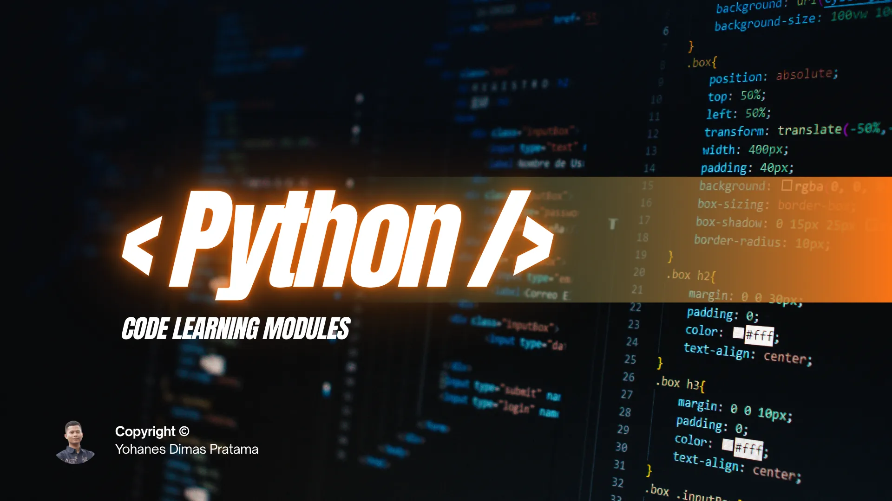

# Python Learning Modules




## Project Overview

Python Learning Modules is a structured programming education repository designed to teach Python progressively from foundational syntax to ecosystem development and practical project engineering. It centers on Python as the primary language and organizes 300 numbered, standalone executable scripts (`01` through `300`) across 18 sequential module directories (`module-01` through `module-18`). Each module pairs an Indonesian-language Markdown study guide (`README.md`) explaining concept goals, execution commands, and expected results with self-contained `.py` source files and 300 captured terminal execution log images inside per-module `output/` folders.

## Learning Objectives

The curriculum aims to build end-to-end fluency in writing, structuring, testing, and applying Python code across core computer science topics and local application prototypes. Because the repository provides example implementations and execution log captures rather than graded exams, learners use the modules to practice concepts directly and verify behavior locally.

- Write and execute well-structured Python scripts using standard input/output, variables, operators, conditionals, and loops.
- Model data and program logic using built-in collections (`list`, `tuple`, `set`, `dict`), string processing, comprehensions, iterators, generators, and advanced functions.
- Design modular software with object-oriented programming, custom exceptions, context managers, file I/O, packages, and the Python Standard Library.
- Implement foundational searching, sorting, linear and non-linear data structures, recursion/backtracking, dynamic programming, greedy strategies, and Big O analysis.
- Apply modern Python capabilities including type hints, structural pattern matching, caching, memory introspection, and descriptor/metaclass concepts.
- Build local prototypes with external ecosystem libraries (`NumPy`, `pandas`, `Matplotlib`, `Requests`, `BeautifulSoup`, `OpenPyXL`, `Flask`, `FastAPI`, `SQLAlchemy`) and verify behavior with `unittest`, `pytest`, mocking, and profiling tools.

## Learning Level & Approach

The curriculum follows a progressive, module-based sequence that transitions into project-based consolidation in the final module. Earlier modules rely solely on Python 3.10+ and the Standard Library so learners can focus on language mechanics before introducing third-party ecosystem packages and testing workflows in Modules 16–18.

| Attribute | Description |
| :--- | :--- |
| Learning Level | Beginner to Advanced (sequential progression across 18 modules) |
| Learning Approach | Module-Based (`Modules 01–17`) and Project-Based (`Module 18`) |
| Learning Format | Module Markdown Guides (`README.md`), Executable Scripts (`.py`), and Execution Log Captures (`output/*.png`) |
| Programming Focus | Python (Core Language, OOP, Algorithms, Modern Features, Data/API Ecosystem, Testing) |
| Instructional Language | Indonesian module guides with English/Indonesian code identifiers and technical terms |

## Learning Path & Curriculum

Learners follow the 18 numbered modules in ascending order (`01` to `300`), progressing from basic script execution to multi-concept practical mini-projects:

1. Foundations and Control Flow (`Modules 01–05`, Scripts `01–63`): Script execution, types, operators, branching, and iteration.
2. Functions, Collections, and Functional Constructs (`Modules 06–10`, Scripts `64–143`): Modular functions, built-in collections, string manipulation, comprehensions, generators, decorators, and recursion.
3. Object-Oriented Design, Files, and Standard Library (`Modules 11–13`, Scripts `144–207`): Classes, inheritance, dunder methods, exceptions, file formats, custom packages, and built-in library modules.
4. Algorithms, Modern Python, Ecosystem, and Capstone Projects (`Modules 14–18`, Scripts `208–300`): Data structures and algorithms, typing and introspection, data/API/web libraries, testing/tooling, and 20 standalone mini-projects.

| Order | Module | Main Topics | Materials |
| :---: | :--- | :--- | :--- |
| 01 | [Module 01 — Introduction & Program Structure](module-01-pengenalan-python-dan-struktur-program/README.md) | Script execution, comments, `print()`, indentation, syntax errors, interpreter | Guide, 10 Scripts, 10 Logs |
| 02 | [Module 02 — Variables & Data Types](module-02-variabel-dan-tipe-data/README.md) | Numeric types, strings, booleans, `None`, casting, mutability | Guide, 14 Scripts, 14 Logs |
| 03 | [Module 03 — Input, Output & Operators](module-03-input-output-dan-operator/README.md) | `input()`, arithmetic, comparison, logical, bitwise, precedence, f-strings | Guide, 14 Scripts, 14 Logs |
| 04 | [Module 04 — Branching & Decision Making](module-04-percabangan-dan-pengambilan-keputusan/README.md) | `if`/`elif`/`else`, nested conditions, ternary expressions, `match-case` | Guide, 10 Scripts, 10 Logs |
| 05 | [Module 05 — Loops](module-05-perulangan/README.md) | `for`, `while`, `range()`, nested loops, `break`/`continue`, `loop-else`, patterns | Guide, 15 Scripts, 15 Logs |
| 06 | [Module 06 — Functions](module-06-fungsi/README.md) | Parameters, return values, `*args`/`**kwargs`, scope, recursion, docstrings | Guide, 15 Scripts, 15 Logs |
| 07 | [Module 07 — Built-in Data Structures](module-07-struktur-data-bawaan-python/README.md) | Lists, tuples, sets, dictionaries, nesting, copying, collection conversion | Guide, 20 Scripts, 20 Logs |
| 08 | [Module 08 — String Manipulation](module-08-manipulasi-string/README.md) | Indexing, slicing, string methods, splitting/joining, Unicode, palindromes | Guide, 14 Scripts, 14 Logs |
| 09 | [Module 09 — Comprehensions, Iterators & Generators](module-09-comprehension-iterator-dan-generator/README.md) | List/dict/set comprehensions, `iter`/`next`, `yield`, `yield from`, pipelines | Guide, 16 Scripts, 16 Logs |
| 10 | [Module 10 — Advanced Functions](module-10-fungsi-lanjutan/README.md) | Lambdas, `map`/`filter`/`reduce`, closures, decorators, `partial`, callables | Guide, 15 Scripts, 15 Logs |
| 11 | [Module 11 — Object-Oriented Programming](module-11-object-oriented-programming/README.md) | Classes, encapsulation, inheritance, polymorphism, ABCs, dataclasses, metaclasses | Guide, 24 Scripts, 24 Logs |
| 12 | [Module 12 — Exceptions, File Handling & Modules](module-12-exception-file-handling-dan-modul/README.md) | `try`/`except`/`finally`, custom exceptions, `pathlib`, JSON/CSV/Pickle, packages | Guide, 20 Scripts + Helper/Pkg, 20 Logs |
| 13 | [Module 13 — Python Standard Library](module-13-standard-library-python/README.md) | `math`, `datetime`, `os`, `collections`, `itertools`, `re`, `logging`, `sqlite3` | Guide, 20 Scripts, 20 Logs |
| 14 | [Module 14 — Algorithms & Data Structures](module-14-algoritma-dan-struktur-data/README.md) | Searching, sorting, stacks, queues, linked lists, trees, heaps, graphs, DP | Guide, 23 Scripts, 23 Logs |
| 15 | [Module 15 — Modern Python & Advanced Features](module-15-python-modern-dan-fitur-lanjutan/README.md) | Typing (`Protocol`, `Generic`), `match-case`, context managers, `weakref`, `lru_cache` | Guide, 17 Scripts, 17 Logs |
| 16 | [Module 16 — Data, APIs, Automation & Ecosystem](module-16-data-api-otomatisasi-dan-ekosistem-python/README.md) | NumPy, pandas, Matplotlib, Requests, BeautifulSoup, OpenPyXL, Flask, FastAPI, SQLAlchemy | Guide, 17 Scripts, 17 Logs |
| 17 | [Module 17 — Testing, Debugging & Project Management](module-17-testing-debugging-dan-pengelolaan-proyek/README.md) | Debugging, `assert`, `unittest`, `pytest`, mocking, profiling, packaging, linting | Guide, 16 Scripts, 16 Logs |
| 18 | [Module 18 — Practical Python Projects](module-18-proyek-praktik-python/README.md) | 20 standalone CLI, database, file automation, API, scraper, and dashboard projects | Guide, 20 Scripts, 20 Logs |

## Learning Modules & Contents

Each module directory contains a dedicated `README.md` with per-submodule explanations, exact terminal commands, expected results, source files, and links to execution log captures in `output/`. Use the module index below to navigate directly to each guide and representative source/log files.

### Module 01 — Introduction & Program Structure (`01–10`)

- **Module Guide:** [Open Module 01 README](module-01-pengenalan-python-dan-struktur-program/README.md)
- **Covered Submodules:** [01 Hello World](module-01-pengenalan-python-dan-struktur-program/01_hello_world.py) through [10 Run Python Script](module-01-pengenalan-python-dan-struktur-program/10_run_python_script.py) (10 scripts covering program structure, comments, `print()`, escape sequences, indentation, syntax checking, and interpreter info)
- **Sample Execution Output:** [View Log Capture 01](module-01-pengenalan-python-dan-struktur-program/output/01_hello_world.png)

### Module 02 — Variables & Data Types (`11–24`)

- **Module Guide:** [Open Module 02 README](module-02-variabel-dan-tipe-data/README.md)
- **Covered Submodules:** [11 Variables](module-02-variabel-dan-tipe-data/11_variables.py) through [24 Mutable & Immutable Objects](module-02-variabel-dan-tipe-data/24_mutable_immutable.py) (14 scripts covering integers, floats, complex numbers, strings, booleans, `None`, `type()`, conversion, casting, and mutability)
- **Sample Execution Output:** [View Log Capture 11](module-02-variabel-dan-tipe-data/output/11_variables.png)

### Module 03 — Input, Output & Operators (`25–38`)

- **Module Guide:** [Open Module 03 README](module-03-input-output-dan-operator/README.md)
- **Covered Submodules:** [25 Input Function](module-03-input-output-dan-operator/25_input_function.py) through [38 Multiple Input Values](module-03-input-output-dan-operator/38_multiple_input_values.py) (14 scripts covering terminal input, validation, arithmetic, assignment, comparison, logical, identity, membership, bitwise operators, and f-string formatting)
- **Sample Execution Output:** [View Log Capture 25](module-03-input-output-dan-operator/output/25_input_function.png)

### Module 04 — Branching & Decision Making (`39–48`)

- **Module Guide:** [Open Module 04 README](module-04-percabangan-dan-pengambilan-keputusan/README.md)
- **Covered Submodules:** [39 If Statement](module-04-percabangan-dan-pengambilan-keputusan/39_if_statement.py) through [48 Leap Year](module-04-percabangan-dan-pengambilan-keputusan/48_leap_year.py) (10 scripts covering `if`, `if-else`, `elif`, nested conditions, compound conditions, ternary expressions, `match-case`, grade calculator, and parity checks)
- **Sample Execution Output:** [View Log Capture 39](module-04-percabangan-dan-pengambilan-keputusan/output/39_if_statement.png)

### Module 05 — Loops (`49–63`)

- **Module Guide:** [Open Module 05 README](module-05-perulangan/README.md)
- **Covered Submodules:** [49 For Loop](module-05-perulangan/49_for_loop.py) through [63 Guessing Game](module-05-perulangan/63_guessing_game.py) (15 scripts covering `for`, `while`, `range()`, nested loops, `break`, `continue`, `else`, accumulators, multiplication tables, number/star patterns, and primes)
- **Sample Execution Output:** [View Log Capture 49](module-05-perulangan/output/49_for_loop.png)

### Module 06 — Functions (`64–78`)

- **Module Guide:** [Open Module 06 README](module-06-fungsi/README.md)
- **Covered Submodules:** [64 Basic Functions](module-06-fungsi/64_function_basic.py) through [78 Function Type Hints](module-06-fungsi/78_function_type_hints.py) (15 scripts covering parameters, `return`, default/keyword/positional/`*args`/`**kwargs` arguments, `global`/`nonlocal` scope, recursion, and docstrings)
- **Sample Execution Output:** [View Log Capture 64](module-06-fungsi/output/64_function_basic.png)

### Module 07 — Built-in Data Structures (`79–98`)

- **Module Guide:** [Open Module 07 README](module-07-struktur-data-bawaan-python/README.md)
- **Covered Submodules:** [79 List Basics](module-07-struktur-data-bawaan-python/79_list_basic.py) through [98 Collection Conversion](module-07-struktur-data-bawaan-python/98_collection_conversion.py) (20 scripts covering lists, tuples, unpacking, sets, set algebra, dictionaries, nesting, copying, and type conversion)
- **Sample Execution Output:** [View Log Capture 79](module-07-struktur-data-bawaan-python/output/79_list_basic.png)

### Module 08 — String Manipulation (`99–112`)

- **Module Guide:** [Open Module 08 README](module-08-manipulasi-string/README.md)
- **Covered Submodules:** [99 String Indexing](module-08-manipulasi-string/99_string_indexing.py) through [112 Palindrome Checker](module-08-manipulasi-string/112_palindrome_checker.py) (14 scripts covering slicing, string methods, searching, replacing, splitting/joining, validation, text cleaning, formatting, and Unicode)
- **Sample Execution Output:** [View Log Capture 99](module-08-manipulasi-string/output/99_string_indexing.png)

### Module 09 — Comprehensions, Iterators & Generators (`113–128`)

- **Module Guide:** [Open Module 09 README](module-09-comprehension-iterator-dan-generator/README.md)
- **Covered Submodules:** [113 List Comprehension](module-09-comprehension-iterator-dan-generator/113_list_comprehension.py) through [128 Enumerate & Zip](module-09-comprehension-iterator-dan-generator/128_enumerate_zip.py) (16 scripts covering conditional/nested/dict/set comprehensions, generator expressions, custom iterators, `yield`, `yield from`, pipelines, and lazy evaluation)
- **Sample Execution Output:** [View Log Capture 113](module-09-comprehension-iterator-dan-generator/output/113_list_comprehension.png)

### Module 10 — Advanced Functions (`129–143`)

- **Module Guide:** [Open Module 10 README](module-10-fungsi-lanjutan/README.md)
- **Covered Submodules:** [129 Lambda Function](module-10-fungsi-lanjutan/129_lambda_function.py) through [143 Advanced Recursion](module-10-fungsi-lanjutan/143_recursion_advanced.py) (15 scripts covering higher-order functions, `map`/`filter`/`reduce`, `sorted` keys, closures, decorators with arguments, `functools.partial`, and callable objects)
- **Sample Execution Output:** [View Log Capture 129](module-10-fungsi-lanjutan/output/129_lambda_function.png)

### Module 11 — Object-Oriented Programming (`144–167`)

- **Module Guide:** [Open Module 11 README](module-11-object-oriented-programming/README.md)
- **Covered Submodules:** [144 Class Basics](module-11-object-oriented-programming/144_class_basic.py) through [167 Method Resolution Order](module-11-object-oriented-programming/167_mro_method_resolution.py) (24 scripts covering attributes, `@classmethod`/`@staticmethod`, encapsulation, properties, inheritance, composition, dunder methods, dataclasses, enums, `__slots__`, descriptors, and metaclasses)
- **Sample Execution Output:** [View Log Capture 144](module-11-object-oriented-programming/output/144_class_basic.png)

### Module 12 — Exceptions, File Handling & Modules (`168–187`)

- **Module Guide:** [Open Module 12 README](module-12-exception-file-handling-dan-modul/README.md)
- **Covered Submodules:** [168 Try-Except](module-12-exception-file-handling-dan-modul/168_try_except.py) through [187 Relative Imports](module-12-exception-file-handling-dan-modul/187_relative_imports.py), supported by helper module [pembantu_belajar.py](module-12-exception-file-handling-dan-modul/pembantu_belajar.py) and package directory [paket_belajar](module-12-exception-file-handling-dan-modul/paket_belajar/) (20 numbered scripts covering exceptions, file I/O, `pathlib`, JSON, CSV, Pickle, module creation, and `__main__` guards)
- **Sample Execution Output:** [View Log Capture 168](module-12-exception-file-handling-dan-modul/output/168_try_except.png)

### Module 13 — Python Standard Library (`188–207`)

- **Module Guide:** [Open Module 13 README](module-13-standard-library-python/README.md)
- **Covered Submodules:** [188 Math Module](module-13-standard-library-python/188_math_module.py) through [207 Copy Module](module-13-standard-library-python/207_copy_module.py) (20 scripts covering `math`, `statistics`, `random`, `secrets`, `datetime`, `time`, `calendar`, `os`, `sys`, `collections`, `itertools`, `functools`, `re`, `logging`, `argparse`, `subprocess`, `shutil`, `hashlib`, and `sqlite3`)
- **Sample Execution Output:** [View Log Capture 188](module-13-standard-library-python/output/188_math_module.png)

### Module 14 — Algorithms & Data Structures (`208–230`)

- **Module Guide:** [Open Module 14 README](module-14-algoritma-dan-struktur-data/README.md)
- **Covered Submodules:** [208 Linear Search](module-14-algoritma-dan-struktur-data/208_linear_search.py) through [230 Big O Analysis](module-14-algoritma-dan-struktur-data/230_big_o_analysis.py) (23 scripts covering linear/binary search, bubble/selection/insertion/merge/quick sort, stacks, queues, singly/doubly linked lists, binary trees, BSTs, heaps, hash tables, graphs, BFS/DFS, backtracking, dynamic programming, and greedy algorithms)
- **Sample Execution Output:** [View Log Capture 208](module-14-algoritma-dan-struktur-data/output/208_linear_search.png)

### Module 15 — Modern Python & Advanced Features (`231–247`)

- **Module Guide:** [Open Module 15 README](module-15-python-modern-dan-fitur-lanjutan/README.md)
- **Covered Submodules:** [231 Type Hints Basic](module-15-python-modern-dan-fitur-lanjutan/231_type_hints_basic.py) through [247 Reflection & Introspection](module-15-python-modern-dan-fitur-lanjutan/247_reflection_introspection.py) (17 scripts covering unions, generics, `Protocol`, `typing.cast`, structural pattern matching, custom context managers, `contextlib`, `weakref`, garbage collection, copy semantics, memory profiling, walrus operator, `lru_cache`, and ABCs)
- **Sample Execution Output:** [View Log Capture 231](module-15-python-modern-dan-fitur-lanjutan/output/231_type_hints_basic.png)

### Module 16 — Data, APIs, Automation & Ecosystem (`248–264`)

- **Module Guide:** [Open Module 16 README](module-16-data-api-otomatisasi-dan-ekosistem-python/README.md)
- **Covered Submodules:** [248 NumPy Arrays](module-16-data-api-otomatisasi-dan-ekosistem-python/248_numpy_arrays.py) through [264 Web API Validation](module-16-data-api-otomatisasi-dan-ekosistem-python/264_web_api_validation.py) (17 local-demo scripts covering NumPy, pandas, Matplotlib, HTTP requests with local/mocked endpoints, JSON processing, BeautifulSoup HTML parsing, file/Excel automation, Flask, FastAPI `TestClient`, SQLAlchemy, and Pydantic validation)
- **Sample Execution Output:** [View Log Capture 248](module-16-data-api-otomatisasi-dan-ekosistem-python/output/248_numpy_arrays.png)

### Module 17 — Testing, Debugging & Project Management (`265–280`)

- **Module Guide:** [Open Module 17 README](module-17-testing-debugging-dan-pengelolaan-proyek/README.md)
- **Covered Submodules:** [265 Debugging Basic](module-17-testing-debugging-dan-pengelolaan-proyek/265_debugging_basic.py) through [280 Environment Variables](module-17-testing-debugging-dan-pengelolaan-proyek/280_environment_variables.py) (16 scripts covering debug logging, `assert`, `unittest`, `pytest`, mocking, edge cases, `cProfile`, virtual environments, `pip`, `requirements.txt`, project layout, wheel/zip packaging, AST linting, formatting, static type inspection, and environment variables)
- **Sample Execution Output:** [View Log Capture 265](module-17-testing-debugging-dan-pengelolaan-proyek/output/265_debugging_basic.png)

### Module 18 — Practical Python Projects (`281–300`)

- **Module Guide:** [Open Module 18 README](module-18-proyek-praktik-python/README.md)
- **Covered Projects:** [281 Calculator Project](module-18-proyek-praktik-python/281_calculator_project.py) through [300 Task Management Project](module-18-proyek-praktik-python/300_task_management_project.py) (20 standalone local prototypes consolidating core Python, SQLite, file automation, CSV/Excel reporting, mocked HTTP APIs, scraping, FastAPI, and pandas/Matplotlib summaries)
- **Sample Execution Output:** [View Log Capture 281](module-18-proyek-praktik-python/output/281_calculator_project.png)

## Projects & Coding Challenges

Module 18 (`module-18-proyek-praktik-python`) serves as the practical consolidation track, providing 20 self-contained example implementations that run locally using in-memory data, temporary directories, or local test clients rather than live external services.

| # | Project Name | Learning Focus | Source File |
| :---: | :--- | :--- | :--- |
| 281 | Console Calculator | Operator mapping, CLI arguments, division-by-zero validation | [281_calculator_project.py](module-18-proyek-praktik-python/281_calculator_project.py) |
| 282 | Number Guessing Game | `random.randint`, single-turn comparison and CLI input | [282_number_guessing_project.py](module-18-proyek-praktik-python/282_number_guessing_project.py) |
| 283 | Quiz Application | Input normalization, answer-key validation, scoring | [283_quiz_application.py](module-18-proyek-praktik-python/283_quiz_application.py) |
| 284 | Student Grade System | Score range validation (`0–100`), average and pass status | [284_student_grade_project.py](module-18-proyek-praktik-python/284_student_grade_project.py) |
| 285 | Student Database | In-memory SQLite (`:memory:`), parameterized SQL queries | [285_student_database_project.py](module-18-proyek-praktik-python/285_student_database_project.py) |
| 286 | Inventory Management | Dictionary state updates, stock bounds checking | [286_inventory_management_project.py](module-18-proyek-praktik-python/286_inventory_management_project.py) |
| 287 | Cashier System | Integer price arithmetic, cart total calculation, item validation | [287_cashier_system_project.py](module-18-proyek-praktik-python/287_cashier_system_project.py) |
| 288 | Expense Tracker | Class-based transaction log, positive amount validation | [288_expense_tracker_project.py](module-18-proyek-praktik-python/288_expense_tracker_project.py) |
| 289 | Library Management | Set-based borrow/return state transitions and error handling | [289_library_management_project.py](module-18-proyek-praktik-python/289_library_management_project.py) |
| 290 | Employee Management | Unique ID dictionary records, duplicate and negative-salary guards | [290_employee_management_project.py](module-18-proyek-praktik-python/290_employee_management_project.py) |
| 291 | Contact Book | Name-keyed dictionary lookup and empty-string validation | [291_contact_book_project.py](module-18-proyek-praktik-python/291_contact_book_project.py) |
| 292 | Password Generator | Cryptographic random selection via `secrets.choice` | [292_password_generator_project.py](module-18-proyek-praktik-python/292_password_generator_project.py) |
| 293 | File Organizer | Temporary directory file grouping by extension via `pathlib` | [293_file_organizer_project.py](module-18-proyek-praktik-python/293_file_organizer_project.py) |
| 294 | CSV Data Analyzer | `csv.DictReader` with `StringIO`, numeric parsing and averaging | [294_csv_data_analyzer_project.py](module-18-proyek-praktik-python/294_csv_data_analyzer_project.py) |
| 295 | Excel Report Generator | Workbook creation and `AVERAGE` formula insertion via `openpyxl` | [295_excel_report_project.py](module-18-proyek-praktik-python/295_excel_report_project.py) |
| 296 | Mocked Weather API Client | HTTP status/JSON handling with `requests` and `unittest.mock` | [296_weather_api_project.py](module-18-proyek-praktik-python/296_weather_api_project.py) |
| 297 | Local HTML Web Scraper | CSS selector extraction (`article h2`) via `BeautifulSoup` | [297_web_scraper_project.py](module-18-proyek-praktik-python/297_web_scraper_project.py) |
| 298 | In-Memory REST API | `FastAPI` POST/GET routes, Pydantic models, and `TestClient` | [298_rest_api_project.py](module-18-proyek-praktik-python/298_rest_api_project.py) |
| 299 | Data Analysis Dashboard | `pandas` `groupby` aggregation and in-memory `Matplotlib` plot | [299_data_dashboard_project.py](module-18-proyek-praktik-python/299_data_dashboard_project.py) |
| 300 | Task Management App | List-of-dicts task creation, completion toggling, and validation | [300_task_management_project.py](module-18-proyek-praktik-python/300_task_management_project.py) |

## Programming Languages & Tech Stack

The repository distinguishes between the core language and standard library taught across Modules 01–15 and the external Python packages used in Modules 16–18.

| Category | Technology | Purpose |
| :--- | :--- | :--- |
| Language & Runtime | Python (3.10+) | Primary programming language taught and executed across all 18 modules |
| Standard Library | Python Standard Library | Core I/O, collections, math, `datetime`, `re`, `pathlib`, `sqlite3`, `unittest`, `cProfile` |
| Numerical & Data Analysis | NumPy, pandas | Array operations, DataFrames, data cleaning, and `groupby` aggregation (Modules 16 & 18) |
| Visualization | Matplotlib | Static chart generation in memory (Modules 16 & 18) |
| HTTP & Scraping | Requests, BeautifulSoup (`beautifulsoup4`) | Local/mocked HTTP request handling and HTML parsing (Modules 16 & 18) |
| Office Automation | OpenPyXL (`openpyxl`) | Programmatic `.xlsx` workbook generation and formula authoring (Modules 16 & 18) |
| Web & API Frameworks | Flask, FastAPI, Pydantic | Minimal web endpoints, schema validation, and `TestClient` checks (Modules 16 & 18) |
| Database ORM | SQLAlchemy | Declarative model mapping and SQLite session queries (Module 16) |
| Testing | pytest | Automated test execution for `test_` functions (Module 17) |
| Environment Manifest | `requirements.txt` | Lists ecosystem dependencies above plus supporting tools (`uvicorn`, `httpx2`, `Pillow`, `PySide6`) |

## Prerequisites & Setup

Modules 01 through 15 require only Python 3.10 or newer (needed for `match-case` syntax introduced in Module 04 and typing features in Module 15) and zero external packages. Modules 16, 17 (`pytest` examples), and 18 (ecosystem mini-projects) require installing the dependencies declared in [requirements.txt](requirements.txt) inside a virtual environment.

- **Required (All Modules):** Python 3.10+ interpreter and terminal/CLI access (`python` or `py`).
- **Required (Modules 16–18 Ecosystem Examples):** Python virtual environment (`venv`) with packages from [requirements.txt](requirements.txt).
- **Optional:** A code editor or IDE such as VS Code for reading module guides alongside `.py` scripts and `output/*.png` captures.

```bash
# 1. Clone the repository and enter the project directory
git clone https://github.com/weztcy/Python-Learning-Modules.git
cd "Python-Learning-Modules"

# 2. Create and activate a virtual environment (required for Modules 16-18)
python -m venv .venv
# Windows PowerShell:
.venv\Scripts\Activate.ps1
# macOS / Linux:
# source .venv/bin/activate

# 3. Install ecosystem dependencies
pip install -r requirements.txt
```

## Code Execution & Usage

Each module README instructs learners to run scripts from inside that module's directory so relative helper imports (such as `pembantu_belajar.py` in Module 12) resolve directly. Modules 01–15 run with the system Python interpreter, while Modules 16–18 should be executed using the activated virtual environment interpreter.

1. Open the target module directory and review its `README.md` for concept notes, interactive input prompts (where applicable), and expected terminal output.
2. Run a standalone script from inside its module folder:

```bash
# Example: Modules 01-15 (Standard Library only)
cd module-01-pengenalan-python-dan-struktur-program
python 01_hello_world.py

# Example: Modules 16-18 (with virtual environment activated)
cd ../module-18-proyek-praktik-python
python 281_calculator_project.py 8 / 2
```

3. Run the `pytest` demonstration script in Module 17:

```bash
cd module-17-testing-debugging-dan-pengelolaan-proyek
python 268_pytest_basic.py
```

4. Compare your terminal results with the captured execution log images stored in each module's `output/` subdirectory (for example, `module-01-pengenalan-python-dan-struktur-program/output/01_hello_world.png`).

## Contributing

Contributions to improve explanations, expand example coverage, or refine execution guides are welcome through the following workflow:

1. Fork the repository.
2. Create a branch for the change.
3. Add or improve learning materials, source code, exercises, or documentation.
4. Verify code examples and links where practical.
5. Commit and push the branch.
6. Open a pull request with a clear explanation.

## License

This project is licensed under the MIT License.
See the [LICENSE](LICENSE) file for details.

## Author & Contact

**Yohanes Dimas Pratama**

- GitHub: [github.com/weztcy](https://github.com/weztcy)
- Portfolio: [yohanesdimas.com](https://yohanesdimas.com)
- LinkedIn: [linkedin.com/in/yohanes-dimas](https://www.linkedin.com/in/yohanes-dimas)
